# All4One Agent Framework — 开发执行依赖图

> 本文档基于 `architecture_design.md` 的目标架构与 `spectragent/` 的现存实现，拆分出 33 个开发模块（M01–M33）及其依赖关系。每个模块是一个可独立交付的工作包，包含业务实现、业务逻辑和设计思考。

---

## 1. 全局依赖 DAG

```mermaid
flowchart TB
    %% ════════════════════════════════════════
    %% P0 — 基础设施
    %% ════════════════════════════════════════
    subgraph P0_FOUNDATION ["P0 · 基础设施 ✅ 已完成"]
        M01["M01 ✅<br/>conscribe __wiring__<br/>三元素扩展<br/><i>v0.6.1 已实现</i>"]
    end

    %% ════════════════════════════════════════
    %% P0 — 核心抽象（可并行）
    %% ════════════════════════════════════════
    subgraph P0_ABSTRACTIONS ["P0 · 核心抽象层（四模块可并行）"]
        M02["M02<br/>Observation<br/>Fragment 体系"]
        M03["M03<br/>AgentLoop<br/>注册表 + Protocol"]
        M04["M04<br/>Hook + Event<br/>Emitter 体系"]
        M05["M05<br/>Action 体系<br/>演进"]
    end

    %% ════════════════════════════════════════
    %% P0 — 框架组装
    %% ════════════════════════════════════════
    subgraph P0_FRAMEWORK ["P0 · 框架组装层"]
        M06["M06<br/>Capability<br/>注册表"]
        M07["M07<br/>Environment<br/>+ 前缀路由"]
        M08["M08<br/>AgentRuntime<br/>通用编排"]
        M09["M09<br/>ReactLoop<br/>实现"]
    end

    %% ════════════════════════════════════════
    %% P1 — 持久化
    %% ════════════════════════════════════════
    subgraph P1_PERSISTENCE ["P1 · 持久化层"]
        M10["M10<br/>RunTrace<br/>WAL 持久化"]
        M11["M11<br/>TraceWriter +<br/>Metrics Hook"]
        M27["M27<br/>Trace<br/>读写加固"]
        M28["M28<br/>环境归档<br/>机制"]
        M29["M29<br/>Browser 归档器<br/>+ 可回放档位"]
    end

    %% ════════════════════════════════════════
    %% P1 — 迁移
    %% ════════════════════════════════════════
    subgraph P1_MIGRATION ["P1 · Browser 迁移层"]
        M12["M12<br/>Agent 基类<br/>改造"]
        M13["M13<br/>Browser<br/>Capability"]
        M14["M14<br/>Browser Agents<br/>三件套适配"]
    end

    %% ════════════════════════════════════════
    %% P1 — 泛化
    %% ════════════════════════════════════════
    subgraph P1_GENERALIZE ["P1 · 泛化层"]
        M15["M15<br/>DataLoader<br/>泛化"]
        M16["M16<br/>Evaluator<br/>体系"]
        M17["M17<br/>Memory<br/>协议协商"]
    end

    %% ════════════════════════════════════════
    %% P1 — 集成验证
    %% ════════════════════════════════════════
    subgraph P1_VALIDATION ["P1 · 集成验证"]
        M18(["M18<br/>Browser<br/>端到端验证"])
    end

    %% ════════════════════════════════════════
    %% P2 — Docker + SWE 生态
    %% ════════════════════════════════════════
    subgraph P2_FLYWHEEL ["P2 · 数据飞轮（browser）"]
        M30["M30<br/>离线回放"]
        M31["M31<br/>状态分叉<br/>（检查点恢复 + BranchLoop）"]
        M32["M32<br/>训练导出<br/>（canonical 样本 + 翻译 + 学生渲染）"]
        M33(["M33<br/>度量闸门<br/>（报告 + 链 + fixture 演练）"])
    end

    subgraph P2_DOCKER ["P2 · Docker + SWE 生态"]
        M19["M19<br/>Docker<br/>Capability"]
        M20["M20<br/>CodeAct<br/>Loop"]
        M21["M21<br/>SWE Agent"]
    end

    %% ════════════════════════════════════════
    %% P3 — 高级场景
    %% ════════════════════════════════════════
    subgraph P3_ADVANCED ["P3 · 高级场景"]
        M22["M22<br/>FunctionCalling<br/>Loop"]
        M23["M23<br/>ToolSandbox<br/>Capability"]
        M24["M24<br/>PlanExecute<br/>Loop"]
        M25["M25<br/>GPU Profiling<br/>Capability"]
        M26["M26<br/>Desktop / Android<br/>Capability"]
    end

    %% ════════════════════════════════════════
    %% 依赖边
    %% ════════════════════════════════════════

    %% M01 → P0 抽象层
    M01 --> M02
    M01 --> M03
    M01 --> M04

    %% P0 抽象层 → P0 框架组装层
    M02 --> M06
    M05 --> M06
    M06 --> M07
    M01 --> M07
    M02 --> M08
    M03 --> M08
    M04 --> M08
    M05 --> M08
    M07 --> M08
    M03 --> M09
    M04 --> M09

    %% P0 → P1 持久化
    M02 --> M10
    M04 --> M11
    M10 --> M11
    M10 --> M27
    M11 --> M27
    M04 --> M28
    M06 --> M28
    M07 --> M28
    M08 --> M28
    M11 --> M28
    M27 --> M28
    M13 --> M29
    M28 --> M29
    M29 --> M30
    %% M18 只做了抽样验证；用户 2026-10-09 裁决：browser 的数据飞轮线在 M29 之后直接开始 M30（见 M18、M30 条目）
    M18 -.->|抽样豁免| M30

    %% → M31 状态分叉：ReactLoop 的一步、任务加载器、评测结果（require_eval）、trace 读侧、离线回放
    M09 --> M31
    M15 --> M31
    M16 --> M31
    M27 --> M31
    M30 --> M31

    %% → M32 训练导出：评测结果（require_eval）、trace 读侧、dom_raw（遮挡证据）、回放日志（文档 miss 过滤）、分叉 run（分叉样本）
    M16 --> M32
    M27 --> M32
    M29 -->|遮挡证据 dom_raw| M32
    M30 -->|文档 miss 过滤| M32
    M31 -->|分叉样本| M32

    %% → M33 度量闸门：恢复校验、原路径回放与分叉覆盖（M31，经它也读到 M29 的归档与 M30 的回放日志）、导出确定性与产出（M32）
    M31 --> M33
    M32 --> M33

    %% P0 → P1 迁移
    M01 --> M12
    M03 --> M12
    M06 --> M13
    M09 --> M14
    M12 --> M14
    M13 --> M14

    %% P0 → P1 泛化
    M05 --> M15
    M01 --> M16
    M10 --> M16
    M01 --> M17
    M03 --> M17

    %% P1 → 集成验证
    M08 --> M18
    M11 --> M18
    M14 --> M18
    M15 --> M18
    M16 --> M18
    M17 --> M18

    %% P0/P1 → P2
    M06 --> M19
    M03 --> M20
    M04 --> M20
    M12 --> M21
    M19 --> M21
    M20 --> M21

    %% P0/P1 → P3
    M03 --> M22
    M04 --> M22
    M05 --> M22
    M06 --> M23
    M15 --> M23
    M03 --> M24
    M04 --> M24
    M06 --> M25
    M19 --> M25
    M06 --> M26

    %% ════════════════════════════════════════
    %% 样式
    %% ════════════════════════════════════════
    classDef p0 fill:#E8313530,stroke:#E83135,stroke-width:2px,color:#1a1a1a
    classDef p1 fill:#3B82F630,stroke:#3B82F6,stroke-width:2px,color:#1a1a1a
    classDef p2 fill:#10B98130,stroke:#10B981,stroke-width:2px,color:#1a1a1a
    classDef p3 fill:#8B5CF630,stroke:#8B5CF6,stroke-width:2px,color:#1a1a1a
    classDef milestone fill:#F59E0B30,stroke:#F59E0B,stroke-width:3px,color:#1a1a1a

    class M01,M02,M03,M04,M05,M06,M07,M08,M09 p0
    class M10,M11,M12,M13,M14,M15,M16,M17,M27,M28,M29 p1
    class M18,M33 milestone
    class M19,M20,M21,M30,M31,M32 p2
    class M22,M23,M24,M25,M26 p3

    style P0_FOUNDATION fill:none,stroke:#E83135,stroke-width:2px,stroke-dasharray:5 5
    style P0_ABSTRACTIONS fill:none,stroke:#E83135,stroke-width:2px,stroke-dasharray:5 5
    style P0_FRAMEWORK fill:none,stroke:#E83135,stroke-width:2px,stroke-dasharray:5 5
    style P1_PERSISTENCE fill:none,stroke:#3B82F6,stroke-width:2px,stroke-dasharray:5 5
    style P1_MIGRATION fill:none,stroke:#3B82F6,stroke-width:2px,stroke-dasharray:5 5
    style P1_GENERALIZE fill:none,stroke:#3B82F6,stroke-width:2px,stroke-dasharray:5 5
    style P1_VALIDATION fill:none,stroke:#F59E0B,stroke-width:2px,stroke-dasharray:5 5
    style P2_FLYWHEEL fill:none,stroke:#10B981,stroke-width:2px,stroke-dasharray:5 5
    style P2_DOCKER fill:none,stroke:#10B981,stroke-width:2px,stroke-dasharray:5 5
    style P3_ADVANCED fill:none,stroke:#8B5CF6,stroke-width:2px,stroke-dasharray:5 5
```



### 关键路径（Critical Path）

```
M01 ✅ → M02 → M06 → M07 → M08 → M18
M01 ✅ → M03 → M09 → M14 → M18
M01 ✅ → M03 → M12 → M14
          M06 → M13 → M14
```

M01 已完成（conscribe v0.6.1），**M02/M03/M04/M05 四模块现在可以立即并行启动**。当前最长路径为 **M02 → M06 → M07 → M08 → M18**。

---

## 2. 模块详细设计

---

### M01: conscribe `__wiring__` 三元素扩展 — ✅ 已完成

**优先级**: P0 | **前置依赖**: 无 | **被依赖方**: M02, M03, M04, M07, M12, M16, M17 | **状态**: ✅ conscribe v0.6.1 已实现

#### 已实现内容

conscribe v0.6.1 已完整实现 `__wiring__` 三元素 tuple 支持，包括：

- **WiringSpec** (`wiring.py:25-40`)：frozen dataclass，含 `allowed_keys`(required) + `optional_keys` 字段
- **ResolvedWiring** (`wiring.py:43-61`)：解析结果，`allowed_keys` 合并 required+optional，`optional_keys` 单独保留元数据
- **三元素 tuple 解析** (`wiring.py:110-136`)：`("observation", ["terminal"], ["filesystem"])` → required=["terminal"], optional=["filesystem"]
- **配置生成** (`extractor.py:351-408`)：required + optional 合并为 `Literal[...]` 类型约束
- **MRO 合并** (`wiring.py:64-89`)：子类可收窄父类声明
- **错误诊断** (`exceptions.py:142-172`)：缺失 key 时提供详细上下文
- **测试覆盖**：单测 `test_wiring.py` + E2E `test_wiring_e2e.py` 全部通过

#### 设计思考

三元素 tuple 的设计灵感来自 Avro schema evolution 的 reader/writer 协商模型 — required 是强约束（缺失即不兼容），optional 是弱约束（允许降级运行）。这使得 Observation Fragment、Capability、Memory 三个维度都能用同一套机制表达「必要 vs 可选」，避免每个注册表自己造轮子。

#### 后续模块可直接使用的能力

当前实现中 optional_keys 在 Pydantic 配置层面与 required 等价（都出现在 `Literal[...]` 中）。required vs optional 的语义区分记录在 `ResolvedWiring.optional_keys` 元数据中，供运行时（如 AgentRuntime 的 Observation 协商引擎 M02）读取和使用。M02/M08 等模块需要利用这个元数据在运行时执行真正的「required 缺失则报错、optional 缺失则降级」逻辑。

---

### M02: Observation Fragment 体系

**优先级**: P0 | **前置依赖**: M01 | **被依赖方**: M06, M08, M10

#### 业务实现

将当前单一的 `Observation` 万能袋模型（`schemas/observation.py` — 含 dom/screenshot/url/tabs 等全部字段）拆解为独立注册的 **Fragment**。每个 Fragment 是语义不可分割的一组字段，走 conscribe 注册表自动发现。同时实现**三方协商引擎**：Capability（provides）/ Agent（requires）/ Loop（requires）三方声明汇合，运行前自动计算出「本次运行需要激活哪些 Fragment」。

#### 业务逻辑

**Fragment 注册表**：创建 `ObservationRegistrar`，每个 Fragment 继承 `ObservationFragment` 基类并声明 `__registry_key__` 和 `__source__`：
- `__source__ = "env"` — 由 Capability 的 Resolver 填充（如 DOMObs、ScreenshotObs、TerminalObs）
- `__source__ = "loop"` — 由 Loop 自行填充，不依赖 Environment（如 ActionResultObs）

首批 Fragment 定义：
| Fragment | registry_key | source | 字段 | 当前对应 |
|----------|-------------|--------|------|---------|
| DOMObs | `dom` | env | element_tree (DOMState), selector_map | `Observation.dom` |
| ScreenshotObs | `screenshot` | env | image_path, viewport_width, viewport_height | `Observation.screenshot` + `viewport` |
| BrowserMetaObs | `browser_meta` | env | url, page_title, tabs | `Observation.url` + `page_title` + `tabs` |
| ActionResultObs | `action_result` | loop | last_action, success, error | 当前散落在 step 逻辑中 |
| TerminalObs | `terminal` | env | stdout, stderr, exit_code, cwd | 新增（为 SWE 场景预留） |
| ToolResultObs | `tool_result` | env | tool_name, result, success | 新增（为 Tool-Use 场景预留） |

**三方协商引擎**：
1. 从 Capability 的 `__wiring__` 收集 provides 集合
2. 从 Agent 和 Loop 的 `__wiring__` 收集 requires（required + optional）
3. 执行 Avro 式协商：
   - Agent/Loop required ∧ Env provides → 激活
   - Agent/Loop optional ∧ Env provides → 激活
   - Env provides ∧ 无人 requires → 不激活（性能优化）
   - Agent/Loop required ∧ Env 不 provides → CONFIG ERROR
4. 输出 `ObservationNegotiationResult`（定义在 `spectragent/core/negotiation/observation.py`），包含 `active_fragments: frozenset[str]`。Fragment 键是全限定的 `source.id`（如 `browser.dom`、`docker.terminal`、`loop.action_result`）——同一 local id 在不同 capability 下注册互不冲突。

**动态 Observation Model 生成**：协商完成后，根据 active_fragments 动态组合出嵌套结构的 Pydantic model。每个 fragment 是子 model，通过 `obs.dom.element_tree`、`obs.terminal.stdout` 方式访问。

#### 设计思考

当前 `Observation` 的万能袋设计在只有浏览器场景时尚可工作，但扩展到 SWE/Tool-Use/Desktop 后会出现两个问题：(1) 每个场景只用到少数字段，大量 None 字段浪费且模糊语义；(2) 无法按需激活 resolver — 纯视觉 Agent (UITars) 不应该触发 DOM 计算。

Fragment 注册表 + 协商将 Observation 从「静态数据结构」变为「动态协商结果」，实现**按需计算**。UITars 只声明 requires screenshot → DOM Watchdog 不激活 → 省去 DOM 计算开销。同时新增 Fragment（如 gpu_metrics）只需定义一个类，无需修改 framework 核心。

Resolver 模式使 Capability 内部通过 IoC 方式激活 fragment 提供者（如 Browser Capability 中 Watchdog 即 Resolver），消除 observe() 中的 if-else 分支。

---

### M03: AgentLoop 注册表 + slot 兼容性校验

**优先级**: P0 | **前置依赖**: M01 | **被依赖方**: M08, M09, M12, M17, M20, M22, M24

#### 业务实现

创建 `AgentLoopRegistrar` — 独立于 Agent 的 Loop 策略注册表。`AgentLoop` 是公共契约；每种 Loop 用 `__required_slots__` 声明它要求 Agent 提供的方法。

#### 业务逻辑

**核心分离逻辑**：
- **Agent = 领域知识** — 知道怎么构建 prompt、怎么解析 LLM 输出、什么 action space 有意义
- **Loop = 执行策略** — 知道怎么编排 observe-think-act 循环、什么时候调 LLM、怎么处理多步骤

当前 `BaseReactAgent` 将两者混在 `run()` 和 `step()` 中。分离后：
- Agent 实现 `build_react_prompt(observation)` / `parse_react_output(llm_output)` 等纯函数
- Loop 实现 `run(agent, env, task, **kwargs)` 驱动循环，调用 Agent 的方法获取领域知识
- Loop 无 hook/emitter 感知 — 横切关注点由 AOP Weaver 透明织入 agent/env/llm 方法调用

**AgentLoop Protocol**：
- `loop_id: str` — 注册表判别字段
- `weave(agent, **deps)` — 装配运行依赖并把 Loop 的执行闭包装到 `agent.run`
- `_execute(agent, task, **kwargs)` — Loop 的执行入口；依赖包括 `llm`、`memory`、`active_descriptors`、`act_fn`(guarded_act)、`negotiated_obs`
- agent/env/llm 实际上是 AOPProxy 包装对象，方法调用时 hook 自动触发

**每种 Loop 的方法要求**：

| Loop | 要求 Agent 实现的 slots |
|------|------------------------|
| ReactLoop | `build_react_prompt()`, `parse_react_output()`；可选：`get_react_output_model()`（Loop 自己用）、`prepare()`（runtime 的种子消息）、`format_react_output()` 与 `parse_react_thought()`（M32：只有训练导出校验与调用——前者是学生一侧、`parse_react_output` 的逆，后者是 teacher 一侧的 thought；缺了时导出抛 `IncompatibleError`，措辞是 "needed for training export"） |
| CodeActLoop（规划） | `build_code_prompt()`, `parse_code_output()` |
| FunctionCallingLoop（规划） | `build_funccall_prompt()`, `get_tool_schemas()` |
| PlanExecuteLoop（规划） | `build_plan_prompt()`, `build_exec_prompt()`, `parse_plan()` |

一个 Agent 可以提供多种 Loop 所需的 slots。`__wiring__` 只限定配置能选择哪些 Loop 注册键及其子配置；`AgentRuntime.prepare()` 调用 Loop 的 slot 校验，缺方法时抛 `IncompatibleError`，点名 Loop 和缺失方法。

**依赖方向**：单向无循环。Loop 调用 Agent 的方法（Loop → Agent），Agent 不持有 Loop 引用。Agent 是被动的「知识提供者」，Loop 是主动的「编排驱动者」。

#### 设计思考

Agent-Loop 分离是整个框架从「browser-only」走向「multi-scenario」的核心杠杆。当前三个 Agent（BrowserUse / Skyvern / UITars）共享同一个 ReAct 循环，但循环逻辑混在 `BaseReactAgent.run()` 中。SWE 场景需要 CodeAct 循环、Tool-Use 需要 FunctionCalling 循环 — 如果不分离，每种新循环都要重复实现超时控制、错误处理、指标收集等样板代码。

`__wiring__` 跨注册表声明让一个 `SWEAgent` 的配置可选择 `react` 或 `codeact`，无需拆成 `SWEReactAgent` 与 `SWECodeActAgent`。conscribe 生成的配置拒绝范围外的 Loop 键；范围内的 Loop 是否真能调用这个 Agent，由 `prepare()` 校验 slots。

---

### M04: Hook + AOP Weaver 体系

**优先级**: P0 | **前置依赖**: M01 | **被依赖方**: M08, M09, M11, M20, M22, M24, M28

#### 业务实现

创建 `HookRegistrar` + `RuntimeHook` Protocol + AOP 引擎（`Weaver` + `AOPProxy` + `Intercept` + `AdviceType`）。通过真正的 AOP 透明织入将横切关注点（tracing、metrics、实时监控）从 Loop 业务逻辑中完全剥离 — Loop 代码中零 hook 感知。

#### 业务逻辑

**两层 hook 接口**：

1. **Lifecycle 回调**（结构边界）— 由 AgentRuntime 在运行开始/结束/异常时直接调用：
   - `on_run_start(agent, env, task, config)` — 运行开始时触发
   - `on_run_end(result)` — 运行正常结束时触发
   - `on_run_error(error, partial_steps)` — 运行异常时触发

2. **方法拦截**（AOP 织入）— 通过 `__intercepts__` 声明 + `{advice}_{method}` handler：
   - Hook 声明 `__intercepts__ = [Intercept("observe", role="env", advice="after"), ...]`
   - Handler 命名约定：`after_observe`、`after_ainvoke`、`around_build_react_prompt`
   - `AdviceType`：`BEFORE`（调用前）、`AFTER`（调用后）、`AROUND`（包装整个调用）

- `blocking: bool` — 标识此 hook 是否必须完成后 agent 才继续（TraceWriter=True 确保落盘，LiveMonitor=False 异步推送）

**AOP Weaver**：AgentRuntime 在驱动 Loop 之前，通过 Weaver 读取所有 hook 的 `__intercepts__` 声明，为 agent/env/llm 以及作为 loop 角色的 StepRecorder 构建 `AOPProxy` 包装对象。Loop 接收到的是 wrapped 依赖 — 调用方法时 hook handler 透明触发。Weaver 只包装有拦截器的方法，无拦截器的角色直接返回原始对象（零开销）。

**拦截点覆盖**：不同 Hook 声明各自需要的方法。TraceWriter 只在 `around_ainvoke` 里记录 LLM 调用（`proceed()` 之前登记，结束时记为 completed / failed / cancelled），并在 `loop.record_step` 后写入完整 step；MetricsCollector 用 `after_ainvoke` 统计成功调用的 token，用 `around_ainvoke` 统计计费了的失败调用（2026-10-10 修订，见 M27 与 `architecture_design.md` §4.6）。对于尚无方法对应的语义事件（如 PlanExecuteLoop 的「规划完成」），将其建模为 Agent/Loop Protocol 方法（如 `agent.parse_plan()`），再由 Hook 声明拦截。

**YAML 驱动的 hook 配置**：hook 走 conscribe 注册表，通过 YAML 配置启用、参数化、设置 blocking 属性。

#### 设计思考

当前 `BaseReactAgent.run()` 中散落了大量横切逻辑：token 统计、cost 计算、step 时间记录、screenshot 收集等。这些逻辑与 ReAct 循环本身无关，但占据了 run() 约 40% 的代码量，且每新增一个 Loop 都要复制这些逻辑。

AOP Weaver 机制比传统的 `emitter.dispatch()` 更彻底 — Loop 不仅不知道谁在监听，甚至不知道 hook 系统的存在。没有 emitter 参数、没有 dispatch 调用、没有事件字符串。新增一个 LiveMonitor（WebSocket 推送实时状态）只需定义一个 Hook 类 + `__intercepts__` 声明 + YAML 配置，不修改任何 Loop 代码。

blocking vs non-blocking 的区分是关键设计 — TraceWriter 必须 blocking（确认落盘后才能执行下一步，否则 crash 丢数据），LiveMonitor 可以 non-blocking（推送失败不应阻塞 agent）。

---

### M05: Action 体系演进

**优先级**: P0 | **前置依赖**: 无 | **被依赖方**: M06, M08, M15, M22

#### 业务实现

扩展现有 `ActionDescriptor` schema 以支持多场景需求：丰富参数描述（JSON Schema）、前缀化（Composite Environment 消歧）、LLM function calling 格式转换。实现 `guarded_act()` 守卫函数，保证 prompt 描述的 action space 与实际可执行能力永远一致。

#### 业务逻辑

**ActionDescriptor 扩展**：当前的 `ActionDescriptor` 有 `params: dict[str, str]`（简单模式），新增：
- `params_schema: dict[str, Any] | None` — JSON Schema 格式的丰富参数描述（用于 ToolSandbox 等场景，每个 tool 的参数结构复杂且动态）
- `name` 由 `descriptor()` 写成 `self.action_id`（全限定 key），不再有运行时前缀化：`with_prefix()` 随之删除
- 不做 function-calling schema 转换：原 `to_tool_schema()` 已删除（对 14 个已发布 action 全部产出非法 JSON Schema，且无 consumer）。provider 侧的类型是 `core/llm/tools.py: ToolDefinition`，合并留给 FuncCall loop，见 `docs/action_descriptor_vs_tool_definition.md`
- 去掉 `env_types` 字段 — action 属于哪个环境不再由 descriptor 自己声明，而是由 Capability 归属自然确定

**guarded_act() 机制**：AgentRuntime 在协商 action space 后生成一个闭包函数，它做两件事：(1) 校验 agent 发出的 action name 在 active set 中；(2) 委托给 `env.act()` 执行。这保证 prompt 里告诉 LLM 有什么 action，实际就能用什么 action — 不会出现 prompt 里写了 `edit_file` 但运行时 env 没有这个 action 的错位。

**action_filter 配置收窄**：YAML 配置支持 `action_filter: [click, type, navigate, done]`，在全量 action space 基础上只保留子集。用于消融实验（测试 agent 在受限 action 集下的表现）。

#### 设计思考

当前 `ActionDescriptor` 的 `env_types` 字段隐含了一个设计缺陷 — action 声明自己属于什么环境，但实际上是 Capability 提供 action、Environment 聚合 action。action 不应该知道自己属于谁，只描述自己是什么。去掉 `env_types` 后，action 的归属由 Capability 注册表关系自然确定。

`guarded_act()` 的设计动机是消除 prompt-capability 不一致性 — 这是 agent benchmark 中常见的 bug 来源。通过单一闭包同时用于 prompt 构建（传给 Agent 的 active_descriptors）和执行验证（guarded_act 校验），从架构上消除不一致的可能。

---

### M06: Capability 注册表

**优先级**: P0 | **前置依赖**: M02, M05 | **被依赖方**: M07, M13, M19, M23, M25, M26, M28

#### 业务实现

创建 `CapabilityRegistrar` + `BaseCapability` Protocol，替代当前的 `BrowserProvider` 概念。Capability = ActionGroup（action 声明 + 执行）+ Resolver（observation fragment 按需提供），是框架中「环境能力」的原子单位。

#### 业务逻辑

**BaseCapability Protocol**：每个 Capability 同时负责自己 scope 内的 action 执行和 observation 提供：
- `capability_id: str` — 注册表判别字段
- `get_action_descriptors(**context) → list[ActionDescriptor]` — 声明此 Capability 提供的 action。对于 ToolSandbox 等场景，action 列表是动态的（每个 task 不同的 tools）
- `execute_action(action, **kwargs) → ActionResult` — 执行一个 action
- `provided_fragments → frozenset[str]` — 声明此 Capability 能提供哪些 observation fragment
- `resolve_fragment(fragment_key, **kwargs) → ObservationFragment` — 按需解析一个 observation fragment
- `setup(config, **kwargs)` / `teardown()` / `is_alive` — 生命周期管理

**Capability 通过 `__wiring__` 声明 provides**：
- `"observation": ("observation", ["dom", "screenshot", "console_log"])` — BrowserCapability 能提供这些 fragment
- `"backend": ["local_chrome", "lexmount", "browseruse", ...]` — 可选 backend 列表

**六种平级 Capability（无继承层级）**：
| capability_id | 首次实现 | 典型 benchmark |
|--------------|---------|---------------|
| browser | M13 (P1) | WebArena, BrowseComp, Mind2Web |
| docker | M19 (P2) | SWE-bench, Terminal-Bench |
| tool_sandbox | M23 (P3) | τ-bench, ToolBench |
| gpu_profiling | M25 (P3) | KernelBench, TritonBench |
| desktop_vm | M26 (P3) | OSWorld |
| android | M26 (P3) | AndroidWorld |

每个 Capability 各自管理自己的 lifecycle（启动/销毁/清理）和 cloud backend（local / cloud provider N）。Framework（AgentRuntime）不感知 capability 内部实现细节。

#### 设计思考

当前架构中 `BrowserProvider` 只管「获取 CDP 连接 URL」，action 执行在 `BrowserSession`，observation 提供在各 Watchdog — 三者分散。Capability 概念将这三者统一为一个内聚的单元：「我提供什么 action + 我提供什么 observation fragment + 我怎么管理自己的 backend」。

核心设计来源是对 8 大 benchmark domain 的分析：没有「base sandbox」—— Browser 的世界是 CDP，Code agent 的世界是 Docker，Mobile 的世界是 ADB。它们之间不共享 base，只是 framework 层编排逻辑相同。因此 Capability 之间是 **flat peers**（平级同伴），不是 hierarchy（层级继承）。

Resolver 模式使 Capability 内部按需提供 fragment。以 Browser 为例，Watchdog 即 Resolver — DOMWatchdog 提供 dom fragment，ScreenshotWatchdog 提供 screenshot fragment。新增 Watchdog = 新增一个类，BrowserCapability 本身不改。

---

### M07: Environment + 前缀路由

**优先级**: P0 | **前置依赖**: M01, M06 | **被依赖方**: M08, M28

#### 业务实现

创建 `EnvironmentRegistrar` + `Environment` Protocol + `EnvironmentBase` 基类。Environment 是 Capability 的组合者和路由器，通过 `__wiring__` 注入 Capabilities，聚合 action space，支持多 Capability 场景的前缀路由。

#### 业务逻辑

**Environment Protocol 演进**：当前 `Environment`（`agents/env_interfaces.py`）是简单的 observe/act 接口。新版本增加：
- `capabilities() → frozenset[str]` — 从注入的 capabilities 聚合
- `observe(negotiated, session_id)` — 接受协商结果，按需委托给 Capability resolver
- `get_action_space(**context)` — 聚合所有 capabilities 的 descriptors

**前缀路由**：
- 单 Capability Environment（如 BrowserEnvironment）— action 名不加前缀，`click` 直接路由到 BrowserCapability
- 多 Capability Environment（如 CompositeEnvironment）— action 名自动前缀化，`browser.click` → 拆前缀 → BrowserCapability.execute_action("click")
- 前缀拆分逻辑集中在 `EnvironmentBase.act()` 中，Capability 永远只看到无前缀的 action name

**预定义 Environment**：
| env_type | __wiring__ capabilities | 场景 |
|----------|------------------------|------|
| browser | ["browser"] | WebArena, BrowseComp |
| docker_terminal | ["docker"] | SWE-bench |
| composite | 配置驱动，任意组合 | GAIA (browser+tool_sandbox) |

**observe() 的委托逻辑**：遍历 NegotiationResult 中的 active fragments，对于 `__source__=="env"` 的 fragment，路由到对应 Capability 的 `resolve_fragment()` 获取数据。loop-sourced fragment（如 action_result）由 Loop 自行填充。

#### 设计思考

当前 `BrowserSession` 直接实现 `Environment` protocol，内部硬编码了所有 browser 操作。这在单一场景下工作，但 GAIA 场景需要 browser + tool_sandbox 两个 capability 同时存在 — 一个 Environment 实例要能路由到两个不同的能力源。

前缀路由的设计灵感来自 REST API 的 path-based routing — `/browser/click` 路由到 browser handler，`/tool_sandbox/call_tool` 路由到 tool_sandbox handler。单 capability 场景不加前缀是为了保持简洁（大多数 benchmark 只有一个 capability），多 capability 时自动前缀化以消歧。

---

### M08: AgentRuntime 通用编排

**优先级**: P0 | **前置依赖**: M02, M03, M04, M05, M07 | **被依赖方**: M18, M28

#### 业务实现

从现有 `BaseReactAgent.run()` 中提取与 loop 范式无关的逻辑（约 90%），封装为独立的 `AgentRuntime` 类。AgentRuntime 是 framework 的中枢 — 负责兼容性验证、observation 协商、action 协商 + guarded_act 生成、AOP 织入、超时控制、错误处理，然后委托 Loop.run() 执行具体编排。

#### 业务逻辑

**prepare() 装配、execute() 驱动的主流程**：
1. **兼容性验证** — 检查 Agent 是否提供 Loop 要求的 callable slots（如 ReactLoop 要求 `build_react_prompt` 和 `parse_react_output`）
2. **Observation 协商** — 调用 `spectragent.core.negotiation.negotiate_observation(agent, loop, env)`，综合 Capability provides / Agent requires / Loop requires，输出 `ObservationNegotiationResult`
3. **Action 协商** — 调用 `negotiate_action(agent, env)` → `ActionNegotiationResult`，生成 active_descriptors + guarded_act 闭包
4. **AOP 织入** — Weaver 读取所有 hook 的 `__intercepts__` 声明，为 agent/env/llm 构建 AOPProxy 包装对象
5. **Lifecycle 通知** — 直接调用 hook.on_run_start()（区别于 AOP：lifecycle 是结构边界事件，不是方法拦截）
6. **Loop 驱动** — `asyncio.wait_for(loop.run(wrapped_agent, wrapped_env, task, llm=wrapped_llm, memory=memory, active_descriptors=..., act_fn=guarded_act, negotiated_obs=...), timeout=timeout)`
7. **结果组装** — 收集 AgentResult（包含 agent_done status、env_status、metrics、action_history）
8. **异常处理** — TimeoutError → 构建 timeout result + dispatch on_run_error；其他异常 → dispatch on_run_error + re-raise

**与当前 BaseReactAgent.run() 的对应关系**：
| 当前 run() 中的逻辑 | 去向 |
|-------------------|------|
| 超时控制 (asyncio.wait_for) | AgentRuntime.execute() |
| 错误处理 (try/except) | AgentRuntime.execute() |
| 指标收集 (token/cost) | MetricsCollector Hook (M11) |
| Step 循环编排 (for step in range) | ReactLoop.run() (M09) |
| 系统 prompt 构建 | Agent.build_react_prompt() |
| LLM 调用 | Loop 内部 |
| Action 解析 | Agent.parse_react_output() |
| Action 执行 | Loop 通过 guarded_act 调用 |
| 结果组装 | AgentRuntime.execute() |

#### 设计思考

AgentRuntime 的设计类比是 Spring 的 `ApplicationContext` — 它不执行业务逻辑，而是负责组件的发现、校验、组装、注入和生命周期管理。Loop 类比是 `@Transactional` 注解修饰的 Service 方法 — 它只关心业务编排，事务管理（超时、重试、日志）由容器透明处理。

关键设计决策：AgentRuntime **不是**单例。每次 execute() 调用是独立的运行上下文。这确保了零全局状态 — 并行运行多个 agent（不同配置、不同 LLM、不同 benchmark）互不干扰。

---

### M09: ReactLoop 实现

**优先级**: P0 | **前置依赖**: M03, M04 | **被依赖方**: M14, M31

#### 业务实现

从现有 `BaseReactAgent.run()` 中提取 ReAct 编排逻辑，实现为独立的 `ReactLoop` 类（`__registry_key__ = "react"`）。ReactLoop 驱动标准的 observe → build_prompt → LLM → parse_output → act 循环。

#### 业务逻辑

**ReactLoop.run() 编排流程**（每步）：
1. 调用 `env.observe(negotiated_obs)` 获取 NegotiatedObservation — AOP `after_observe` 自动触发
2. 调用 `agent.build_react_prompt(observation)` 构建消息列表（Agent 领域知识）
3. 获取 `agent.get_react_output_model()` 结构化输出 model
4. 调用 `llm.ainvoke(messages, output_format=output_model)` 获取 LLM 输出 — AOP `after_ainvoke` 自动触发
5. 调用 `agent.parse_react_output(llm_output)` 解析出 actions（Agent 领域知识）
6. 依次通过 `act_fn(action)`（guarded_act）执行每个 action
7. 记录 step 到 memory（assistant message）
8. 检查 is_done / max_steps 终止条件

> Loop 代码中零 hook/emit 调用 — 横切关注点（tracing、metrics）由 AOP Weaver 在方法调用时透明拦截。

**ReactLoop 接收的注入（通过 kwargs）**：llm、memory、act_fn（guarded_act）、negotiated_obs、active_descriptors、session_id。这些由 AgentRuntime 在 execute() 中注入。

**ReactLoop 自身的 conscribe 配置字段**：max_steps、max_actions_per_step、max_consecutive_parse_errors。

**与当前 BaseReactAgent 的差异**：
- 当前 Agent 的 `step()` 方法内含 LLM 调用 — 分离后 LLM 调用由 Loop 驱动
- 当前 Agent 的 `run()` 内含 observe + act — 分离后 Loop 调用 env.observe/env.act
- 当前 Agent 内含 metrics 收集 — 分离后由 MetricsCollector Hook 通过 AOP 拦截 llm.ainvoke 自动收集

#### 设计思考

ReactLoop 是第一个也是最关键的 Loop 实现 — 三个现有 Browser Agent 都使用 ReAct 范式。设计上 ReactLoop 应该是现有 `BaseReactAgent.run()` 的**提取而非重写** — 保持行为完全一致，只是把 agent-specific 部分（prompt 构建、output 解析）替换为对 Agent Protocol 方法的调用。

---

### M10: RunTrace WAL 持久化

**优先级**: P1 | **前置依赖**: M02 | **被依赖方**: M11, M16, M27

#### 业务实现

实现 RunTrace 的 WAL（Write-Ahead Log）风格持久化系统：每步必须确认落盘后才继续下一步，crash 后可通过 manifest 恢复到最后一个完整 step。同时实现 RunTrace 的 lazy loading 读取器。

#### 业务逻辑

**写入协议**（每步顺序执行）：
1. 写入不可变内容物 — observation fragment JSON / screenshot PNG 文件（`observations/NNN_dom.json`、`observations/NNN_screenshot.png`）
2. 写入 LLM 交互记录（`messages/NNN_input.json`、`messages/NNN_output.json`）
3. 写入 step record（`steps/NNN.json`，引用上述文件路径）
4. 原子更新 manifest（`manifest.json`，记录 `last_step_completed: N`）— commit point

原子更新使用 POSIX `write-then-rename`：先写临时文件 → fsync → rename（POSIX 保证原子性）。

**2026-10-10 修订**：上面的文件名（`observations/NNN_dom.json`、`NNN_screenshot.png`、`messages/NNN_input.json` / `NNN_output.json`）是 M10 当时的形状，已被 M27 的 trace 布局 v2 取代（全限定 fragment key、每次 LLM 调用一个 `messages/NNN_call_KK.json`、manifest `format_version: 2`），以 `architecture_design.md` §5.3 为准。

**Crash recovery**：读 manifest → 知道最后一个完整 step → manifest 之后的孤立文件是未完成 step，安全忽略。

**目录结构**：每次运行一个独立目录（`traces/{run_id}/`），包含 manifest、config 快照、steps/、observations/、messages/、evals/ 子目录。

**Lazy loading 读取器**：`RunTrace` 类不一次性加载全部数据。不同使用者按需加载 — exact_match evaluator 只读 result.json（几 KB），visual_judge 才加载所有 screenshot。通过 property + lazy 实现。

#### 设计思考

不使用 SQLite 的理由：agent 场景数据结构异构（不同 fragment 字段完全不同），schema 随框架演进频繁变化，与关系数据库的同构行/稳定 schema 假设冲突。数据落盘速度不是运行瓶颈（LLM 推理每步数秒，文件写入只需毫秒），SQLite 的查询优势可通过后置索引实现。

WAL 设计借鉴了数据库 WAL 的核心思想：每步确认持久化后才继续。如果 agent 在第 47 步 crash，前 46 步的数据不能丢。这对 benchmark 评测至关重要 — 30 分钟的运行如果因为一个 bug 全部丢失是不可接受的。

---

### M11: TraceWriter + Metrics Hook

**优先级**: P1 | **前置依赖**: M04, M10 | **被依赖方**: M18, M27, M28

#### 业务实现

实现两个核心 RuntimeHook：`TraceWriter`（全量落盘，blocking=True）和 `MetricsCollector`（token 统计，blocking=True 但开销极低）。将当前散落在 `BaseReactAgent.run()` 中的 metrics 逻辑迁移到 Hook 中。

#### 业务逻辑

**TraceWriter**（AOP 拦截 + lifecycle 回调）：
- `__intercepts__` = `[Intercept("ainvoke", role="llm", advice="after"), Intercept("ainvoke", role="llm", advice="around"), Intercept("record_step", role="loop", advice="after")]`
- `on_run_start` — 创建 WALWriter + run 目录 + 写入 config 快照 + 初始化 manifest
- `after_ainvoke(result, ...)` — 暂存一次成功的 LLM 调用；`around_ainvoke` 暂存抛异常的调用并测量等待时间
- `after_record_step(result, ...)` — Loop 交出完整 StepRecord 后写入本步观测、所有 LLM 消息、动作及结果；调用 `WALWriter.commit_step()` 原子更新 manifest，这才是持久化提交点
- `on_run_end` — 写入 result.json、处理尚未形成完整 step 的消息并更新最终状态
- blocking=True — 必须确认落盘后 agent 才能继续下一步

**2026-10-10 修订**：上面 TraceWriter 一节里的 `Intercept("ainvoke", role="llm", advice="after")` 和 `after_ainvoke(result, ...)` 一条是 M11 当时的形状，已被 M27 取代：TraceWriter 的 `__intercepts__` 只剩 `[Intercept("ainvoke", role="llm", advice="around"), Intercept("record_step", role="loop", advice="after")]`，每次 LLM 调用只在 `around_ainvoke` 里记录——`proceed()` 之前登记（prompt、请求的 `output_format`、开始时间），返回记 `completed`，抛 `Exception` 记 `failed`，抛 `BaseException` 记 `cancelled`，一律重抛；等待时间仍在它的 `finally` 里累加。`after` 看不到被取消的调用，把成功的调用放回 `after` 会丢掉被取消调用的 prompt，或者把一次调用记两遍。以 M27 条目和 `architecture_design.md` §4.6、§5.4 为准。下面 MetricsCollector 的 `after` + `around` 不变。

**MetricsCollector**（AOP 拦截 + lifecycle 回调）：
- `__intercepts__` = `[Intercept("ainvoke", role="llm", advice="after"), Intercept("ainvoke", role="llm", advice="around")]`
- `after_ainvoke(result, ...)` — 从 ChatInvokeCompletion.usage 中提取 token usage
- 按 model 分组累加 prompt_tokens / completion_tokens / cached_tokens
- `on_run_end` — 将聚合的 AgentMetrics + AgentUsage 附加到 AgentResult
- blocking=True 但实际操作仅是内存累加，开销可忽略

#### 设计思考

将 metrics 从 agent loop 抽离到 hook 的核心好处：不同 Loop（React / CodeAct / PlanExecute）的 metrics 收集逻辑完全相同（都是从 LLM completion 中提取 token 信息），通过 Hook 一次实现、所有 Loop 共享。同理 TraceWriter 也是跨 Loop 共享的 — 不需要每个 Loop 自己实现落盘逻辑。

---

### M12: Agent 基类改造

**优先级**: P1 | **前置依赖**: M01, M03 | **被依赖方**: M14, M21

#### 业务实现

改造 `AgentBase` 和 `BaseAgent` Protocol，从「内嵌 run/step 的编排者」变为「被动的领域知识提供者」。增加 `__wiring__` 声明可配置的 Loop 范围，并实现各 Loop 所需的方法 slots。

#### 业务逻辑

**BaseAgent Protocol 演进**：
- 移除 `step(observation) → list[Action]` — 不再由 Agent 驱动单步（Loop 驱动）
- 移除 `run(env, task) → AgentResult` — 不再由 Agent 驱动全局循环（AgentRuntime 驱动）
- 保留 `agent_name`、`observation_types`、`system_prompt`、`get_action_space()`
- 新增 `domain: str` — 领域标识（如 "web_navigation", "software_engineering"）

**AgentBase 改造**：
- 新增 `__wiring__` 类变量 — 声明兼容的 loop、需要的 capability、observation 需求
- 基类默认 `"llm": "llm"` — 允许所有 LLM（简单 IoC，大多数 agent 不对 LLM 有限制）
- 基类默认 `"agent_loop": "agent_loop"` — 允许所有 Loop（子类收窄）
- `__wiring__` 支持 MRO 合并 — 子类可以收窄父类的声明

**运行入口**：`AgentRuntime.prepare()` 校验 slots、协商依赖，再由 Loop 把 `agent.run(task)` 安装到实例上；不保留旧的 `agent.run(env, task)` 路径。

#### 设计思考

Agent 基类改造是三个 Browser Agent 适配（M14）的前提。改造的核心原则是「一份代码支持多种 Loop」— BrowserUseAgent 未来可能不仅用 ReactLoop，还可能用 PlanExecuteLoop（先规划再执行）。同一个 Agent 提供各 Loop 所需的 slots 即可，无需为每种 Loop 建一个 Agent 类。

---

### M13: BrowserCapability

**优先级**: P1 | **前置依赖**: M06 | **被依赖方**: M14, M29

#### 业务实现

`BrowserCapability` 直接实现 Capability 契约，持有独立注册的 browser actions、IoC 注入的 backend，以及由 Watchdog 提供的 observation fragments。旧 `BrowserSession` 路径已删除。

#### 业务逻辑

**当前执行链**：`actions: list[ActionBase]` 由 YAML 或 `__wiring__` 默认全集构造；`execute_action()` 按全限定 action key 委托对应实例。`resolve_fragment()` 在一个已声明的 observation cycle 内复用一次 `BrowserStateRequestEvent` 的结果，Watchdog 以 `provides` 声明并产出 fragment。DOMWatchdog 是 `browser.dom` 的唯一 resolver，配置的 cleaner 实例自行选择 CDP 三路或页内 JS 采集，再交由同一预算、serializer 与 selector map 链消费。

**Backend 管理**：`BrowserProviderRegistrar` 的 local Chrome 与六个 lite cloud SDK 由 `__wiring__["backend"]` 注入；backend 只负责 session 生命周期与 CDP URL。

**Scope 编排**：每个已接管 tab 有观测与 JS 执行两个 EventScope；前者的 DOM handler 可跨 scope 等待后者的 JS handler。一个共享 JavaScriptExecutionWatchdog 服务多个 tab，且不发布第二份 `browser.dom`。这利用 agent-cdp 的 N:M scope↔watchdog 连接能力，见 `architecture_design.md` §4.4/§4.12/§11。M29 起，归档或回放档位打开时另有一个 browser 级的 archive EventScope，随 recorder 连接建与关（不是第三个 per-tab scope：弹窗的流量在控制连接接管它之前就到了）；tab 仍然只有这两个 scope，`bind_tab_scopes` 的签名不变，见 §4.14 与 M29。

#### 设计思考

Browser 特有的 CDP、tab/frame 和输入实现留在 capability 内；Runtime 只看 Capability Protocol、协商结果及环境路由。策略可替换，但一次 run 的观测和动作仍由同一协商结果约束。

**2026-04-08 修订**：初版仍有 `_ACTION_EVENT_MAP` / `_ACTION_DESCRIPTORS` / `_translate_params` 硬编码中心节点；现已由 per-action conscribe 注册与对称协商取代。agent 声明相对动作需求，能力声明可提供的全限定动作，`AgentRuntime.prepare()` 在运行前验证并绑定，不保留旧 dispatch 路径。

---

### M14: Browser Agents 三件套适配

**优先级**: P1 | **前置依赖**: M09, M12, M13 | **被依赖方**: M18

#### 业务实现

将 BrowserUseAgent、SkyvernAgent、UITarsAgent 三个现有 agent 适配到新的 Agent-Loop 分离架构：实现 ReactLoop 要求的 slots、添加 `__wiring__` 配置范围声明、将编排逻辑移交 ReactLoop。

#### 业务逻辑

**三个 Agent 各自需要的适配**：

| Agent | 当前特殊逻辑 | 适配方式 |
|-------|------------|---------|
| BrowserUseAgent | flash_mode 跳过 thinking、multi-action (max_actions_per_step=3)、观测模式开关 | flash_mode 保留为 Agent 配置字段；`use_vision` 已被三态 `observation_mode: dom \| dom_vision \| vision` 取代（W3），它既选 prompt 的 surface 片段，也收窄带进协商的 required/optional（`architecture_design.md` §4.4）；multi-action 通过 ReactLoop 的 max_actions_per_step 配置 |
| SkyvernAgent | Jinja2 模板渲染 prompt、action_history_window、TOTP/2FA 支持 | 模板渲染保留在 build_react_prompt 中（Agent 领域知识）；action_history_window 影响 Memory 策略 |
| UITarsAgent | 坐标解析（AST parser）、prompt_template 切换（COMPUTER_USE / MOBILE_USE） | 坐标解析保留在 parse_react_output 中；prompt_template 保留为 Agent 配置字段 |

**统一适配模式**：每个 Agent 提供 ReactLoop 所需的方法；`get_react_output_model()` 是可选 slot：
- `build_react_prompt(observation)` ← 从当前的 `build_messages()` 重构
- `parse_react_output(llm_output)` ← 从当前的 `parse_llm_output()` 重构
- `get_react_output_model()` ← 从当前的 `get_output_model()` 重构

**__wiring__ 声明**：
- BrowserUseAgent: `agent_loop: ["react"]`, `capability: ["browser"]`, `observation: (["dom", "screenshot"], ["browser_meta"])`
- SkyvernAgent: `agent_loop: ["react"]`, `capability: ["browser"]`, `observation: (["dom"], ["screenshot"])`
- UITarsAgent: `agent_loop: ["react"]`, `capability: ["browser"]`, `observation: (["screenshot"], [])`（纯视觉，不需要 DOM）

#### 设计思考

三个 Agent 的适配顺序应为 BrowserUseAgent → SkyvernAgent → UITarsAgent。BrowserUseAgent 最接近标准 ReAct 范式，适合第一个适配以验证 ReactLoop 的正确性。UITarsAgent 最特殊（纯视觉 + 坐标动作），适合最后适配以压力测试抽象层的泛化能力。

每完成一个 Agent 的适配，需要通过对应 benchmark 的回归测试验证行为不变。不应该出现「适配后得分下降」的情况 — 这是纯架构重构，不改业务逻辑。

---

### M15: DataLoader 泛化

**优先级**: P1 | **前置依赖**: M05 | **被依赖方**: M18, M23, M31

#### 业务实现

将当前 browser-specific 的 `BaseBrowserTaskLoader` / `BaseBrowserEvalLoader` 泛化为通用的 `BaseTaskLoader` / `BaseEvalLoader`，`BrowserTask` 泛化为 `TaskDefinition`。新增 `get_task_context()` 方法支持 per-task 动态上下文。

#### 业务逻辑

**去 Browser 前缀**：
- `BaseBrowserTaskLoader` → `BaseTaskLoader`
- `BaseBrowserEvalLoader` → `BaseEvalLoader`
- `BrowserTask` → `TaskDefinition`

**TaskDefinition 泛化**：
- 保留通用字段：task_id, benchmark, task_text, language, expected_answer, difficulty, domain
- `env_type` 从硬编码 "browser" 改为配置驱动（"browser" / "docker_terminal" / "composite"）
- 去掉 browser-specific 字段（如 start_url），改为 `metadata: dict[str, Any]` 承载场景特定信息
- 新增 `setup: TaskSetup`（通用化 BrowserSetup — login 需求、凭证引用等）

**get_task_context() 新增**：返回 task 特定的上下文信息，最关键的用途是 ToolBench/τ-bench 场景中每个 task 定义不同的可用 tools。流程：TaskLoader.get_task_context(task_id) → AgentRuntime 传给 Capability.setup(task_tools=...) → Capability.get_action_descriptors() 动态生成。

**现有 Loader 保留**：lexbench_browser / mind2web / browsecomp loader 保留并实现新的 BaseTaskLoader protocol。

#### 设计思考

DataLoader 的泛化是独立工作流，与核心框架改造的依赖较弱。唯一硬依赖是 ActionDescriptor 的 params_schema 扩展（M05）— ToolSandbox 场景中 task_context 携带的 tool 定义需要用 JSON Schema 描述参数。

---

### M16: Evaluator 体系

**优先级**: P1 | **前置依赖**: M01, M10 | **被依赖方**: M18, M31（`require_eval` 读评测结果）、M32（`require_eval`、样本的判定标签、泄漏扫描用的评测加载器）

#### 业务实现

创建 `EvaluatorRegistrar` + `BaseEvaluator` Protocol。Evaluator 接收完整的 `RunTrace`（而非仅 `AgentResult`）作为输入，支持后置多次评测（不同 judge、不同版本，无需重跑 agent）。

#### 业务逻辑

**BaseEvaluator Protocol**：
- `evaluator_id: str` — 注册表判别字段
- `evaluate(trace: RunTrace, reference: EvalReference, **kwargs) → EvalResult` — 唯一核心方法

**Evaluator 接收 RunTrace 而非 AgentResult 的意义**：不同评测策略需要不同深度的数据 — exact_match 只需最终答案（`trace.result.answer`），llm_judge 需要全程 action history + screenshots，test_suite 需要在 Docker 容器中运行测试。RunTrace 的 lazy loading（M10）保证只加载需要的部分。

**预定义 Evaluator**：
| evaluator_id | 评测方式 | 典型 benchmark |
|-------------|---------|---------------|
| exact_match | 答案精确/模糊匹配 | GAIA, BrowseComp |
| llm_judge | LLM-as-judge 评分 | WebArena, Mind2Web |
| test_suite | 运行测试套件 | SWE-bench |
| tool_trace | 工具调用序列匹配 | ToolBench, BFCL |

**后置多次评测**：评测结果存储在 `traces/{run_id}/evals/` 下，文件名包含 evaluator_id + 版本号。新 judge 无需重跑 agent。

#### 设计思考

Record Once, Evaluate Many 是框架的核心原则 — agent 运行时全量落盘（log 是一等公民），评测与运行完全解耦。这使得评测方法论可以独立演进：今天用 GPT-4o 做 judge，明天换 Claude 做 judge，只需重新 evaluate 已有 trace，无需花 30 分钟重跑 agent。

---

### M17: Memory 协议协商

**优先级**: P1 | **前置依赖**: M01, M03 | **被依赖方**: M18

#### 业务实现

Agent 通过 `__wiring__` 选择并注入 Memory 策略；Loop 与 Memory 各自声明消息协议需求和支持范围，由 `AgentRuntime.prepare()` 检查两者能否配合。配置校验负责 `memory_id` 和所选策略的子配置，不判定这两个实例的行为兼容性。

#### 业务逻辑

**消息协议 key**：
- `user_assistant` — 基础对话协议（user + assistant 消息交替）
- `tool_call` — function calling 扩展（assistant tool_call + tool_result 消息）
- `planning` — 规划协议（planning/execution 分区消息）
- `code_execution` — 代码执行协议（code_generated + execution_result 消息）

**Loop 声明需求**（`__required_message_protocols__`）：
- ReactLoop: `{ "user_assistant" }` — 只需基础对话，已实现
- FunctionCallingLoop（规划）: `{ "user_assistant", "tool_call" }` — 需要 tool 消息支持
- PlanExecuteLoop（规划）: `{ "user_assistant", "planning" }` — 需要规划分区

**Memory 声明支持**（`supports_protocols`）：
- SimpleMemory: 支持 `{ "user_assistant" }`
- SlidingWindowMemory、TokenBudgetMemory: 支持 `{ "user_assistant", "tool_call" }`
- SummaryMemory（规划）: 预计只支持 `{ "user_assistant" }`；具体契约在实现时确定

**协商规则**：`Loop requires ⊆ Memory supports`，否则 `prepare()` 抛 `IncompatibleMemoryError`，说明 Loop、Memory 和缺失协议。

#### 设计思考

Memory 协商避免了用户选择的 Loop 需要 `tool_call`、Memory 却只能保存普通对话时，直到调用 LLM 才出现难以定位的消息错误。两个子配置各自有效仍可能无法协作；`prepare()` 在运行前报出明确的组合错误。

---

### M18: Browser 端到端集成验证

**优先级**: P1 (里程碑) | **前置依赖**: M08, M11, M14, M15, M16, M17

#### 业务实现

端到端验证新架构下三个 Browser Agent 在所有现有 benchmark（lexbench_browser, online_mind2web, browsecomp）上的行为完全一致。这是 P0-P1 阶段的交付物验收点。

#### 业务逻辑

**验证矩阵**：3 Agent × 3 Benchmark，与保存的改造前基线对比；不恢复或保留旧架构运行路径。

**验证标准**：
- 功能正确性：所有 benchmark task 的 pass/fail 结果与旧架构一致
- 性能无退化：token 消耗差异 < 5%（因 prompt 结构微调可能有小幅变化）
- Trace 完整性：RunTrace 文件可被 Evaluator 正确读取和评分
- 配置驱动：通过 YAML 配置切换 Agent / LLM / Memory / Hook，无需改代码

**问题定位**：若端到端结果与改造前不同，比较同一 task 的配置快照、prompt、action 和 RunTrace，定位差异后修正新路径。

#### 设计思考

M18 是 P1 结束的 gate — 只有三个 Browser Agent 全部通过端到端验证，才能开始 P2 的新场景扩展。这是「内核先行，不退化」策略的检验点。

**豁免（用户 2026-10-09 裁决，仅限数据飞轮线）**：M18 目前只在抽样任务上验证过（2026-10-01 用户把 M18 放宽到抽样任务，三个 agent 都到达目标），完整矩阵没有跑完，M18 本身**不算通过**。只涉及 browser 的数据飞轮线（M30 起）在 M29 之后直接开始，抽样的 M18 对这条线算数；其他 P2 模块仍以完整的 M18 为门。

---

### M19: DockerCapability

**优先级**: P2 | **前置依赖**: M06 | **被依赖方**: M21, M25

#### 业务实现

实现 `DockerCapability`（`__registry_key__ = "docker"`），提供 Docker 容器内的 bash 执行、文件读写、快照/恢复等 action，以及 terminal/filesystem observation fragment。

#### 业务逻辑

**Actions**：
- `bash(cmd)` — 在容器内执行 bash 命令
- `read_file(path)` / `write_file(path, content)` — 文件操作
- `edit_file(path, old, new)` — 结构化文件编辑
- `snapshot()` / `restore(snapshot_id)` — 容器状态快照（用于 task 间隔离）
- `submit(answer)` — 提交解决方案

**Observation Fragments**：
- TerminalObs — stdout, stderr, exit_code, cwd
- FilesystemObs — 文件内容、目录列表（可选 fragment）

**Backend 管理**：local Docker / AWS ECS / Modal 等，通过 `__wiring__` 声明可选 backend，YAML 选择。

**与 GPUProfilingCapability 的共享容器关系**：KernelBench 场景中 DockerCapability 和 GPUProfilingCapability 共用同一个容器。DockerCapability 管理容器生命周期，GPUProfilingCapability 通过容器取代码、在裸机 GPU 上执行。两者通过 shared session 协调。

#### 设计思考

DockerCapability 是从 browser-only 走向 multi-scenario 的第一个新 capability。它的设计会成为后续 capability（GPU、Desktop、Android）的参考模板。关键是保持与 BrowserCapability 同层级的抽象粒度 — 不要过细（每个 bash 命令一个 action）也不要过粗（整个 Docker SDK 暴露为一个 action）。

---

### M20: CodeActLoop

**优先级**: P2 | **前置依赖**: M03, M04 | **被依赖方**: M21

#### 业务实现

实现 `CodeActLoop`（`__registry_key__ = "codeact"`），驱动 observe → build_code_prompt → LLM 生成代码 → sandbox 执行 → verify 的循环。

#### 业务逻辑

**CodeActLoop 的编排与 ReactLoop 的差异**：
- ReactLoop：LLM 输出 → 解析为 Action → act_fn 执行
- CodeActLoop：LLM 输出 → 直接作为代码 → sandbox 执行 → 验证结果 → 如果失败可自动重试

**CodeActLoop 特有的 emit 事件**：
- `code_generated` — LLM 生成代码后触发
- `verification` — 代码执行后验证结果时触发

**与 CodeActLoop slots 的关系**：
- Agent 实现 `build_code_prompt(observation)` — 构建面向代码生成的 prompt
- Agent 实现 `parse_code_output(code_result)` — 从代码执行结果中提取 action

#### 设计思考

CodeActLoop 验证了 Agent-Loop 分离的核心价值 — 同一个 SWEAgent 既可以用 ReactLoop（逐步 action），也可以用 CodeActLoop（生成代码直接执行），只需配置 `agent_loop: codeact`。这使得同一个 agent 在不同 benchmark 上可以选择最佳的编排策略。

---

### M21: SWE Agent

**优先级**: P2 | **前置依赖**: M12, M19, M20 | **被依赖方**: 无

#### 业务实现

实现 `SWEAgent`（`__registry_key__ = "swe_agent"`），面向软件工程 benchmark（SWE-bench 等）。Agent 提供 ReactLoop 与 CodeActLoop 各自要求的 slots，通过配置选择不同 Loop。

#### 业务逻辑

**`__wiring__` 声明**：
- `agent_loop: ["react", "codeact"]` — 兼容两种 Loop
- `capability: ["docker"]` — 需要 Docker 能力
- `observation: (["terminal"], ["filesystem"])` — 必须有终端输出，文件系统可选

**领域知识**（一份代码）：
- 系统 prompt 包含软件工程专业知识（代码定位策略、调试方法、补丁格式）
- 输出解析理解代码结构（diff 格式、bash 命令）
- 支持 task-specific 上下文（issue 描述、repo 结构、已有测试）

**ReactLoop slots**：逐步 action — observe 终端输出 → 构建 prompt → LLM 决定下一个 bash/edit 命令
**CodeActLoop slots**：代码生成 — observe 终端输出 → 构建 prompt → LLM 生成完整修复代码 → sandbox 执行 → 验证

#### 设计思考

SWE Agent 是 Agent-Loop 分离后第一个「一个 Agent 支持多种 Loop」的实例。`__wiring__` 让配置可以选择 `codeact`，但不验证 SWEAgent 的方法实现；缺少 CodeActLoop 要求的 slots 时，`prepare()` 抛出解释缺失方法的错误。

---

### M22: FunctionCallingLoop

**优先级**: P3 | **前置依赖**: M03, M04, M05 | **被依赖方**: 无

#### 业务实现

实现 `FunctionCallingLoop`（`__registry_key__ = "function_calling"`），利用 LLM 原生的 tool_call 能力，将 ActionDescriptor 转换为 LLM tools 参数。

#### 业务逻辑

**编排流程**：
1. 将 active_descriptors 转换为 provider 的 function calling 格式（转换器尚未实现——见 `docs/action_descriptor_vs_tool_definition.md`，其中记录了"全限定 key 里的点号不被 tool name 文法接受"这个必须先解决的冲突）
2. LLM 调用时携带 `tools` 参数
3. 解析 LLM 输出的 `tool_call` → 构建 `Action(name, params)` → 通过 `act_fn` 执行
4. 将 ActionResult 作为 `tool_call_result` 回传给 LLM
5. 重复直到 LLM 不再发出 tool_call 或达到 max_steps

**与 ReactLoop 的关键差异**：
- ReactLoop：LLM 用自然语言/JSON 输出 action，Agent 负责解析
- FunctionCallingLoop：LLM 通过原生 tool_call 输出 action，Loop 直接映射，无需 Agent 解析

**Memory 协议要求**：需要支持 `tool_call` 消息类型（tool_call + tool_result 消息对）。

#### 设计思考

FunctionCallingLoop 的核心依赖是 ActionDescriptor → `ToolDefinition` 的转换（尚未实现，M05）和 Memory 的 tool_call 消息协议（M17）。它将 agent 的 action space 完全映射为 LLM 的 tool 声明，让 LLM 做 action 选择而非 Agent 做 output 解析。这对支持 ToolBench / BFCL 等 benchmark 至关重要。

---

### M23: ToolSandboxCapability

**优先级**: P3 | **前置依赖**: M06, M15 | **被依赖方**: 无

#### 业务实现

实现 `ToolSandboxCapability`（`__registry_key__ = "tool_sandbox"`），提供动态 tool 执行环境。核心特点：每个 task 定义不同的可用 tools，action space 是动态的。

#### 业务逻辑

**动态 action space**：
- `setup(config, task_tools=...)` — 从 TaskLoader.get_task_context() 接收 per-task 的 tool 定义
- `get_action_descriptors()` — 动态生成：遍历 task_tools，每个 tool 转换为一个 ActionDescriptor（使用 params_schema 表达复杂参数结构）
- 每换一个 task → 重新 setup → 重新生成 descriptors → FunctionCallingLoop 重新构建 tools 参数

**执行逻辑**：所有动态 tool 的执行逻辑统一 — HTTP 调用 API sandbox → 返回 JSON 结果。不同的是每个 tool 的参数验证和路由。

**Observation Fragment**：`ToolResultObs` — tool_name, result, success。

#### 设计思考

ToolSandboxCapability 是 get_action_descriptors() 接口设计的压力测试 — 它证明了「action space 可以是动态的」这一设计决策的必要性。Browser 和 Docker 的 action space 是静态的（每次都是 click/type/navigate），但 ToolBench 的每个 task 有完全不同的 tools。Capability 的 get_action_descriptors(**context) 允许这种动态性。

---

### M24: PlanExecuteLoop

**优先级**: P3 | **前置依赖**: M03, M04 | **被依赖方**: 无

#### 业务实现

实现 `PlanExecuteLoop`（`__registry_key__ = "plan_execute"`），支持两阶段编排：plan → execute_steps → 可选 replan。

#### 业务逻辑

**两阶段编排**：
1. **Planning 阶段** — 调用 `agent.build_plan_prompt()` → LLM 生成执行计划 → `agent.parse_plan()` 解析为步骤列表；需要观察规划完成时可拦截 `parse_plan` 方法
2. **Execution 阶段** — 逐步执行计划中的步骤。每步：observe → 构建 step-specific prompt → LLM → action → act
3. **可选 Replan** — 如果执行过程中偏离计划（如遇到意外状态），可触发重新规划

**与 ReactLoop 的关键差异**：
- ReactLoop：每步独立决策（observe → think → act）
- PlanExecuteLoop：先整体规划，然后按计划执行（plan → execute × N）

**特有方法边界**：`agent.parse_plan()` — 规划/重规划完成后返回计划；Hook 可声明 `after_parse_plan` 拦截，不增加 emitter 旁路。

**PlanExecuteLoop 所需 slots**：
- `build_plan_prompt(observation)` — 构建规划 prompt
- `build_exec_prompt(observation, plan, current_step)` — 构建执行 prompt
- `parse_plan(llm_output)` — 解析执行计划

#### 设计思考

PlanExecuteLoop 适用于 GAIA 等需要多步推理的 benchmark — 先分析任务需要哪些步骤（搜索信息 → 计算 → 验证），再逐步执行。若计划需要进入 trace，应明确其数据契约并让相应 Hook 拦截 `parse_plan()`；不会凭一个通用 `handle()` 自动落盘。

---

### M25: GPU Profiling Capability

**优先级**: P3 | **前置依赖**: M06, M19 | **被依赖方**: 无

#### 业务实现

实现 `GPUProfilingCapability`（`__registry_key__ = "gpu_profiling"`），提供 CUDA 编译、GPU 执行、性能分析（nsys/ncu）等 action。与 DockerCapability 共享容器，Agent 在 Docker 里写代码，通过 GPU Capability 在裸机上执行。

#### 业务逻辑

**与 DockerCapability 的协作模型**：
- DockerCapability 管容器生命周期，Agent 通过它写代码（bash, edit_file）
- GPUProfilingCapability 不管 Docker 生命周期，但知道怎么从容器中取代码
- GPU 执行在裸机上进行（profiling 需要独占 GPU，不能在 Docker 中运行 nsys/ncu）
- 通过 bare-metal harness daemon 实现：Unix socket IPC → CUDA toolkit + nsys + ncu

**Actions**：
- `gpu_compile()` — 取代码 → 裸机编译
- `gpu_run()` — 取代码 → 裸机 GPU 执行 → 返回 stdout
- `profile_system()` — nsys 分析 → 解析 .nsys-rep → JSON
- `profile_kernel()` — ncu 分析 → 解析 .ncu-rep → JSON
- `gpu_verify()` — correctness check

**Observation Fragment**：`GPUMetricsObs` — 包含 kernel 执行时间、内存带宽、occupancy 等指标。

**Benchmark 组合**：KernelBench 配置 `capabilities: [docker, gpu_profiling]`，通过 CompositeEnvironment 前缀路由（`docker.bash`, `gpu_profiling.gpu_run`）。

#### 设计思考

GPUProfilingCapability 是 Capability 架构「flat peers, no hierarchy」设计的最佳验证案例。它不是 DockerCapability 的子类，而是一个平级的 peer — 只是两者在 KernelBench 场景中协作使用同一个容器。这种「共享资源但独立能力」的模式在 TheAgentCompany（desktop_vm + browser + tool_sandbox）等场景中同样适用。

---

### M26: Desktop / Android Capability

**优先级**: P3 | **前置依赖**: M06 | **被依赖方**: 无

#### 业务实现

实现 `DesktopVMCapability`（VNC + AT-SPI / PyWinAuto）和 `AndroidCapability`（ADB + gRPC），分别支持桌面和移动 agent benchmark。

#### 业务逻辑

**DesktopVMCapability**：
- Actions: screenshot(), click(x,y), keyboard(text), scroll(), get_a11y_tree()
- Fragments: DesktopScreenshotObs, A11yTreeObs
- Backend: VNC 连接到桌面 VM
- 典型 Benchmark: OSWorld, macOSWorld

**AndroidCapability**：
- Actions: tap(x,y), swipe(start, end), input(text), screenshot(), get_ui_tree()
- Fragments: MobileScreenshotObs, UITreeObs
- Backend: ADB + gRPC 连接到 Android emulator 或真机
- 典型 Benchmark: AndroidWorld, MobileWorld

两者与 BrowserCapability 相似但使用不同的底层协议（VNC/AT-SPI vs CDP，ADB vs CDP）。各自管理自己的 backend 连接和生命周期。

#### 设计思考

Desktop 和 Android Capability 验证了 Capability 抽象的终极泛化能力 — 从 CDP WebSocket 到 VNC 到 ADB，中间层协议完全不同，但 framework 层（AgentRuntime → Environment → Capability）的编排逻辑完全相同。如果新增 Capability 需要修改 framework 代码，说明 Capability 抽象有泄漏。

---

### M27: Trace 读写加固

**优先级**: P1 | **前置依赖**: M10, M11 | **被依赖方**: M28, M31, M32

#### 业务实现

收尾 2026-10-01 复核出的 WAL 遗留项，把 trace 升到格式 v2：读侧每个访问器都经由 manifest、按写进去的类型读回；写侧一步只提交一次，能承载 M28 `env/` 那种每步上百个文件的证据；失败现场（截断、取消、校验失败）完整落盘。设计以 `architecture_design.md` §4.2、§4.6、§5.2–§5.5 为准。

#### 业务逻辑

**写侧**（`core/trace/fsio.py`、`core/trace/encoding.py`、`core/trace/wal.py`、`core/trace/models.py`）：
- `WALWriter.commit_step(step, record, *, fragments=(), llm_calls=(), extra_files=())` 取代 `write_observation` / `write_messages` / `write_step_record` 与旧的 `commit_step`：内容文件逐个数据 fsync（不做逐文件目录 fsync）→ `steps/NNN.json` 与可选的 `steps/NNN.extra.json` → 每个不同目录 fsync 一次（含新建目录的父目录）→ 原子重写 manifest（提交点）。
- `commit_trailing(*, llm_calls=(), extra_files=())` 取代 `commit_unfinished_messages`，不推进 `last_step_completed`。
- `init_run` 是 run 的第一次提交：`config.json`（按需建 run 目录和 `traces/`）→ 建子目录 → 一批目录 fsync（run 目录，加上新建目录的父目录）→ 初始 manifest。之后的提交只 fsync run 目录之内的目录，run 目录自己的名字只在这里落盘。
- 数据 fsync 之前先 flush：`os.fdopen` 缓冲着的小文件（step 记录、早期 manifest、调用记录）否则在 fsync 时还是空的。
- `fsio.fsync_dir` 的 errno 策略：只在 Windows 跳过，只容忍 `EINVAL` / `ENOTSUP` / `EOPNOTSUPP`，其余（含 `os.open` 失败）一律上抛。`fsio.atomic_write` 是唯一公开的原子写 helper，`evaluator/runner.py` 写 evals 也走它。
- 内容寻址文件 run 内去重（校验 sha256 与路径一致，已提交的路径也照样校验）；相对路径校验（POSIX 相对、无 `..`——每个通道都查，fragment 文件与 artifact、调用记录、output schema、extra 文件；不撞 WAL 自有名字——WAL 的文件名也不能当目录用、已提交文件不可覆盖、一个路径不能既是文件又是目录）。
- WALWriter 记着哪些目录已确认落盘：重试或下一次提交，对失败那次建出来、还没落盘的目录照样 fsync 其父目录。
- 文件权限同普通写入（`0o666` 经 umask；替换时沿用原权限），不用 `mkstemp` 的 `0o600`。
- manifest v2：每步的 fragment 索引（key → `file` / `artifact` / `failed`）、`llm_calls`、`extra_index`；`trailing`、`output_formats`、`format_version: 2`。

**记录侧**（`core/hooks/trace_writer.py`、`core/runtime.py`、`core/llm/`、`core/capabilities/browser/observations.py`）：
- TraceWriter 只在 `around_ainvoke` 里记录 LLM 调用：`proceed()` 之前登记（messages、请求的 `output_format`、开始时间），返回记 completed，抛 `Exception` 记 failed，抛 `BaseException` 记 cancelled，一律重抛。删除 `after_ainvoke` 及其 `Intercept`。
- 每次调用一个 `messages/NNN_call_KK.json`（`RecordedLLMCall`）；请求的 output schema 按内容寻址写一次 `messages/output_formats/<sha256>.json`。
- `ModelOutputTruncatedError(..., partial_output=...)`，openai_base、anthropic_base、google 的抛出点传入已生成的文本。
- 失败的 optional fragment 在 fragment 索引里标 `failed: true`；删除非 fragment observation 的 `NNN_observation.json` 兜底。
- `DOMObs` 序列化 `selector_map` 时每个条目用自己的 visited 集合，条目自包含。
- `AgentRuntime.execute` 捕获 `asyncio.CancelledError`：构造 `error="Execution cancelled"` 的 ERROR 结果 → `_finish`（`on_run_end` → `on_run_error` → drain）→ 重抛；teardown 留在 `finally`。收尾自身失败时只记日志，重抛的仍是那个 `CancelledError`；其余路径收尾只做一次，成功路径的 `_finish` 放在 `try` 的 `else` 里。
- `ScreenshotWatchdog` 在 CDP 回复没有图像数据时抛错；`ScreenshotObs.trace_binary()` 对空字节不写 artifact。

**读侧**（`core/trace/reader.py`、`schemas/observation/_registrar.py`）：
- 访问器：`observation_fragment(step, key) -> FragmentBase | FragmentFailure | None`、`screenshot(step) -> bytes | None`、`screenshots -> list[Path]`、`llm_messages(step) -> list[RecordedLLMCall]`、`trailing_calls`、`extra_files(step)`、`trailing_extra_files`、`read_extra(path) -> bytes`、`output_schema(sha256) -> dict`。同一次改动删除 `get_observation`、`get_messages`、`unfinished_message_files`、截图 glob 和 `_BINARY_SUFFIXES`。
- `FragmentBase.from_trace(payload, artifact) -> Self` 是 `trace_binary` / `trace_json_exclude` 的逆运算；`ScreenshotObs` 放回图像字节，`DOMObs` 读回 `DOMState` 与 `DOMElementNode`。
- 注册表落空时懒执行 `discover("spectragent.schemas")` 与 `discover("spectragent.core.capabilities")` 再查，仍落空抛 `TraceSchemaError`。
- 一个归一化入口（`_parse`，model 经 `_read_model`）把损坏 JSON、非 UTF-8、空文件、schema 不匹配、manifest 列了但磁盘上缺失统一成点名文件的 `TraceSchemaError`；`result.json` 不存在仍返回 `None`。解析用 `json.loads`，不用 pydantic 的 `validate_json`（后者拒绝超过 200 层的嵌套，写侧能写到约 254 层）。
- manifest 和 extra 索引列出的路径，打开之前检查形状和是否留在 run 目录内（含符号链接）；越界抛点名列出它的文件的 `TraceSchemaError`。
- `format_version` 低于 2 的旧 trace：v2 形状的访问器抛 `TraceSchemaError`，`config` / `result` / `step` / `step_records` / `step_count` 照常可读。

#### 验收

- 崩溃窗口：提交点之前写下的观测、调用记录、截图和类 `env/` 的 extra 文件（`env/steps/000/x.y/name`、`env/blobs/sha256/ab/...`），不论是模拟 manifest rename 之前崩溃，还是手工放置的孤立文件，对每个访问器都不可见。
- 多次调用的步：每一次调用按顺序可读，包括 parse 重试、带 `raw_output` 的 `StructuredOutputValidationError`、带 `partial_output` 的截断、保留 prompt 的取消。
- 1000 个小文件的提交：断言结构（文件 fsync 数 = 文件数 + WAL 自身文件数；目录 fsync 数 ≤ 不同目录数 + 新建目录的父目录数 + 1），并检查每次数据 fsync 那一刻文件里已是全部字节（只数次数，看不出 fsync 跑在 flush 之前），墙钟上限可用 `SPECTRAGENT_WAL_COMMIT_BUDGET_S` 覆盖（默认约 3 s；本机 APFS 实测约 0.2 s）。
- `init_run`：I/O 顺序是 `config.json` → 目录 fsync（run 目录、`traces/`，这个 run 新建了 `traces/` 时再加它的父目录）→ manifest；manifest 写成之前任何一步失败，都不留下 manifest。
- 写侧路径矩阵：每个写入通道（fragment 文件、artifact、调用记录、output schema、extra 文件，以及 `commit_trailing`）× {`..` 越出 run 目录、`.` 段、空段、反斜杠}，都在写任何字节之前抛 `ValueError`，manifest 不变。
- 错误矩阵：每个读入口 × {非法 JSON、非 UTF-8、空文件、schema 不匹配、列了但缺失}，都抛点名文件的 `TraceSchemaError`。
- 回归：`FragmentFailure` 读回仍是 `FragmentFailure`，不会变成空的 `ScreenshotObs` / `DOMObs` / `BrowserMetaObs`；按 `ObservationRegistrar` 全部注册类参数化的 encode → decode 往返不变。
- 取消：`asyncio.wait_for` 超时和外部 `task.cancel()` 两种情况下，manifest 都收尾为 `error`，进行中那次调用作为 trailing call 保留 prompt，teardown 照常执行；收尾失败时调用方看到的仍是 `CancelledError`（`asyncio.timeout` 下是 `TimeoutError`）。
- 深页面：深度截断过的 DOM 页面、嵌套超过 200 层的调用记录和 fragment，经 `RunTrace` 都能读回。
- 路径越界矩阵：每个经 manifest 或索引取路径的访问器 × {绝对路径、`..`、指向目录外的符号链接}，都抛点名列出它的文件的 `TraceSchemaError`。

#### 设计思考

M27 兑现 architecture §5.5 的两条承诺："读回来的必须是写进去的那个类型"和"manifest 是提交点"。所有离线消费者都建在它上面：导出（M32）、分叉加载器（M31）、评测器，以及 M28 的 `env/` 归档读取。

每个文件的数据 fsync 保留，只合并目录 fsync：只 rename 不 fsync 数据，掉电后 manifest 可能列着一个空文件，那就违背了 architecture §5.1 "确认落盘才继续"。目录 fsync 按目录合并不损失任何保证，省下的是 `env/` 那种大批量提交的逐文件目录 fsync。extra 文件走每步一个索引文件，而不是内联进 manifest：manifest 每次提交都整份重写、每个读者都 eager 读，内联会让它随 run 长度二次增长。

TraceWriter 只在 `around` 里记录调用，因为 `CancelledError` 是 `BaseException`：`after` 看不到被取消的调用，在 `except Exception` 里才登记又会连 prompt 一起丢。光改 hook 还不够，外部取消之前根本不派发 lifecycle，所以 runtime 也要补一条取消分支。

旧 trace 不做兼容 shim（AGENTS.md §0.4）：v1 的失败 fragment 没有判别字段，按 key 类型化读回会把失败变成空 fragment。代价是 v1 trace 不能再被图像 judge 重新打分，只能重跑任务。

---

### M28: 环境归档机制（框架层，与 capability 无关）

**优先级**: P1 | **前置依赖**: M04, M06, M07, M08, M11, M27 | **被依赖方**: M29

#### 业务实现

把环境证据做成继 observation、action 之后的第三条 provides 轴，只建框架层：注册表、capability 侧与 environment 侧的协议、协商与绑定、TraceWriter 在提交点的拉取、`env/` 子树与读侧访问器、隐私记录与 secret guard 的扩展。不带任何具体归档器，也还没有 YAML 面（见下面的 M28/M29 边界）。设计以 `architecture_design.md` §4.2、§4.2.1、§4.3–§4.6、§4.9、§5.1–§5.6、§6、§10 为准。

#### 业务逻辑

**归档轴**（`spectragent/core/archive/`，所有模块都不用 `from __future__ import annotations`）：
- `_registrar.py`：`Archiver` Protocol；`ArchiverRegistrar = create_registrar("archiver", Archiver, discriminator_field="archiver_id", key_separator=".")`；`ArchiverBase`（`archiver_id` / `source` / `privacy_markers`，没有任何采集方法——采集行为归所属 capability 自己的 archiver 基类）。
- `types.py`：`ArchiveFile`（`archiver_id`、`name`、`media_type`、`data`、`meta: ArchiveProvenance`、`content_addressed`、`scope`）、`ArchiveProvenance`（`captured_at`、`cycle`、`ids`）、`ArchiveBatch`、`ArchiveContractError`。
- `protocols.py`：`ArchivingCapability`（`provided_archivers`、`bind_archivers`、`collect_archive`）、`ArchiveConsumer`（只有一个属性 `archive`）。
- `privacy.py`：`PRIVACY_POLICY`、字段名与凭证参数名模式、`redact_url` / `redact_value`、`RedactionLedger`、隐私标记常量。

**Capability 与 Environment**：
- `CapabilityBase` 的默认实现：`provided_archivers` 从 `__wiring__["archiver"]` 派生；`bind_archivers([])` 无操作、非空绑定抛 `NotImplementedError`；`collect_archive()` 返回空批次。`BaseCapability` Protocol 不变。
- `Environment` Protocol 补上一直缺着的 `provided_actions`，并新增 `provided_archivers`、`bind_archivers`、`collect_archive`；`EnvironmentBase` 按前缀路由绑定（先校验后绑定，分不到的 capability 被清空），并发收集、按 capability 顺序合并；新错误 `UnroutableArchiverError`、`ArchiveCollectionError`。

**协商与绑定**：
- `negotiate_archive(consumers, env)` → `ArchiveNegotiationResult`（注册为 `archive`：`active_archivers`、`archive_bindings`）；`IncompatibleArchiveError` 一次报全，点名请求方、键、环境与它提供的归档器。
- `AgentRuntime.prepare()`：`negotiate_memory` 之后立即校验；拦截点审计之后、作为 `prepare()` 的最后一步在原始 env 上 `bind_archivers`；没有归档消费者时对 env 零调用。`on_run_start` 多传 `archive_negotiation`、`env_evidence_recorded`、`env_evidence_privacy`、`task_setup`。

**TraceWriter**（`core/hooks/trace_writer.py`）：
- 去掉 `@dataclass`，手写 `__init__`：`trace_dir`、`record_secrets` 仍是 `Annotated` 参数（生成的配置不变），`archive: list[ArchiverBase] | None = None` 是普通参数；`HookBase` 改为 `@dataclass(eq=False)`。
- `on_run_start` 只在 archive 非空时核对协商结果并缓存原始 env；`after_record_step` 在 manifest 提交之前 `collect_archive()`，校验批次（步提交与收尾一样：只收已绑定归档器的证据，内容寻址的也一样；名字是至多 255 字节 UTF-8 的单段、进索引的字符串都能编码成 UTF-8；路径在批次内按 `encoding.fold_path` 不区分大小写和 Unicode 规范化形式地互不相同）后随 `commit_step(..., extra_files=...)` 落进 `env/`；收尾至多再收集一次，调用、每个遗留批次、尾部各自一次 `commit_trailing`，一次失败只赔上它自己那一样；run 记录按版本提交，版本保持采集顺序（遗留批次在收尾才提交，它的 run 记录若早于已提交的最新一版就不再提交）；采集失败即 run 失败。收尾那次收集被取消时，取消优先于它底下又失败的冲刷。
- `ReactLoop`：run 因失败而结束的那一步（否决、基础设施失败、动作失败、最后一次容许的解析错误）记录失败时，记录失败只记日志并附在结局上（否决上的 note、ERROR 结果 `error` 的后缀），不顶替结局——否决照样越过 `raise_on_error=False` 让 sweep 停下。这一步的记录被取消切断（收集太慢、run 的超时恰好到期）时，取消原样重抛，但带着结局（`core/loops/errors.py` 的 `RunEnded` / `carry_outcome`：否决本身或已建好的终止结果）；act 阶段的否决在交出那一步之前先记日志。
- `AgentRuntime.execute`：否决和取消一样优先于在它底下失败的收尾——记录失败一直持续到收尾（磁盘一直满着，`TraceWriter` 冲刷不了被否决那一步的调用）时，收尾的错误只记日志、作为 note 附在否决上，重抛的仍是 `RunAbort`；其他异常路径上收尾失败照原样上抛。run 自己的超时也顶替不了已经定下的结局：`except TimeoutError` 先看切断 Loop 的那次取消带没带结局（`carried_outcome`），带着否决就照否决收尾并重抛 `RunAbort`（超时是它上面的 note），带着终止结果就照它收尾并返回（`error` 仍点名根因）；外部取消照旧优先。

**Trace**（`core/trace/`）：
- `encoding.py`：`archive_step_path` / `archive_trailing_path` / `archive_blob_path` / `archive_run_path`、`encode_archive_file`；`models.py`：`ArchiveMeta`、`ArchiveRecord`、`TaskSetupRecord`，`TraceConfig.env_evidence_recorded` / `env_evidence_privacy` / `task_setup`，`TraceNegotiation.active_archivers` / `archive_bindings`。WAL 的接口不变（仍只有 `TraceFile`）；它的路径比较改用 `encoding.fold_path`——不区分大小写、也不区分 Unicode 规范化形式（APFS 两者都不区分），原先只做 `casefold`。
- `RunTrace.archive_files(step, archiver_id)`、`iter_archive(archiver_id, *, include_trailing=False)`、`blob(sha256)`、`archive_run_file(capability_id)`，全部经 M27 的 extra 索引解析，不探测路径。

**测试与守卫**：
- 共享契约 harness `tests/_helpers/archive_contract.py`：capability 侧七条（不带步号、未绑定不采、按前缀路由且空绑定清空、交出并忘掉、只交已绑定归档器的证据且每批至多一份 JSON run 记录、来源信封、采不到就抛错），经直接驱动的 TraceWriter 六条（多步提交 → 读回、崩溃窗口、收尾、采集失败即 trace 以 error 收尾、空归档零开销、与另一个归档 capability 同处一个环境时 run 记录按 capability 计数、编号与去重——与对方字节相同的 run 记录照样提交）；先对假 capability（`contract_archive`）跑通。`TestTheArchiveContractHasTeeth` 用八个各错一条规则的 capability 证明 capability 侧每一条都只抓它针对的那一种错误，并用一个文件名与假 capability 完全不同的结构化 capability 跑通 TraceWriter 那六条（可移植性：M29 的 `browser` factory 不用改 harness）；完整性守卫在发布的 capability 声明了归档器却没有 factory 时失败。
- `test_archive_binding_errors.py`：经真实的 `AgentRuntime` 与真实消费者（TraceWriter 本身），逐条验证绑定错误在 `prepare()` 抛出且点名双方、经 `execute()` 时发生在 `on_run_start` 与 setup 之前。
- secret guard 扫描 `env/`（含 gzip）并带正向对照；`task_setup` 植入带 `?token=` 的 start_url，脱敏的 run 里不出现、`record_secrets` 的 run 里出现。
- `test_receptor_hygiene.py`：Rule 2 扩到 `core/hooks/` 与 `core/archive/`；新增 Rule 3（受体不能是 dataclass 合成的 `__init__` 的参数，受体参数也不能默认成 conscribe 的 `WiredField`），正向对照只用未注册的普通类。
- `test_archive_boundaries.py`：import 方向守卫（runtime / 协商 / environment 不 import TraceWriter 和具体归档器，`core/archive` 不 import trace / hooks / 协商 / environment / capability，`core/trace` 只 import `core.archive.privacy`）与"不记钱"字段名扫描。

#### 验收

- `archive` 为空：没有 `env/` 目录，对 env 零归档调用——没有这些方法的 stub env 照样跑完 `prepare` + `execute`。"不建 archive scope、不开 recorder 连接"在 M28 时空成立，由 M29 用 fake CDP 重新断言。
- 绑定错误都在 `prepare()` 抛 `IncompatibleArchiveError`，点名请求方与环境（以及对应 capability）提供了什么：前缀找不到 capability；capability 不提供该键；同一个键在一个列表里重复；同一个键跨消费者重复；两个消费者都声明了非空 archive；没有 environment（这一条是归档协商自己的规则：真实的无 env run 在更早的 observation 协商就失败——它要读环境的 provides——所以 `prepare()` 层面的测试把前两步协商替换掉，钉住归档那一步的行为）。经 `execute()` 时报错发生在 `on_run_start` 和 setup 之前（没有 trace 目录，什么也没绑定），不看 `raise_on_error`。
- 假 capability 契约测试全部通过：`uv run pytest tests/test_core/test_archive/test_archive_contract.py -q`。
- `collect_archive` 失败使 run 失败：该步不提交，其 LLM 调用作为 trailing 落盘，manifest 收尾为 `error`；`raise_on_error=False` 时返回点名采集失败的 ERROR 结果。成功的 run 上收尾采集失败：manifest 记 `error`，错误从 `execute` 抛出。采集失败恰好落在被否决的那一步：`execute` 照样抛 `RunAbort`（即使 `raise_on_error=False`），sweep 停下；磁盘在被否决的那一步写满、一直满到收尾（有无归档都一样）：仍是 `RunAbort`，步提交与收尾的失败各是它上面的一条 note，sweep 停下、下一个任务不会被组装；落在基础设施失败的那一步：ERROR 结果仍点名根因。被否决那一步的收集太慢、run 自己的超时在收集时到期：`execute` 照样抛 `RunAbort`（`raise_on_error` 两种取值都一样），超时是它上面的一条 note，`result.json` 点名否决，sweep 停下、下一个任务不会被组装；基础设施失败的那一步同样被超时切断：返回的 ERROR 结果仍点名根因，不是超时结果。
- secret guard 覆盖 `env/`（含 gzip），有正向对照。
- 结构守卫（Rule 2 扩展、Rule 3、import 守卫、价格字段扫描）连同各自的正向对照全绿。
- `uv run spectragent-gen` 之后 `uv run pytest tests/test_generated -q` 全绿；TraceWriter 生成的配置仍只有 `trace_dir`、`record_secrets`；YAML 里的 `hook[].archive` 块校验失败，而不是被静默丢弃。

#### 设计思考

归档是继 observation 和 action 之后的第三条对称轴：provides 写全限定键，绑定在协商期完成，下游只读绑定表（`archive_bindings`）。唯一的不对称在 requires 的来源：它来自 trace hook 实例的 `archive` 列表，永远全限定，不来自任何类的 `__wiring__`。记录什么由每次 run 自己选（用户裁决 D3），不属于 agent 的领域知识，也不是记录器类的固有属性。

capability 被拉取时产出证据，但不知道 WAL、步号和 `env/` 布局；"第 t 步的提交取走的就归第 t 步"是记录器一侧的规则。这让 capability 侧的契约（交出并忘掉、不带参数、原子交接）可以被一个与 capability 无关的 harness 检查，M29 只需要把 BrowserCapability 接进去。

采集失败即 run 失败（fail closed）：归档是显式要求的，一份不完整的归档如果静默落盘，之后在它上面做的回放和分叉都会出错，而且没有人会发现。run 记录按版本提交，因为 WAL 已提交的路径不可变，而环境指纹在 run 中途可能变化（M29 会在变化时再发）。

**M28/M29 边界**：一个还没有实现的注册表不能成为 Composer 层——`composer.py` 对没有实现的已收集层直接抛错；不收集它，TraceWriter 上一个连向它的 wired slot 又会让每个 `trace_writer` 都组装失败（四份发布配置都声明了 `trace_writer`）；`generate_all` 跳过空层，fingerprint 测试随之失败。所以 M28 落地归档轴除 YAML 面以外的全部：TraceWriter 把 `archive` 当普通构造参数接收（`__config_annotated_only__` 把它挡在生成的配置之外），既没有 `__wiring__["archive"]`，也没有 `Annotated` 类型，`archiver` 不进 `_collect_registrars()`——给它一个没有 wiring 的 `Annotated` 类型会生成 `archive: Any`，把原始 dict 交给 hook。M28 仍然运行 `uv run spectragent-gen`（TraceWriter 的构造函数变了），并保持 `tests/test_generated` 全绿。YAML 面随首批 browser 归档器进 M29，见 M29 条目。

**使用的 skill**：`af-trace-and-hooks`、`af-add-a-receptor`、`af-add-a-capability`、`af-regenerate-and-verify`。

---

### M29: Browser 归档器 + 可回放录制档位

**优先级**: P1 | **前置依赖**: M13, M28 | **被依赖方**: M30（离线回放，边已补）、M32（遮挡判断用 `browser.dom_raw` 的 paint order，边已补）

#### 业务实现

Browser 的环境证据与回放档位：一条独立于 agent 的 recorder 连接（双客户端，fail closed），一个 browser 级 archive scope 与按绑定安装的 ArchiveWatchdog，三个归档器 `browser.network` / `browser.storage` / `browser.dom_raw`，环境指纹（BrowserCapability 的 run 记录 `env/run.browser.json`），`ReplayabilityRegistrar`（`off` / `pinned`），以及与归档无关、顺手修掉的 M18 缺陷（同一 cycle 的 `browser_meta` 比 DOM 与截图早）。BrowserCapability 在 `__wiring__["archiver"]` 里声明三个 provides，按 §4.9 的归档契约实现 `bind_archivers` / `collect_archive`。设计以 `architecture_design.md` §4.2、§4.9、§4.9.x、§4.12、§4.14、§5.4、§5.6、§6、§8、§10、§11 为准；事实依据是 S1、S2a 两轮实测（Chrome 153）。

#### 业务逻辑

**传输与 provider**：
- `CDPClient`：`max_frame_size: int | None`、`compression`、`proxy` 三个选项；接收循环 `finally` 里的关闭回调（`add_close_callback`，`stop()` 不算丢失）；`fail_pending(exc)`；带超时的 `send`。recorder 连接用 `compression=None`、`proxy=None`、`max_frame_size=None`；控制连接对 loopback 端点 `proxy=None` 与 `compression=None`（实测更快、回复逐字节相同，§4.14）。
- Provider 能力常量 `NETWORK_CAPTURE`、`LAUNCH_ARGS`（`backends/capabilities.py`），只有 `local_chrome` 声明；`LaunchArgsProvider`：`open(*, launch_args=...)`、`launch_arg_conflicts(...)`；`NetworkCaptureProvider`：`persistent_profile()`（声明 `NETWORK_CAPTURE` 却答不出 profile 是否新建的 provider 被协作检查拒绝）。`local_chrome` 把同一开关的多次出现合并成一个（`--js-flags`、`--disable-features`、`--enable-features`，`backends/chrome_switches.py`），`ProviderSession.metadata` 记 `command_line` 与去掉易变值的 `launch_flags`。

**回放档位**（`core/capabilities/browser/replay/`）：`ReplayabilityProtocol` / `ReplayabilityRegistrar`（`replayability_id`）/ 基类 / `default_replayability()`；`off`（什么都不做）与 `pinned`（`base_time`（`run_start` / `from_archive`，后者只与 M30 的归档来源一起有效）、`random_seed`、`timezone`、`locale`、`device_scale_factor`、`user_agent`、`reduced_motion`）。pinned 是自己启动开关的唯一来源（`--js-flags=--random-seed`、`--lang`、`--force-device-scale-factor`、`--disable-back-forward-cache`、`--disable-features=HttpsUpgrades`、重新加回的三个默认开关），不再有 `--disable-site-isolation-trials`；shim 是移植自 WPR `deterministic.js` 的 Python 字符串常量（Date 每 25 次构造前进 50 ms、带种子的随机数与 `crypto`、v4 UUID、拒绝 SW 注册）。receptor 加进 `__wiring__`、类级注解与 Python 默认、`_collect_registrars()`，重新生成；每一个手写的 capability 块（`configs/*.yaml`、`configs/README.md`、测试里的配置）加上 `replayability: {replayability_id: "off"}`（`off` 加引号：YAML 1.1 把裸的 `off` 读成 `false`）。

**recorder 连接**（`core/capabilities/browser/recorder.py`，`RecorderConnection`）：绑定了归档器或 `replayability` 不是 `off` 时在第一个 tab 之前打开（只有档位时是只做 shim 的模式）；browser 级 `Target.setAutoAttach{waitForDebuggerOnStart}`；逐 target 的流水线准备（档位 → 归档器 → 一次合并的 `Fetch.enable` 与递归 auto-attach），`PausedTarget` 模式 B 在 `finally` 里 resume；内部 target 只 resume、detach；同一 target 的第二个 session（SW 在 browser 级与注册它的页面之下各接一次）照样准备——SW 主脚本只在页面之下那个 session 上被拦截——记录由归档器去重；暂停类事件在派生的 task 里处理并在 `finally` 里放行，元数据由贡献者声明（`event_methods`）、经本地分发器逐贡献者准入（`admit_event`：字节与凭证值留在贡献者的侧存储或根本不带）后进 browser 级 archive scope，收集前过屏障；存活靠推送，丢失即失败（`RecorderLostError`）；teardown 先显式清理。只在 capability 自己拥有的浏览器上（`NETWORK_CAPTURE`），显式 `cdp_url`、注入的控制客户端、六个云 provider 都报错；控制连接永不设置 `waitForDebuggerOnStart: true`。协作检查一次报全、点名双方（`browser/cooperation.py`，§4.14 "协作检查一览"）。

**归档器**（`core/capabilities/browser/archive/`）：`BrowserArchiverBase(ArchiverBase)`（`needs`、`open(ctx)` → 运行期会话，配置实例从不持有 session / scope）、`BrowserArchiveContext`、`BrowserArchiveSession`；capability 遍历绑定的实例，不按 id 分支、不查注册表。ArchiveWatchdog（`watchdogs/archive_watchdog.py`，shared，provides ∅）按 `BrowserWatchdog.should_install(ctx)` 安装，覆盖 `bind_tab_scopes` 做观测 scope → archive scope 的跨 scope 连接；不做 `TabScopes` 重构。
- `browser.network`：Fetch Response 阶段取 body，按声明长度分档（内联 / `streamed_later` 补取 / `too_large`），逐命令超时，recorder 在 `finally` 里放行；Playwright `crNetworkManager` 事件模型的移植（重定向每跳一条、ExtraInfo 配对、worker 请求）；POST body；WebSocket；304 原样；206 原样（Range 契约）；每步 WARC/1.1 `exchanges.warc.gz`（warcio，核心依赖；revisit 去重）+ `index.jsonl`（`exchange` / `body` / `pending` 三种行，只写原始请求事实，不写匹配键）；`require_replayable`。
- `browser.storage`：收集时读 cookie 与每 tab 每 origin 的 DOM storage，cookie 值默认 sha256。
- `browser.dom_raw`：DOM 参与协商时持久化本 cycle 已有的原始采集（`WatchdogContext.raw_capture_sink`，只要提交的 cycle）；纯视觉 run 在 recorder 上自己采一次；Skyvern 路径归档 JS 原始输出。
- 环境指纹 `env/run.browser.json`：第一次收集时发出、变了才再发。

**隐私**：`dom/sensitivity.py` 的唯一规则（与 Skyvern 页内规则用测试对齐）；请求头在每个来源剥离（默认三个 + `strip_request_headers`）；POST 字段脱敏并导出 `redact_post_body` 给 M30；原始 DOM 脱敏；cookie 值哈希；`RedactionRule` 增加 `request_header` / `input_value` / `value_hash`，`BROWSER_REDACTION_POLICY`；会话态定义为非新建的 profile，需要每个归档器写 `allow_session_state: true`；secret guard 植入 CDP 设的请求头、经 CDP 设的 cookie、POST 密码、DOM 密码值，0 次出现（含 gzip），带正向对照；代理凭证头（`Proxy-Authorization`）在 Chrome 155 上无法经 `setExtraHTTPHeaders` 植入（请求以 `net::ERR_INVALID_ARGUMENT` 失败），它的剥离由 fake CDP 测试覆盖。

**M18 修复**：`BrowserStateSummary` 的文档戳、`browser_meta` 最后运行并读 `Page.getFrameTree`（`BrowserMetaObs.loader_id`）、戳不一致在原有重发预算内重发，用完仍不一致就抛错。

**M28/M29 边界**：M29 在加入三个 browser 归档器的同一次改动里落地归档的 YAML 面：
- `TraceWriter.__wiring__["archive"]`，以及同一个构造参数上的 `Annotated[list[ArchiverBase] | None, Field(...)]` 类型；
- 类级的 `archive: list[ArchiverBase]` 受体注解，放在 mixin 上——Composer 读类级注解来决定按 list 注入，没有它就走单实例分支；
- `archiver` 加进 `_collect_registrars()`，`uv run spectragent-gen` 重新生成，按 `af-regenerate-and-verify` 验证；`test_no_dropped_annotated_fields` 扩到手写 `__init__` 的 `Annotated` 参数（M28 留下的缺口）；
- 新录制配置 `configs/flywheel/record_*.yaml` 里的 YAML 块（评测配置不打开归档）；Composer 测试钉住省略、`archive: []`、存在顶层 `archiver:` 段时被采纳这三种情形（deferred resolution，architecture §4.2.1）；拼错的 `archiver_id` 被拒绝；capability 块里的 `archiver:` 以 negotiation-only 的报错拒绝；
- BrowserCapability 在 fake CDP 下接入 `tests/_helpers/archive_contract.py`；
- 用 fake CDP 断言什么都没绑定、档位是 `off` 时不开 recorder 连接、不建 archive scope（M28 验收里在 M28 时空成立的那一条）。

**共享的 fixture 站点**（`tests/_helpers/fixture_site.py`，M30、M31、M33 复用）：两个可注册的主机（跨站 OOPIF），也能经 `--host-resolver-rules="MAP <host> 127.0.0.1:<port>"` + `--no-proxy-server` 在非 localhost 的主机名下提供页面；重定向链、POST 表单、JSON POST、GraphQL（单个与批量）、dedicated worker 的 fetch、嵌套 worker、注册 SW 的页面（localhost 是 secure context）、`window.open` 弹窗、超过阈值的大 body、Range 视频（自写的 206）、WebSocket、统计信标；逐请求的访问日志加 TCP accept 日志（完整性与外联的判据）；内容确定（没有光标闪烁、动画、异步字体）。

**依赖与 notice**：`warcio` 进核心依赖；根目录新建 `THIRD_PARTY_NOTICES.md`，列出每个移植来源（WPR `deterministic.js` BSD-3、Playwright `crNetworkManager.ts` Apache-2.0 连同它的 NOTICE、实际移植了的 Lighthouse / pydoll / browser-use 片段），被移植的文件保留上游文件头并加"modified by af"；锁文件测试断言没有 `surt` / `py-wacz`（`wacz`）/ `cdxj-indexer`。

#### 验收

- S1 的证据成为带门控的 live 回归测试（`requires_chrome`，短超时）：覆盖面（每个 fixture 请求都被抓到）、清理之后不卡死、`PausedTarget` 模式 B 的 resume、内部 target 被 resume。
- fixture 场景（重定向链、POST 表单、JSON POST、GraphQL、OOPIF、worker 的 fetch、SW 页面、弹窗、大 body、Range 视频、WebSocket）：访问日志看到的每个请求在 `index.jsonl` 里要么有 body，要么有明确的 `body_status`（`served_but_not_captured == []`）；嵌套 worker 被标出来，不当作完整。
- 同一档位（`off` 与 `pinned` 各一遍），开与关归档，agent 的观测逐字节相同（`serialized_dom` 与截图哈希；`serialized_dom` 里的 backend node id 标记按出现顺序重编号后比较——两次独立启动的浏览器即使都不归档也会给同一元素不同的 id，实测见 architecture §4.14 已知限制）。
- 每步额外延迟的 p50 有上限（基准测试，墙钟上限可用环境变量覆盖），p95 与去重前后的每步字节数写进机器可读的产物，供 M33 读。
- 任何 body 都不进控制连接（测试里把控制连接的 `max_frame_size` 调小，一旦泄漏就大声失败）。
- 归档为空且档位为 `off`：零开销（fake CDP：没有第二个客户端、没有 archive scope、没有 ArchiveWatchdog）。
- 协作检查的每一条都点名双方：`require_replayable` 与 `off`；pinned 与不支持的 provider / `cdp_url` / 矛盾的旋钮 / 非新建 profile；云 provider 上的归档器（六个都拒绝）；会话态缺 `allow_session_state`。
- pinned 的 shim 行为测试（真实 Chrome，页面与 dedicated worker 都测）；隐私守卫（0 次出现，gzip 也查）；敏感控件规则的 JS ↔ Python 对齐测试。
- BrowserCapability 在 fake CDP 下通过 M28 的归档契约 harness；浏览器自己的时序条款（不无限阻塞、原子交接、在途条目恰好一次）由 fake CDP 测试钉住。
- 一次真实的录制 run：由发布的 `configs/flywheel/record_*.yaml` 在本地 fixture 站点上产出，模型是本机脚本化的 OpenAI 兼容端点（不花钱），报告点名 trace 记录的 agent、cleaner、serializer、backend 与模型路由。
- 文档：architecture §4.2、§4.9、§4.9.x、§4.12、§4.14、§5.4、§5.6、§6、§8、§9、§10、§11；`AGENTS.md` §2.2 与 §4；本条目；skill guide（`af-add-a-capability` 的 provider 能力与 recorder 规则、`af-add-a-receptor` 的必填受体连带改动、`af-trace-and-hooks` 的 browser 证据格式）；PRD 修订记录。
- `CONVENTIONS.md` 的闸门全绿；`uv run spectragent-gen` 之后 `tests/test_generated` 全绿。

#### 设计思考

recorder 连接加上 browser 级 archive scope，同时隔离了传输层与事件循环，D2 "capability 用专门独立的 scope 采集"落在这里；DOMWatchdog 不知道归档的存在，只把原始采集交给一个默认什么都不做的 sink。

双客户端只有在 fail closed 时才安全（S1：还连着却不再应答的 recorder 会让整个浏览器的新 target 卡死；M29 复测，socket 真正关闭时 Chrome 会放开），所以存活是推送的、丢失即失败、teardown 先清理、只用 capability 自己拥有的浏览器——这也是 v1 只支持 `local_chrome` 的原因，云 provider 的录制可用性并入 lite SDK 审计。

archive scope 是 browser 级的，因为弹窗的流量在控制连接接管它之前就到了；tab 因此仍然只有两个 scope，PRD 原来的 `TabScopes` 重构没有了动机，到下一个真正 per-tab 的 scope 再泛化。

`index.jsonl` 只写原始请求事实、不写匹配键，匹配键由 M30 在加载时用唯一的规范化实现计算——录制时写下的键会随规则变化而过期。capability 分不出哪一次收集是最后一次，所以"在途条目"用同一条规则处理每一次收集：等有界的时间，没定下来的写一行 `pending`，定下来时证据恰好交出一次。

**使用的 skill**：`af-add-a-receptor`、`af-add-a-capability`、`af-regenerate-and-verify`、`af-add-an-observation-fragment`、`af-trace-and-hooks`。

---

### M30: 离线回放（网络来源、匹配、miss 策略、隔离、一致性）

**优先级**: P2 | **前置依赖**: M29（录制档位、归档器、recorder 连接）；M18 只做了抽样验证——用户 2026-10-09 裁决：这条只涉及 browser 的数据飞轮线在 M29 之后直接开始 M30，抽样的 M18 对它算数（M18 本身不算通过，见 M18 条目） | **被依赖方**: M31（分叉在归档上恢复检查点，边已补）、M32（按回放日志的文档 miss 过滤样本，边已补）

#### 业务实现

从一个已录制 run 的环境证据离线回放网络：两根 browser 内部的策略轴 `NetworkSourceRegistrar`（`source_id`：`live` 默认 / `archive`）与 `MissPolicyRegistrar`（`miss_policy_id`：`strict`），回放的读侧 `ArchiveReader`（`core/archive`，`RunTrace` 满足它），匹配（规范化、L0/L1/L2、游标、站点规则），在 recorder 连接上 Request 阶段 fulfill 的回放服务，`strict` 的 miss 类别，回放日志（`replay.jsonl`）及其读侧，网络隔离（provider 能力 `NETWORK_ISOLATION`），以及启动浏览器之前的一致性检查。设计以 `architecture_design.md` §4.3、§4.9、§4.9.x、§4.10、§4.14（"回放"之后的几节与"回放实测"）、§5.3、§5.5、§6、§8、§9、§10、§11 为准；事实依据是 S2a 实测（Chrome 153）与 `ref/flywheel/MANIFEST.md` 里钉住的上游。

#### 业务逻辑

**S2 拆成两段**：S2a 是建服务之前的 CDP 行为探针（Request 阶段暂停与 DNS、IP 字面量与 `*.localhost`、worker 的暂停 session、弹窗、CORS 预检、最大 fulfill body、代理、Range、日期），已做完，结论写进 §4.14 "回放实测"；S2b 是 fixture 验收之后在 10 个真实 `online_mind2web` 任务上的度量（观测一致性、miss 类别分布、黑洞时序），要活站点与 LLM 花费，**须用户明确授权**（路由、N、token 上限），M30 只准备配置与命令，不跑。

**受体**（`core/capabilities/browser/replay/`）：`network_source.py`、`live.py`、`archive_source.py`（`ArchiveNetworkSource`：不是 dataclass、手写 `__init__`，带 `miss_policy` 受体与 `matcher` 子配置，旋钮 `isolation: required | none_acknowledged`、`shift_dates: none | all`、`max_fulfill_body_bytes`、`fulfill_timeout_s`、`log_repeat_limit`）、`miss_policy.py`、`strict.py`。`BrowserCapability.__wiring__["network_source"]`、类级注解与 Python 默认（`live`）；`network_source` 与 `miss_policy` 进 `_collect_registrars()`，重新生成，生成配置是 capability → `network_source` → `miss_policy` 三层嵌套的判别联合；每一个手写的 capability 块（`configs/*.yaml`、`configs/flywheel/*.yaml`、`configs/README.md`、测试里的配置、`af-add-a-receptor` 的示例）加上 `network_source: {source_id: live}`；拼错的 `source_id` / `miss_policy_id` 被拒绝。

**读侧**：`core/archive/source.py` 的 `ArchiveEntry` / `ArchiveReader` Protocol 与 `open_archive(run_dir)`（用 `RunTrace` 实现；`core/archive` 不 import `core.trace` 这条规则唯一的、由测试按模块名钉住的例外）；`RunTrace.archive_lines(path, model)`（逐行 JSON 的归档文件读成 model，失败抛点名文件与行号的 `TraceSchemaError`）。`replay_archive` 是源 run 目录，经任务上下文按 `setup()` 签名路由（§4.3、§4.10）；`spectragent-run --replay-archive`。只读已提交的部分：孤立的 `env/` 文件从不被送出，回放前后源目录树哈希不变。

**加载与匹配**：`archive_index.py` 从 M29 的 `index.jsonl` 原始事实与 WARC 加载（revisit 按 `revisit_of` 取 payload、`streamed_later` 从之后的 blob 取、`too_large` / `incomplete` / 最后一行 `pending` 是 miss 原因、206 拼区间图、304 只给条件请求、`websocket` 不当候选），匹配键在加载时用唯一的 `canonical.py` 重算（URL 规范化与易变参数、移植 cdxj-indexer `postquery` 的 body 规范化——排序自己写、JSON 完整路径键、超过 4096 字符取 sha256、GraphQL 含批量、multipart 不看 boundary）；线上请求的 body 先过 M29 的 `redact_post_body` 再算键。`matcher.py`：L0 精确 / L1 规范化 / L2 模糊（同 host 同 path、`2M/T ≥ fuzzy_threshold`，阈值与"文档和非 GET 默认关"是我们的设计，WPR 没有阈值）；每 episode 每键按录制顺序的游标、每条只用一次、用尽重复最后一条并记 `exhausted`（我们的选择）；合并归档的 run 亲和；请求头只打破平局；miss 给出最近 3 个候选。`site_rules.py`：`<domain>.yaml` 按最长后缀选（不依赖 PSL），键 `ignore_query`、`ignore_body_paths`、`ignore_headers`、`fuzzy: on`、`synthesize_204`、`response_echo`。

**服务**（`server.py` 的 `ReplayServer`，recorder 的贡献者）：每个 page / iframe / shared worker / SW target 在 resume 之前开 Request 阶段 Fetch 与 `Network.setCacheDisabled`，回放时拦住 SW；每个暂停一个受跟踪的 task，在暂停它的 session 上应答；recorder 对未应答的 Request 阶段暂停一律 `Fetch.failRequest`、从不 continue（`RecorderParticipant.serves_requests`）。`responder.py`：录下的 3xx 原样、未归档的 CORS 预检合成 204（回显 Origin）、Range 用区间图合成 206、去 CE/TE 重算 CL、去伪头、`Set-Cookie` 分条、`shift_dates`、超过上限的 body 按 `too_large` miss。`strict`：良性（beacon / ping / CSP 报告 / 分析类黑名单 / 站点规则）→ 204；主 frame 文档 → `failRequest(Failed)` 并标 `diverged`；子 frame 文档 → `failRequest`；其余 → 404 + `x-replay-miss: 1`；WebSocket 与绕过 Fetch 的请求（嵌套 worker 脚本）照记 miss。

**回放日志**：`ReplayLogEntry`（命中带 `record_id` / `run_id` / level / 模糊得分，miss 带类别、原因、frame、resourceType、规范键、前 3 候选，`exhausted`，限流折叠的 `summary`）；`browser.network` 回放时只记日志（`ReplayLogSession` 写本步的 `replay.jsonl`，`needs` 多一个 `replay_log`），不重录 WARC；读侧 `replay_log` / `iter_replay_log` / `diverged_steps`，"这一步发散了"在读时推出，不改 `StepRecord`。回放日志导出成 HAR 推迟（还没有按 HAR 打分的评测器）。

**隔离与一致性**：`isolation: required` 时 capability 把 `--host-resolver-rules=MAP * ~NOTFOUND, EXCLUDE localhost` 与 `--no-proxy-server` 经 `LAUNCH_ARGS` 交给声明了 `NETWORK_ISOLATION` 的 provider（v1 只有 `local_chrome`），provider 的 `isolation_conflicts()` 拒绝 `proxy_server`、`extra_args` 里的路由开关与不是 `about:blank` 的 `startup_url`；不支持的 provider 除非写了 `none_acknowledged` 否则报错。`archive` 来源必须绑定 `browser.network`（miss 总有记录）。setup 在启动浏览器之前比较源指纹：档位与参数（`base_time` 除外）、`shim_sha256`、viewport、去掉路由开关之后的启动开关摘要（`LaunchArgsProvider.planned_launch_flags` 在启动前算）；Chrome 版本与未固定的 UA、脱敏策略不同只警告并记进回放指纹；`base_time: from_archive` 从源指纹取 T0。回放 run 自己的 `env/run.browser.json` 记源 `run_id`、源指纹摘要、站点规则摘要。

**依赖与 notice**：不加依赖（warcio 已是核心依赖；不引入 surt / py-wacz / cdxj-indexer，锁文件测试守着）；`THIRD_PARTY_NOTICES.md` 加 cdxj-indexer `postquery.py`（Apache-2.0，注明没带 surt）、WPR `archive.go` 的模糊匹配与按时间顺序服务 / `proxy.go` 的 `updateDates`（BSD-3）、mitmproxy 的 pop 语义与 `refresh`（MIT）、Playwright `harBackend.ts` 的精确匹配与 multipart 处理（Apache-2.0）。

#### 验收

全部在 fixture 上、真实 Chrome、不用 LLM（`tests/_helpers/replay_driver.py`：录制用脚本化的模型，回放把源 run 录下的模型输出原样重放给同一个 agent，于是 agent 发出同样的坐标 / 导航动作；M31 用恢复器替换它）：

- 原路径回放：每一步的观测签名（URL、去掉 backend id 的元素签名、截图哈希）与录制时完全一致，miss 为 0；带密码与 token 的 POST 在归档只有脱敏值的情况下照样零 miss。
- 零线上出口：回放期间 fixture 服务器的访问日志与 TCP accept 计数（WebSocket 服务器也数 accept、不数握手）都不变；录制的页面用非 localhost 的主机名，另有一页 `egress` 只走 IP 字面量（页面、脚本、preconnect、WebSocket）——回放去掉了名字映射，只有它还有通往 fixture 的路，`MAP *` 也黑洞 IP 字面量，所以挡住它的是隔离；对照组（同一回放写 `isolation: none_acknowledged`）里 accept 计数会动、HTTP 请求数不动（服务从不放行），零外联的断言因此不是空的；只在线上存在的金丝雀主机名失败并被记为 miss；隔离下 WebSocket 被挡住。
- 没录到的请求归因到 step、frame 与 resourceType。
- 同一个归档回放两次，截图哈希完全一致。
- `strict` 的每个类别端到端；`base_time: from_archive`；`isolation: none_acknowledged` 的路径；没绑定 `browser.network` 的回放报错；拼错的 `source_id` 被拒绝；生成的三层嵌套联合；孤立文件不被送出、源目录树哈希不变。
- 纯单测：规范化（含录制侧与回放侧脱敏后算键的一致性）、匹配器（各级、游标、`exhausted`、两 run 亲和、请求头平局、前 3 候选）、站点规则的每个键、每种应答形态（含 304 不顶替 200）、回放日志限流、一致性检查的每一条、"没有任何决定会 continue 请求"的不变量。
- 锁文件测试（没有 surt / py-wacz / cdxj-indexer）；四个移植来源的 notice。
- 文档：architecture §4.3、§4.9、§4.9.x、§4.10、§4.14、§5.3、§5.5、§6、§8、§9、§10、§11；`AGENTS.md` §2.2 与 §2.7；`configs/README.md` 与 `configs/replay_rules/README.md`；本条目；PRD 修订记录。
- `CONVENTIONS.md` 的闸门全绿；`uv run spectragent-gen` 之后 `tests/test_generated` 全绿。
- S2b 的配置与命令备好，等用户授权；不在 M30 里跑。

**落地（2026-10-11，待验收）**：读侧与匹配在 `core/archive/source.py`、`replay/{network_source,live,archive_source,miss_policy,strict,canonical,site_rules,archive_index,matcher}.py`；服务在 `replay/{server,responder,replay_log,consistency}.py`、`recorder.py`（`serves_requests`）、`archive/network.py`（`ReplayLogSession`）、`cooperation.py`、`backends/{capabilities,base,chrome_switches,local_chrome}.py`；发布的回放配置 `configs/flywheel/replay_ui_tars_archive.yaml`；fixture 验收 `tests/test_core/test_capabilities/test_browser_replay_live.py`（真实 Chrome）。与本条目文字的差异见 PRD 修订记录 E20、E21。S2b 的脚本在本地 `tmp/flywheel/s2b/`，没跑。

#### 设计思考

回放放在 capability 里而不是做成代理 provider：Request 阶段 fulfill 让页面保留真实的 https origin、secure context 与 Secure cookie，不涉及 CA 与 HSTS，body 原字节返回（SRI 照样通过），frameId 与 resourceType 在同一条 CDP 通道里，逐步归因因此可行（WARC-Bench 的回放器是同类做法）。可是 S2a 证明 Fetch 本身不是隔离（preconnect 与 WebSocket 不经过它），所以隔离是必需的，并且由网络来源推出：provider 只静态声明它支持（`__capabilities__`），旁边没有第二个开关。回放从不放请求到线上。录制与回放之间唯一允许的差异是档位的 T0 与路由开关，其余都由一致性检查在启动浏览器之前点名。capability 不知道 WAL：它拿到的是 `ArchiveReader`，读的是已提交的证据；匹配键在加载时重算，所以改站点规则不需要重录。

**使用的 skill**：`af-add-a-receptor`、`af-add-a-capability`、`af-regenerate-and-verify`、`af-trace-and-hooks`。

---

### M31: 状态分叉（检查点恢复 + BranchLoop + 分叉任务）

**优先级**: P2 | **前置依赖**: M09（ReactLoop 的一步）、M15（任务加载器与任务上下文）、M16（`require_eval` 读评测结果）、M27（类型化的 trace 读侧、自包含的 `selector_map`）、M30（离线回放：分叉在源 run 的归档上恢复检查点） | **被依赖方**: M32（分叉样本，边已补）、M33（恢复校验率、分叉覆盖、原路径回放，边已补）

#### 业务实现

把一个已录制的 run 恢复到第 t 步之前的状态，在那里让 teacher 做一个（或几个）新的决定：`BranchLoop`（`ReactLoop` 子类，`loop_id: branch`）+ 恢复器轴 `RestorerRegistrar`（`restorer_id`，v1 `prefix_replay`）+ capability 侧的可选协议 `RestorationSupport`（browser 实现：元素重定位与恢复校验）+ `trace_branches` 任务加载器与选步轴 `StepSelectorRegistrar`（`selector_id`：`explicit` / `every_k` / `all`）+ 通用的 `ReactLoop.terminal_observation`。框架改动：任务上下文拆成 `TaskContext{env, loop, branch}` 与有类型的 Loop 输入通道（`__loop_inputs__`）；`StepRecord.origin` / `restoration`；`TraceConfig.branch`；`RunTrace.evals()`；`TraceView` 认得步的来源。设计以 `architecture_design.md` §4.1（Loop 输入、`LoopRun` 与 `_run_step`、终止观测、`BranchLoop` 与恢复器）、§4.2、§4.3（恢复的路由）、§4.9（`RestorationSupport`）、§4.10（`TaskContext`、`trace_branches`）、§4.11（`TraceView`）、§4.14（"恢复：重定位与校验"）、§5.3（步的来源、`TraceConfig.branch`）、§5.5（`evals()`）、§6、§9、§10、§12、§13.4 为准；PRD 的修订记录 F1–F18 记下了合入时对 PRD §5.5–§5.8、§6.7 与本模块原文的更正。

#### 业务逻辑

**ReactLoop 先拆（行为不变）**：一个 run 的状态 `LoopRun`（`core/loops/run.py`）、一步 `ReactLoop._run_step(run, step_idx, *, observation=None, restoration=None)`、ReAct 的 memory 协议方法 `_cap_actions` / `_remember_rejected` / `_remember_reply`（在线的步与重放只用这一份）；`terminal_observation: bool = False`（done、`max_steps`、连续解析失败到上限、分叉预算用尽时再观测一次，记 `origin="terminal"`；从不在中止、动作失败与否决路径上；observe 失败记下、不致命）；`AgentMetrics.steps` 只数策略步。原有的 `test_react_*.py` 一字不改地通过；`react.py` 现有的私有工具不搬（交接记录），也不再添。

**Loop 输入**：`AgentLoopBase.__loop_inputs__`（`LoopInput(type, required)`）与 `check_loop_inputs`，`prepare()` / `weave()` 对多的、缺的、类型不对的键抛 `IncompatibleLoopInputError`；`AgentRuntime.prepare(loop_inputs=)`、`execute(loop_inputs=, branch=)`，删掉原先把任意关键字转给 `weave` 的 `**kwargs`；weave 的 deps 多 `negotiated_actions` 与只读的 `loop_inputs`；`get_task_context` 返回 `TaskContext`，`BenchmarkRunner` 把三部分分别交给 `execute`（M30 的 `replay_archive` 照旧在 env 部分）。

**BranchLoop**：受体 `restorer`（只在普通 mixin 上注解），旋钮 `continue_steps: int = 0`、`terminal_observation = True`，输入 `checkpoint`。装配期（`weave`，任何 setup 之前）对照源 trace：同一个 agent（`agent_id`、记录下来的闭集旋钮、memory 策略）、相同的观测与动作协商、源 loop 是 `react`、源 run 不是分叉 run、检查点步已提交且是策略步——不符抛 `IncompatibleCheckpointError`。运行期：种子 system 消息与源 run 相同；**从源 trace 重建上下文**（录下的观测 → `build_react_prompt`；每次录下的 LLM 调用依次经 `parse_react_output` 与上面三个 memory 方法），并逐条校验——每次调用之前的上下文与录下的 `messages` 相同、每步的动作 / 截断 / 回复与源 StepRecord 相同；然后经恢复器恢复环境（恢复出的步记 `origin="restored"`，内容抄自源 run、带校验结果、观测是恢复出的 live 观测）；第 t 步在经校验的 obs_t 上走一个 ReAct 步（`loop.step_info` 的 `max_steps` / `today` 取自源 run），再走至多 `continue_steps` 个，最后终止观测。

**恢复器 `prefix_replay`**：对每个 k < t observe → `verify_restoration` → 每个录下的动作 `retarget` → `act_fn` → 比较成败；最后校验 obs_t。旋钮 `verify: strict | warn`、`screenshot_max_distance`（默认 5）、`pace: none | recorded_llm_latency`。逐步交回 `RestoredStep`，`strict` 下发散抛 `RestorationDivergedError`（Loop 记一条 `origin="restored"`、`error_phase="restore"` 的记录，`agent_done=error`、`env_status=failed`）。`RestorationCheck.reason` 是固定顺序的枚举：`document_miss`、`url_mismatch`、`retarget_not_found`、`retarget_ambiguous`、`action_failed`、`signature_mismatch`、`screenshot_distance`。恢复器的包在 `core/loops/restore/`，`RunAbort` 卫生检查改成递归扫描 `core/loops/`。

**Browser**：`retarget`——带 index 的动作先几何（`bounds` 在 `retarget_tolerance_px` 之内）再签名（tag、id / name / aria-label / role、文本哈希），唯一匹配改写 index，否则 `not_found` / `ambiguous`；`switch_tab` 按 tab 顺序与 URL；坐标与导航恒等。`verify_restoration`——URL、可交互元素签名多重集、截图 dHash（Pillow）距离、自上次校验以来的主 frame 文档 miss（回放日志的单调计数）。

**分叉任务**：`trace_branches` 加载器（手写 `__init__`、惰性加载）只经 `RunTrace` 读已提交的部分，按 `sources` glob（排序）、`require_status`、`require_eval`（经 `RunTrace.evals()`）、`require_archive` 筛选，在已提交的策略步里经 `step_selector` 选步，每步展开 `branches_per_step` 个任务：id `<source_run_id>/s<t>/b<i>`，env 部分是源 run 的 `task_setup`（缺失或被脱敏时经源 benchmark 的加载器重解析）加 `replay_archive = 源 run 目录`，loop 部分是 `checkpoint`，branch 部分是 `BranchProvenance`（不进配置摘要）。v1 没有 `trace_branches` 的评测数据加载器。三个 browser agent 的 `__wiring__["agent_loop"]` 允许 `branch`。

#### 验收

- **离线（无 Chrome）**：三个 browser agent（browser_use、skyvern、ui_tars），源 run 含步内解析重问、被 schema 拒绝的回复与截断提示，各自在每个检查点上：策略步收到的上下文与源 run 第 t 步第 0 次调用的 `messages` 逐条相同（确定性的假环境）；换一个每次启动 id 都不同的假环境时，除第 t 步那一轮之外逐条相同（历史来自录下的数据，第 t 步的 prompt 来自经校验的 live obs_t）；Skyvern 的 `_action_history` 重建。`continue_steps: 0` 与 `2` 都跑通；`strict` 与 `warn`；每个 `RestorationCheck.reason` 各有自己的用例；同一个 agent 的不符在 setup 之前抛错；多的 / 缺的 Loop 输入抛错；终止观测的触发与不触发路径；`AgentMetrics.steps` 只数策略步；`TraceView` 与 `online_mind2web` 在带终止观测的 trace 与分叉 trace 上；同一次 sweep 的两个分叉任务共享 `config_hash`、sweep 级旋钮改变它；加载器的筛选、选步、任务 id 与任务上下文。
- **真实 Chrome**（`requires_chrome`，M29 的 fixture 站点、pinned 录制与 M30 的归档、脚本化的 teacher，不花 LLM 费用）：确定性的多步流程（含 index 动作）恢复时 100% 的步通过校验；同一归档、同一种子、同一 LLM 输出的两个分叉终止截图哈希相同；隔离——分叉 b0 的策略动作设了一个 cookie 与一个 localStorage 条目，同一检查点的 b1 两者都没有，且独立通过校验；算出 PRD §9 的恢复校验率，报告点名实际运行的 agent、cleaner、serializer、backend 与模型路由。
- **文档**：architecture 上面列出的各节；`AGENTS.md` §2.2、§2.3、§2.7；本条目与 DAG 边；`configs/README.md` 与发布的 `configs/flywheel/branch_*.yaml`；`af-add-a-loop`、`af-trace-and-hooks`、`af-add-a-receptor`、`af-add-a-capability` 四份 guide；PRD 修订记录。
- `CONVENTIONS.md` 的闸门全绿；`uv run spectragent-gen` 之后 `tests/test_generated` 全绿。

**落地（2026-10-11，待验收）**：Loop 一半在 `core/loops/{_registrar,run,react,branch,validation}.py` 与 `core/loops/restore/{_registrar,context,source,checks,prefix_replay}.py`，通道在 `core/runtime.py`、`core/benchmark_runner.py`、`schemas/{task,restoration,step_record}.py`、`core/trace/models.py`、`core/hooks/trace_writer.py`，`RestorationSupport` 与路由在 `core/capabilities/base.py`、`core/environments/_registrar.py`；browser 的重定位与校验在 `core/capabilities/browser/restoration.py`（`capability.py` 只委托，旋钮 `retarget_tolerance_px`；`replay/replay_log.py` 的 `diverged_total`）；`RunTrace.evals()` 在 `core/trace/reader.py`；选步轴 `core/data_loader/task/step_selector/`，加载器 `core/data_loader/task/{trace_branches,require_eval}.py`；`TraceView` 在 `evaluator/trace_view.py`。发布的分叉配置 `configs/flywheel/branch_ui_tars_archive.yaml`；fixture 的 `branch` 页面（每一步都是 index 动作：链接、输入框、单选框、链接）与真实 Chrome 验收 `tests/test_core/test_capabilities/test_browser_branch_live.py`（3 个分叉、15/15 次恢复校验通过）。与本条目文字的差异见 PRD 修订记录 F19 起。

#### 设计思考

分叉 = 恢复 + 一个策略步 + 可配置的继续步数；"单步分叉"只是 `continue_steps: 0`。恢复的方式是策略（Loop 的受体），元素重定位与恢复校验是 capability 的知识（`RestorationSupport`），teacher 是被测对象（wired 的 LLM），三者分别挂在 Loop、capability、agent 的 LLM 上。上下文从源 trace 重建而不是从恢复出的页面重建：恢复出的页面元素 id、tab id 与截图都是新的，只有录下的数据能让第 t 步的历史与源 run 逐条相同；重放每一步都对照录下的调用自我校验，所以装配期比不了的开放旋钮（`max_actions_per_step` 在源 trace 里是 `"<omitted>"`）也在任何动作执行之前被兜住。恢复器只恢复环境、逐步交回，以后的快照恢复是同一个接口下的另一个策略。

**使用的 skill**：`af-add-a-loop`、`af-add-a-receptor`、`af-trace-and-hooks`、`af-add-a-capability`、`af-regenerate-and-verify`。

---

### M32: 训练导出（canonical 样本 → 翻译 → 学生渲染 → 导出器 → 校验）

**优先级**: P2 | **前置依赖**: M16（评测结果：`require_eval`、判定标签、泄漏扫描用的评测加载器）、M27（类型化的 trace 读侧、自包含的 `selector_map`、`llm_messages`）、M29（`occlusion: check` 的 `browser.dom_raw` 证据）、M30（`max_document_misses` 读回放日志）、M31（分叉样本、`exclude_restoration_diverged`、`RunTrace.evals()`） | **被依赖方**: M33（导出确定性、丢弃原因分布，边已补）

#### 业务实现

把已录制的 run（含分叉 run）离线导出成学生 agent 的训练数据：`CanonicalStepSample`（`schemas/sample.py`，领域中立）；`ActionTranslatorRegistrar`（`translator_id`：`identity` / `index_to_coordinate`，含三种遮挡证据）；ReAct 的两个可选 slot `format_react_output`（学生一侧，v1 只有 `ui_tars`）与 `parse_react_thought`（teacher 一侧，`browser_use` / `ui_tars` / `skyvern`），只由导出器校验；学生渲染（`ConfigComposer` + `AgentRuntime.prepare()` + `seed_messages()`，从不 setup、从不调 LLM）；`ExporterRegistrar`（`exporter_id`：`openai_messages`），`ExporterBase` 持任务字段与 `translator` 受体，是运行根的可选顶层层；校验器；`ExportRunner` 与 `spectragent-export` CLI；新的 Skyvern cleaner 变体 `skyvern_hit_test`（用户 2026-10-09 裁决）。设计以 `architecture_design.md` §4.1（可选 slot、`loop_fragment_builders`）、§4.2（`seed_messages`）、§4.2.1（一个根、可选层）、§4.3 与 §4.9（`CaptureCheck`）、§4.12（`skyvern_hit_test`）、§4.15（训练导出全部）、§5.6、§6、§9、§10、§12 为准；决定文件 `tmp/flywheel/M32_decisions.md`，PRD 修订记录 G1 起。

#### 业务逻辑

**流水线**：源（`core/trace/sources.py::match_runs`，从 `trace_branches` 挪来的同一份）→ 源级检查与筛选（`require_status`、`require_eval`——分叉 run 用源 run 的判定、`exclude_restoration_diverged`、`max_document_misses`、`exclude_sites`、去污染）→ canonical 化（可导出的步：策略步、没有 `error_phase`、至少执行了一个动作）→ 翻译 → 学生渲染 → `exporter.format` → 校验 → 切分、重复标记、manifest → 原子落盘（`<output_dir>.partial/` 全部通过才改名）。

**round-trip**（PRD 的 `parse(format(a)) == a` 做不到：`normalized_1000` 在 1280 px 上 22% 的 x 回不来）：名字按学生的守卫规则解析后相等 + 不动点 `format(parse(format(a))) == format(a)` + 每个点误差 ≤ `PointGrid.quantum` + 其余设了值的参数原样回来；写不出来的参数抛 `UnrepresentableActionError` → 不可译原因 `unrepresentable`。训练标签是量化后的点，量化误差分布进 manifest。

**学生上下文**：较早的 assistant 轮是 `format_react_output(第 k 步翻译后的动作, thought_k)`、weight 0，目标轮 weight 1；memory 用学生自己的策略；`today` / `max_steps` 取源 run 录下的 `loop.step_info`；学生的 env 来源 fragment 必须 ⊆ 源 run 录下的（`IncompatibleFragmentError`）；学生配置的截图管线与录下的不同就报错（`CaptureCheck`）。不可译（`no_counterpart`、`target_offscreen`、`exceeds_action_budget`、`occluded`、`occlusion_unknown`、`unrepresentable`）按 `untranslatable: drop_step`（分段）`| truncate | keep_as_text | fail` 处理，按原因计数。

**遮挡**（`occlusion: check`）：证据依次是 `skyvern_hit_test` 记下的命中测试、`browser.dom_raw` 的 DOMSnapshot paint order、trace 里 BrowserUse 清洗留下的 `paint_order`；都没有就报错点名缺的证据，除非 `occlusion_unknown: untranslatable`。

**校验**：图片个数、坐标范围、round-trip、泄漏扫描（源 benchmark 的评测参考不得出现在种子消息与任务文本里）、凭证扫描（`SECRET_PATTERNS` 挪到 `core/trace/secret_patterns.py`，secret guard 与导出共用）、可插拔的长度估算（v1 文本字符 / 4 + 按模型的图像 token 公式，超长报错、从不截断）。

**切分**：按站点（源任务 `start_url` 的主机）或任务，从不按步；同一个 `branch_group_id` 与它的源任务在同一个切分里；去污染默认对着 `require_eval` 选中的源被评测时所在的 benchmark（源任务的 benchmark，不是评测器的 id）的任务；去污染与泄漏扫描的基准数据经导出文档自己的 `eval_loader` / `task_loader` 块读（旋钮俱全），没配的 benchmark 才用注册加载器的默认值。**分叉样本**：只导出策略步，历史来自源 run，带终止观测引用与 `branch_group_id`，组内重复的标 `duplicate_of`、不删。

**`skyvern_hit_test`**：同样的页内提取（`EXTRACTION_SCRIPT` 不改）之后逐个可交互元素做 `elementFromPoint` 命中测试，记 `hit_test{center_topmost, visible_point}`；`covered_elements: drop`（默认）不给整个被盖住的元素编号；`skyvern` 逐字节不变（`DOMElementNode.hit_test` 的 `TRACE_OMIT_NONE` 让别的 cleaner 的 trace 不多一个键）。

**框架与 browser 的小改动**：`IncompatibleError` 加 `needed_for` 措辞参数、`IncompatibleFragmentError` 加 `provider` 措辞参数；`PointGrid.to_grid` 与 `quantum`；`UnrepresentableActionError`（`core/loops/errors.py`）；`loop_fragment_builders` 挪进 `_loop_fragments.py`；`AgentRuntime.seed_messages`；`CaptureCheck` 协议与 environment 的 `compare_capture` 路由；browser 的 `index_points.py`、`capture_check.py`、`replay_log.document_miss_total`；`.gitignore` 加 `/datasets/`。

#### 验收

全部不花 LLM 费用（录制用脚本化的模型，`tests/_helpers/scripted_llm.py`）：

- 同样的输入导出两次（源以不同的文件系统顺序创建）→ 输出目录整棵树的哈希相同。
- 每个实现了 `format_react_output` 的已注册 agent 都通过通用的 round-trip 测试（v1：`ui_tars`；动作由协商出的 descriptor 的参数合成，可选参数逐个设上）；`PointGrid` 的逆与 quantum（含 1280 px 上 280/1280 的实测损失）。
- 翻译器的几何：DPR 1 与 2、滚动、iframe 偏移、每种遮挡证据、离屏、每种不可译策略；中间一步被丢弃之后的历史。
- **真实 Chrome**：在 M29 的 fixture 站点上新录一个 UI-TARS run（真实的 runtime 与 TraceWriter），用 `identity` 导出，渲染出的上下文与 `RunTrace.llm_messages(k)` 只差列出的预期差异（解析重问轮等）。
- **真实 Chrome**：分别用 BrowserUse 与 `skyvern_hit_test` 录 fixture run（吸顶头部盖住链接的页面），`index_to_coordinate` 导出，遮挡检查被走到；`skyvern_hit_test` 的 live 测试（`drop` 不编号、`keep` 编号且记下命中测试）与 `skyvern` 逐字节不变的证明。
- 隐私：植入的凭证（CDP 请求头、代理、Cookie、POST 密码、DOM 密码值）在 `output_dir` 下出现 0 次；植入的秘密进入渲染出的 prompt 时凭证校验 fail closed；输出里没有任何文件来自 `env/`。
- 分叉样本：在 WAL 建的分叉 trace 上（只有策略步、元数据、重复标出）。
- 学生渲染零 LLM 调用、零 capability setup（哨兵）；缺 slot / 缺 fragment / 截图管线不同各自点名报错。
- 文档：architecture 上面列出的各节；`AGENTS.md` §2.2、§2.3、§2.7；本条目与 DAG 边；`configs/README.md`（导出、学生配置、cleaner 列表、与学生匹配的录制配置建议）；`af-trace-and-hooks`、`af-add-a-loop` 两份 guide 里 `SECRET_PATTERNS` 与可选 slot 的说法；PRD 修订记录。
- `CONVENTIONS.md` 的闸门全绿；`uv run spectragent-gen` 之后 `tests/test_generated` 全绿。

#### 设计思考

学生就是一个 af agent：训练格式与服务格式一致，训练完的学生直接接回 af、用同一份 YAML 评测；新的学生格式就是新的 Agent 类。翻译只做与学生无关的换算（index → CSS px 的点），"学生写不写得出来"由学生自己的格式器判定，两处的不可译走同一个策略。导出不另立根（运行根的层本来都是可选的），也不另立 slot 机制：两个新 slot 是 ReAct 的可选 slot，谁用谁校验，与 runtime 用 `prepare` 是同一个安排。遮挡的证据按"谁录的就用谁的"排优先级；没有证据就直接报错，不把没检查过的当成检查过。

**落地（2026-10-11，待验收）**：导出包 `spectragent/export/`——`_registrar.py`（`Exporter` / `ExporterRegistrar` / `ExporterBase`、`ImageStore`、`ExportRecord`）、`settings.py`、`openai_messages.py`、`translate/`、`canonical.py`、`filters.py`、`split.py`、`benchmarks.py`（`BenchmarkLoaders`：去污染与泄漏扫描读导出文档自己的 `eval_loader` / `task_loader` 块）、`render.py`（`StudentRenderer`、`RenderedSample`）、`validate.py`、`runner.py`（`ExportRunner`、`ExportRunner.from_run`）、`cli.py`（`spectragent-export`）、`errors.py`；`schemas/sample.py`。框架一侧：`core/trace/{sources,secret_patterns}.py`、`core/loops/_loop_fragments.py`（`loop_fragment_builders`、`pinned_step_info`）、`core/loops/restore/source.py`（`recorded_observation`、`recorded_step_info`，分叉与导出共用）、`core/runtime.py::seed_messages`、`core/actions/params.py::point_params`、`core/capabilities/base.py`（`CaptureCheck`）与 `core/environments/_registrar.py::compare_capture`、`core/negotiation/observation.py`（`provider=`）；browser 一侧 `index_points.py`、`capture_check.py`、`dom/cleaning/skyvern_hit_test.py`、`replay/replay_log.py::document_miss_total`。发布的配置 `configs/flywheel/{ui_tars_student,export_sft}.yaml`；测试 `tests/test_export/`（真实 Chrome 验收 `test_export_live.py`：identity 导出与 `llm_messages` 逐条相同、只差记录形态之外的预期差异；BrowserUse + `browser.dom_raw` 与 `skyvern_hit_test` 两条 `index_to_coordinate` 导出）。与本条目文字的差异见 PRD 修订记录 G21 起。

**使用的 skill**：`af-add-a-receptor`、`af-add-an-action`、`af-add-a-loop`、`af-add-an-observation-fragment`、`af-regenerate-and-verify`、`af-trace-and-hooks`。

---

### M33: 度量闸门（报告 + 链 + fixture 演练；live run 只准备不跑）

**优先级**: P2（闸门） | **前置依赖**: M31（原路径回放与分叉、恢复校验；经它读 M29 的归档与 M30 的回放日志）、M32（导出确定性与产出） | **被依赖方**: 无

#### 业务实现

PRD §9 的每一项度量、§10 / §11 交给 M33 的每一个问题，由一个只读已提交 trace 与数据集目录的离线消费者算出，写成 `report.json` + `report.md`，每一节以一条带证据的建议收尾：包 `spectragent/flywheel/`（`metrics.py`、`report.py`、`chain.py`、`cli.py`，`spectragent-flywheel run | report`），地位与 `evaluator/`、`export/` 相同，不是注册表。一条薄的链把现有入口串起来：录制（`spectragent-bench`）→ 原路径回放（`branch` loop 在每个源 run 的最后一步，新的选步 `last`，`configs/flywheel/same_path_ui_tars_archive.yaml`）→ 分叉（`trace_branches`）→ 导出（`spectragent-export`，两次）→ 报告。在 M29 的 fixture 站点上用脚本化的模型零花费地跑完整条链（含发散的站点、POST 分叉、被拦截的页面）；live run 的配置、命令、token 估算与核对清单写进本地的 `tmp/flywheel/M33_live_plan.md`，等用户授权，不跑。live 之前先修两处会扭曲真实站点度量的缺陷：表单提交之后下一次观测卡 30 s（`BrowserCapability` 的观测 cycle 与 `ScreenshotWatchdog`），以及 `tests/_helpers/replay_driver.py` 的脚本化模型连接超时。设计以 `architecture_design.md` §4.10（`last`）、§4.14（"观测不与动作发起的导航赛跑"）、新增的 §4.16（度量闸门全部）、§6、§9、§10、§12 为准；决定文件 `tmp/flywheel/M33_decisions.md`，PRD 修订记录 H1 起。

#### 业务逻辑

**表单提交的卡顿（先修）**：根因实测（Chrome 155）——点击不等它发起的导航，观测在点击返回约 5 ms 后就发 `Page.captureScreenshot`；pinned 的 `--disable-back-forward-cache` 下，表单提交的跨文档导航在提交之前，Chrome 对这一窗口里的截图请求要么报错、要么根本不回应，事件 30 s 超时。修在观测这一层：观测之前等主 frame 在途的跨文档导航提交（有上限，没有在途导航时零等待），截图命令自带远小于事件超时的上限，一次不回应由原有的重发预算吸收。不改 pinned（那个开关是回放档位的确定性契约）。真实 Chrome 回归：fixture 上 GET 与 POST 表单的点击提交、输入框里回车提交，下一次观测及时完成、看到的是提交之后的文档。

**度量**（定义在 §4.16）：归档开销（`record` 对 `control`——同档位、`archive: []` 的对照组——的每步环境侧时间 p50 / p95，env/ 去重前后的每步字节）；body 完整率（`index.jsonl` 每条记录的最终状态）；原路径回放保真（按站点：恢复器的判定与严格版的 URL + 截图哈希）；恢复校验率（按原因、重定位失败按种类）；分叉结果覆盖（检查点及之后零文档 miss 的分叉占比，子资源 miss 按动作类型、resourceType、host 分布）；回放确定性（同一输入的终止截图哈希、同一检查点恢复出的截图哈希）；导出确定性（两次导出的目录树摘要）；隐私（植入的凭证在 traces 与数据集里出现 0 次，外加凭证形状的命中）。分母为 0 时值是 `null` 与原因，从不是 0。

**各节**（PRD §10 / §11）：按站点的统计与剔除名单（`ExportFilters.exclude_sites` 的形状，人放进导出配置）；anti-bot / Cloudflare 拦截；重复分叉率；POST 分叉的 miss；存储增长与压缩评估的输入；保留期与容量（Q7）；导出产出（含 `action_failed` 的去留）；PRD M33 的三个决定（Q1 `strict` 之外的 miss 策略、Q4 录制时扩大覆盖、站点规则自动生成）。建议槽 `{status, verdict, rule, evidence, basis}`：演练的证据最多是"部分"，没数据是"不足"，从不给默认结论。

**链**：`ChainSpec`（YAML，不是 conscribe 的运行根）列出各段的 af 配置；链只改路径字段（`trace_writer.trace_dir`、`trace_branches.data_dir`、导出器的 `sources_root` / `sources` / `output_dir`）并把实际用的配置落到 `<root>/configs/`，在进程内调用各 CLI 的 `main(argv)`；个别任务失败是要度量的数据，段本身失败才停。`spectragent-bench` 不读 `.env`，跑 live 之前在 shell 里导出密钥。

**代码的归属**：M31 留在测试里的 `restoration_rate` / `components` 挪进 `flywheel/metrics.py`；M29 基准的去重账法与 `percentile` 挪进同一处（revisit 的一半是 browser 知识）；`tests/_helpers/secret_scan.py` 的 gzip 感知读法挪进 `core/trace/secret_patterns.py`；`TaskIdentity` / `task_identity` 从 `export/filters.py` 挪进 `core/trace/sources.py`。browser 证据的读法（`archive_index.iter_index_lines`、`replay_log.iter_decisions`、新的 `archive_stats.py`）在 browser 的包里，度量只组织调用。

#### 验收

- 表单提交的卡顿修好，有真实 Chrome 的回归测试（fixture，pinned + 归档：GET / POST 点击提交与回车提交）；`replay_driver` 的脚本化模型超时提高到 60 s（M32 的同一个值）。
- 度量组件只从 trace（与数据集目录）算出 §9 的每一项与 M33 负责的每一节；单测用真实 WAL 写出的、答案已知的 trace（没有任何运行中的状态），覆盖"没测到不变成 0"、未提交的步不可见、折叠的回放日志按条数计。
- 一条命令在 fixture 站点上用脚本化的模型跑完整条链并产出演练报告；报告的数都有解释（确定性的流程原路径保真 100%，发散的站点有预期的文档 miss，POST 分叉的 miss、被拦截的站点进剔除名单，两次导出逐字节相同，植入的凭证 0 次）；报告算两次逐字节相同；演练期间没有非 loopback 的外联。
- live 计划（S2b 与 M33 的 live 链：配置、命令、N、路由选项（不写密钥）、按阶段的 token / 调用估算、核对清单）写在 `tmp/flywheel/M33_live_plan.md`，没有跑任何 live 的东西。
- PRD M33 的验收"报告覆盖 §9 的每一项，并对每个开放决定给出一条带证据的建议"：覆盖这一半在 fixture 数据上通过；证据这一半在 live run 之前如实是"部分"，报告对每个决定都这样写。
- 文档：architecture §4.10、§4.14、§4.16、§6、§9、§10、§12；`AGENTS.md` §0.3、§2.2（`StepSelectorRegistrar` 多 `last`）、§2.7；本条目与 DAG 边；`configs/README.md`（原路径回放配置与链）；PRD 修订记录。
- `CONVENTIONS.md` 的闸门全绿；`uv run spectragent-gen` 之后 `tests/test_generated` 全绿。

#### 设计思考

度量是 trace 的又一个消费者：同一份已提交的数据，评测器算成功率，导出算样本，度量算这条数据线本身能不能用。三者都不碰运行中的状态，所以报告可以在任何一台没有浏览器的机器上重算。链只是把文档里本来就写着的几条命令按顺序跑、把路径接上，没有新增运行路径；原路径回放复用 M31 的恢复器，它本来就逐步重放、逐步校验，不必再造一个"喂回录下的回复"的驱动。建议写成规则加证据，不下结论：阈值写在报告里，演练的数只能校准度量本身，决定要等 live 的证据。

**落地（2026-10-11，待验收）**：表单提交的修复在 `core/capabilities/browser/navigation.py`（`MainFrameNavigation`、`NavigationFeed`）、`capability.py`（`_capture_once` 每次尝试前等待，上限 10 s）与 `watchdogs/screenshot_watchdog.py`（观测路径的截图命令上限 10 s），真实 Chrome 回归 `tests/test_core/test_capabilities/test_browser_form_submit_live.py`；`replay_driver` 的脚本化模型超时 60 s。度量包 `spectragent/flywheel/`——`metrics.py`（`ChainLayout`、`open_role` / `open_chain`、八项度量与七节，`RestorationRate` / `components` / `DedupBytes` / `percentile` 从测试帮手挪进来）、`report.py`（`FlywheelReport`、建议规则与具名阈值、`report.json` / `report.md`）、`chain.py`（`ChainSpec`、`run_chain`）、`cli.py`（`spectragent-flywheel run | report`）；框架一侧 `core/trace/sources.py`（`task_identity`、`unreadable_reason` 从导出挪来）、`core/trace/secret_patterns.py`（`readable_text`、`iter_readable`）、`core/trace/reader.py`（`RunTrace.committed_files` / `read_committed`：存储与归档字节只读它们）、选步 `core/data_loader/task/step_selector/last.py`；browser 一侧 `archive_stats.py`、`replay/archive_index.py::iter_index_lines`、`replay/replay_log.py::iter_decisions`。发布的配置 `configs/flywheel/same_path_ui_tars_archive.yaml`。测试 `tests/test_flywheel/`（`tests/_helpers/flywheel_traces.py` 用真实 WAL 写出答案已知的链根；真实 Chrome 演练 `test_rehearsal_live.py`：fixture 的三个站点、四个任务、整条链约 40 s，原路径保真 shop 1.0 / drift 0.5，分叉 2/3 零文档 miss，POST 分叉一个文档 miss，剔除 blocked 与 drift，两次导出逐字节相同，植入的凭证 0 次，没有非 loopback 的外联）。一条命令：`uv run python -m tests._helpers.flywheel_rehearsal --out <dir>`。live 计划与配置在本地的 `tmp/flywheel/M33_live_plan.md`、`tmp/flywheel/m33_live/`，没跑。与本条目文字的差异见 PRD 修订记录 H17 起。

**使用的 skill**：`af-trace-and-hooks`、`af-add-a-capability`、`af-regenerate-and-verify`。

---

## 3. 并行开发窗口

```
时间轴 ──────────────────────────────────────────────────────►

M01 ✅ 已完成（conscribe v0.6.1）
  ╲
   ├─ M02 ██████                                            ← 立即可开始
   ├─ M03 ██████                                            ← 立即可开始
   ├─ M04 ██████                                            ← 立即可开始
   └─ M05 ████                                              ← 立即可开始（无M01依赖）

        ├─ M06 ██████                                       ← M02+M05 完成后
        ├─ M09 ████                                         ← M03+M04 完成后
        │    ├─ M07 ████                                    ← M06 完成后
        │    │    └─ M08 ████████                            ← M07 完成后（关键路径）
        │    │
        ├─ M10 ██████                                       ← M02 完成后（与M06并行）
        │    └─ M11 ████                                    ← M04+M10 完成后
        │
        ├─ M12 ████                                         ← M03 完成后
        ├─ M13 ████                                         ← M06 完成后
        │    └─ M14 ██████████                               ← M09+M12+M13 完成后
        │
        ├─ M15 ████                                         ← M05 完成后（独立）
        ├─ M16 ████                                         ← M10 完成后
        └─ M17 ████                                         ← M03 完成后

                   └─ M18 ████████                           ← 所有 P1 完成后（Gate）

                           ├─ M19 ████████                   ← M06 后即可开始
                           ├─ M20 ████████                   ← M03+M04 后即可开始
                           └─ M21 ████████                   ← M12+M19+M20
                                   ├─ M22/M23/M24 ████      ← P3
                                   └─ M25/M26 ████          ← P3
```

**M01 已完成，四模块并行窗口已打开**：M02 + M03 + M04 + M05 可立即同时启动开发。

---

## 4. 风险标注

| 模块 | 风险等级 | 风险描述 | 缓解措施 |
|------|---------|---------|---------|
| M01 | ~~中~~ ✅ | ~~conscribe 是外部库~~ → v0.6.1 已完整实现并通过测试 | 无需额外工作 |
| M08 | 高 | AgentRuntime 是所有模块的汇聚点，接口变更影响全局 | 先定义 Protocol，各模块 mock 编程，最后集成 |
| M14 | 高 | 三个 Agent 各有特殊逻辑，适配可能引入行为变化 | 逐个适配 + 逐个 benchmark 回归验证 |
| M09 | 中 | ReactLoop 从 BaseReactAgent.run() 提取，需保持行为一致 | diff-based 验证：相同输入产生相同 LLM prompt |
| M13 | 中 | BrowserSession adapter 的 observe() 拆分可能丢失状态 | adapter 内部保持 BrowserSession 完整调用，仅分拆返回值 |
| M30 | 中 | 真实站点上的回放保真度未知（anti-bot、轮询、时间相关的 URL 与 body），Fetch 之外的外联只能靠隔离挡住，Chrome 行为随版本变化 | fixture 上的 `requires_chrome` 回归当版本金丝雀；隔离默认 `required`；S2b 在用户授权后度量 10 个真实任务，结果交给 M33 |
| M31 | 中 | 真实站点上恢复会因异步加载、时间相关内容与 A/B 实验发散；元素重定位在重复、动态的列表上可能歧义；agent 代码一改，旧检查点就复现不了 | pinned 档位 + 离线回放；逐步校验与 `strict`，原因按枚举分类、M33 按站点统计；重放对照录下的调用自我校验，不符在任何动作之前报 `IncompatibleCheckpointError` |
| M32 | 中 | 产出率：UI-TARS 学生写不出 teacher 的很多动作（`extract_content`、`navigate`、离屏目标、多动作步、带 `clear` 的输入）；量化损失；遮挡证据不全；训练与服务的配置漂移；teacher 的 thought 引用学生看不到的 index；凭证形状之外的秘密 | 丢弃按原因计数交给 M33，`configs/README.md` 建议与学生匹配的录制配置（纯视觉、`max_actions_per_step: 1`）；标签用量化后的点并报告误差分布；没有遮挡证据就报错；manifest 记学生配置摘要、采集检查点名差异；thought 的 index 记号默认丢掉；凭证扫描 fail closed，残余写明 |
| M33 | 中 | 真实站点的度量要活站点与 LLM 花费，须用户授权；fixture 上的数只校准度量本身；原路径回放每个分支要一次 teacher 调用；live 的对照组与录制走的不是同一条路径（只能比分布）；拦截只按应答头识别 | 演练在 fixture 上零花费地跑完整条链并逐个解释度量；live 计划写明 N、路由、按阶段的 token 估算与核对清单，等授权；报告对演练的证据一律标"部分"，没数据标"不足"、从不给默认结论 |
