# All4One Agent Framework — 开发执行依赖图

> 本文档基于 `architecture_design.md` 的目标架构与 `spectragent/` 的现存实现，拆分出 26 个开发模块及其依赖关系。每个模块是一个可独立交付的工作包，包含业务实现、业务逻辑和设计思考。

---

## 1. 全局依赖 DAG

```mermaid
flowchart TB
    %% ════════════════════════════════════════
    %% P0 — 基础设施
    %% ════════════════════════════════════════
    subgraph P0_FOUNDATION ["P0 · 基础设施 ✅ 已完成"]
        M01["M01 ✅<br/>conscribe __wiring__<br/>三元素扩展<br/><i>v0.6.1 已实现</i>"]
    end

    %% ════════════════════════════════════════
    %% P0 — 核心抽象（可并行）
    %% ════════════════════════════════════════
    subgraph P0_ABSTRACTIONS ["P0 · 核心抽象层（四模块可并行）"]
        M02["M02<br/>Observation<br/>Fragment 体系"]
        M03["M03<br/>AgentLoop<br/>注册表 + Protocol"]
        M04["M04<br/>Hook + Event<br/>Emitter 体系"]
        M05["M05<br/>Action 体系<br/>演进"]
    end

    %% ════════════════════════════════════════
    %% P0 — 框架组装
    %% ════════════════════════════════════════
    subgraph P0_FRAMEWORK ["P0 · 框架组装层"]
        M06["M06<br/>Capability<br/>注册表"]
        M07["M07<br/>Environment<br/>+ 前缀路由"]
        M08["M08<br/>AgentRuntime<br/>通用编排"]
        M09["M09<br/>ReactLoop<br/>实现"]
    end

    %% ════════════════════════════════════════
    %% P1 — 持久化
    %% ════════════════════════════════════════
    subgraph P1_PERSISTENCE ["P1 · 持久化层"]
        M10["M10<br/>RunTrace<br/>WAL 持久化"]
        M11["M11<br/>TraceWriter +<br/>Metrics Hook"]
    end

    %% ════════════════════════════════════════
    %% P1 — 迁移
    %% ════════════════════════════════════════
    subgraph P1_MIGRATION ["P1 · Browser 迁移层"]
        M12["M12<br/>Agent 基类<br/>改造"]
        M13["M13<br/>Browser<br/>Capability"]
        M14["M14<br/>Browser Agents<br/>三件套适配"]
    end

    %% ════════════════════════════════════════
    %% P1 — 泛化
    %% ════════════════════════════════════════
    subgraph P1_GENERALIZE ["P1 · 泛化层"]
        M15["M15<br/>DataLoader<br/>泛化"]
        M16["M16<br/>Evaluator<br/>体系"]
        M17["M17<br/>Memory<br/>协议协商"]
    end

    %% ════════════════════════════════════════
    %% P1 — 集成验证
    %% ════════════════════════════════════════
    subgraph P1_VALIDATION ["P1 · 集成验证"]
        M18(["M18<br/>Browser<br/>端到端验证"])
    end

    %% ════════════════════════════════════════
    %% P2 — Docker + SWE 生态
    %% ════════════════════════════════════════
    subgraph P2_DOCKER ["P2 · Docker + SWE 生态"]
        M19["M19<br/>Docker<br/>Capability"]
        M20["M20<br/>CodeAct<br/>Loop"]
        M21["M21<br/>SWE Agent"]
    end

    %% ════════════════════════════════════════
    %% P3 — 高级场景
    %% ════════════════════════════════════════
    subgraph P3_ADVANCED ["P3 · 高级场景"]
        M22["M22<br/>FunctionCalling<br/>Loop"]
        M23["M23<br/>ToolSandbox<br/>Capability"]
        M24["M24<br/>PlanExecute<br/>Loop"]
        M25["M25<br/>GPU Profiling<br/>Capability"]
        M26["M26<br/>Desktop / Android<br/>Capability"]
    end

    %% ════════════════════════════════════════
    %% 依赖边
    %% ════════════════════════════════════════

    %% M01 → P0 抽象层
    M01 --> M02
    M01 --> M03
    M01 --> M04

    %% P0 抽象层 → P0 框架组装层
    M02 --> M06
    M05 --> M06
    M06 --> M07
    M01 --> M07
    M02 --> M08
    M03 --> M08
    M04 --> M08
    M05 --> M08
    M07 --> M08
    M03 --> M09
    M04 --> M09

    %% P0 → P1 持久化
    M02 --> M10
    M04 --> M11
    M10 --> M11

    %% P0 → P1 迁移
    M01 --> M12
    M03 --> M12
    M06 --> M13
    M09 --> M14
    M12 --> M14
    M13 --> M14

    %% P0 → P1 泛化
    M05 --> M15
    M01 --> M16
    M10 --> M16
    M01 --> M17
    M03 --> M17

    %% P1 → 集成验证
    M08 --> M18
    M11 --> M18
    M14 --> M18
    M15 --> M18
    M16 --> M18
    M17 --> M18

    %% P0/P1 → P2
    M06 --> M19
    M03 --> M20
    M04 --> M20
    M12 --> M21
    M19 --> M21
    M20 --> M21

    %% P0/P1 → P3
    M03 --> M22
    M04 --> M22
    M05 --> M22
    M06 --> M23
    M15 --> M23
    M03 --> M24
    M04 --> M24
    M06 --> M25
    M19 --> M25
    M06 --> M26

    %% ════════════════════════════════════════
    %% 样式
    %% ════════════════════════════════════════
    classDef p0 fill:#E8313530,stroke:#E83135,stroke-width:2px,color:#1a1a1a
    classDef p1 fill:#3B82F630,stroke:#3B82F6,stroke-width:2px,color:#1a1a1a
    classDef p2 fill:#10B98130,stroke:#10B981,stroke-width:2px,color:#1a1a1a
    classDef p3 fill:#8B5CF630,stroke:#8B5CF6,stroke-width:2px,color:#1a1a1a
    classDef milestone fill:#F59E0B30,stroke:#F59E0B,stroke-width:3px,color:#1a1a1a

    class M01,M02,M03,M04,M05,M06,M07,M08,M09 p0
    class M10,M11,M12,M13,M14,M15,M16,M17 p1
    class M18 milestone
    class M19,M20,M21 p2
    class M22,M23,M24,M25,M26 p3

    style P0_FOUNDATION fill:none,stroke:#E83135,stroke-width:2px,stroke-dasharray:5 5
    style P0_ABSTRACTIONS fill:none,stroke:#E83135,stroke-width:2px,stroke-dasharray:5 5
    style P0_FRAMEWORK fill:none,stroke:#E83135,stroke-width:2px,stroke-dasharray:5 5
    style P1_PERSISTENCE fill:none,stroke:#3B82F6,stroke-width:2px,stroke-dasharray:5 5
    style P1_MIGRATION fill:none,stroke:#3B82F6,stroke-width:2px,stroke-dasharray:5 5
    style P1_GENERALIZE fill:none,stroke:#3B82F6,stroke-width:2px,stroke-dasharray:5 5
    style P1_VALIDATION fill:none,stroke:#F59E0B,stroke-width:2px,stroke-dasharray:5 5
    style P2_DOCKER fill:none,stroke:#10B981,stroke-width:2px,stroke-dasharray:5 5
    style P3_ADVANCED fill:none,stroke:#8B5CF6,stroke-width:2px,stroke-dasharray:5 5
```



### 关键路径（Critical Path）

```
M01 ✅ → M02 → M06 → M07 → M08 → M18
M01 ✅ → M03 → M09 → M14 → M18
M01 ✅ → M03 → M12 → M14
          M06 → M13 → M14
```

M01 已完成（conscribe v0.6.1），**M02/M03/M04/M05 四模块现在可以立即并行启动**。当前最长路径为 **M02 → M06 → M07 → M08 → M18**。

---

## 2. 模块详细设计

---

### M01: conscribe `__wiring__` 三元素扩展 — ✅ 已完成

**优先级**: P0 | **前置依赖**: 无 | **被依赖方**: M02, M03, M04, M07, M12, M16, M17 | **状态**: ✅ conscribe v0.6.1 已实现

#### 已实现内容

conscribe v0.6.1 已完整实现 `__wiring__` 三元素 tuple 支持，包括：

- **WiringSpec** (`wiring.py:25-40`)：frozen dataclass，含 `allowed_keys`(required) + `optional_keys` 字段
- **ResolvedWiring** (`wiring.py:43-61`)：解析结果，`allowed_keys` 合并 required+optional，`optional_keys` 单独保留元数据
- **三元素 tuple 解析** (`wiring.py:110-136`)：`("observation", ["terminal"], ["filesystem"])` → required=["terminal"], optional=["filesystem"]
- **配置生成** (`extractor.py:351-408`)：required + optional 合并为 `Literal[...]` 类型约束
- **MRO 合并** (`wiring.py:64-89`)：子类可收窄父类声明
- **错误诊断** (`exceptions.py:142-172`)：缺失 key 时提供详细上下文
- **测试覆盖**：单测 `test_wiring.py` + E2E `test_wiring_e2e.py` 全部通过

#### 设计思考

三元素 tuple 的设计灵感来自 Avro schema evolution 的 reader/writer 协商模型 — required 是强约束（缺失即不兼容），optional 是弱约束（允许降级运行）。这使得 Observation Fragment、Capability、Memory 三个维度都能用同一套机制表达「必要 vs 可选」，避免每个注册表自己造轮子。

#### 后续模块可直接使用的能力

当前实现中 optional_keys 在 Pydantic 配置层面与 required 等价（都出现在 `Literal[...]` 中）。required vs optional 的语义区分记录在 `ResolvedWiring.optional_keys` 元数据中，供运行时（如 AgentRuntime 的 Observation 协商引擎 M02）读取和使用。M02/M08 等模块需要利用这个元数据在运行时执行真正的「required 缺失则报错、optional 缺失则降级」逻辑。

---

### M02: Observation Fragment 体系

**优先级**: P0 | **前置依赖**: M01 | **被依赖方**: M06, M08, M10

#### 业务实现

将当前单一的 `Observation` 万能袋模型（`schemas/observation.py` — 含 dom/screenshot/url/tabs 等全部字段）拆解为独立注册的 **Fragment**。每个 Fragment 是语义不可分割的一组字段，走 conscribe 注册表自动发现。同时实现**三方协商引擎**：Capability（provides）/ Agent（requires）/ Loop（requires）三方声明汇合，运行前自动计算出「本次运行需要激活哪些 Fragment」。

#### 业务逻辑

**Fragment 注册表**：创建 `ObservationRegistrar`，每个 Fragment 继承 `ObservationFragment` 基类并声明 `__registry_key__` 和 `__source__`：
- `__source__ = "env"` — 由 Capability 的 Resolver 填充（如 DOMObs、ScreenshotObs、TerminalObs）
- `__source__ = "loop"` — 由 Loop 自行填充，不依赖 Environment（如 ActionResultObs）

首批 Fragment 定义：
| Fragment | registry_key | source | 字段 | 当前对应 |
|----------|-------------|--------|------|---------|
| DOMObs | `dom` | env | element_tree (DOMState), selector_map | `Observation.dom` |
| ScreenshotObs | `screenshot` | env | image_path, viewport_width, viewport_height | `Observation.screenshot` + `viewport` |
| BrowserMetaObs | `browser_meta` | env | url, page_title, tabs | `Observation.url` + `page_title` + `tabs` |
| ActionResultObs | `action_result` | loop | last_action, success, error | 当前散落在 step 逻辑中 |
| TerminalObs | `terminal` | env | stdout, stderr, exit_code, cwd | 新增（为 SWE 场景预留） |
| ToolResultObs | `tool_result` | env | tool_name, result, success | 新增（为 Tool-Use 场景预留） |

**三方协商引擎**：
1. 从 Capability 的 `__wiring__` 收集 provides 集合
2. 从 Agent 和 Loop 的 `__wiring__` 收集 requires（required + optional）
3. 执行 Avro 式协商：
   - Agent/Loop required ∧ Env provides → 激活
   - Agent/Loop optional ∧ Env provides → 激活
   - Env provides ∧ 无人 requires → 不激活（性能优化）
   - Agent/Loop required ∧ Env 不 provides → CONFIG ERROR
4. 输出 `ObservationNegotiationResult`（定义在 `spectragent/core/negotiation/observation.py`），包含 `active_fragments: frozenset[str]`。Fragment 键是全限定的 `source.id`（如 `browser.dom`、`docker.terminal`、`loop.action_result`）——同一 local id 在不同 capability 下注册互不冲突。

**动态 Observation Model 生成**：协商完成后，根据 active_fragments 动态组合出嵌套结构的 Pydantic model。每个 fragment 是子 model，通过 `obs.dom.element_tree`、`obs.terminal.stdout` 方式访问。

#### 设计思考

当前 `Observation` 的万能袋设计在只有浏览器场景时尚可工作，但扩展到 SWE/Tool-Use/Desktop 后会出现两个问题：(1) 每个场景只用到少数字段，大量 None 字段浪费且模糊语义；(2) 无法按需激活 resolver — 纯视觉 Agent (UITars) 不应该触发 DOM 计算。

Fragment 注册表 + 协商将 Observation 从「静态数据结构」变为「动态协商结果」，实现**按需计算**。UITars 只声明 requires screenshot → DOM Watchdog 不激活 → 省去 DOM 计算开销。同时新增 Fragment（如 gpu_metrics）只需定义一个类，无需修改 framework 核心。

Resolver 模式使 Capability 内部通过 IoC 方式激活 fragment 提供者（如 Browser Capability 中 Watchdog 即 Resolver），消除 observe() 中的 if-else 分支。

---

### M03: AgentLoop 注册表 + 兼容性 Protocol

**优先级**: P0 | **前置依赖**: M01 | **被依赖方**: M08, M09, M12, M17, M20, M22, M24

#### 业务实现

创建 `AgentLoopRegistrar` — 独立于 Agent 的 Loop 策略注册表。定义 `AgentLoop` Protocol 以及每种 Loop 对 Agent 的要求 Protocol（`ReactCompatible`、`CodeActCompatible`、`FuncCallCompatible`、`PlanExecCompatible`）。

#### 业务逻辑

**核心分离逻辑**：
- **Agent = 领域知识** — 知道怎么构建 prompt、怎么解析 LLM 输出、什么 action space 有意义
- **Loop = 执行策略** — 知道怎么编排 observe-think-act 循环、什么时候调 LLM、怎么处理多步骤

当前 `BaseReactAgent` 将两者混在 `run()` 和 `step()` 中。分离后：
- Agent 实现 `build_react_prompt(observation)` / `parse_react_output(llm_output)` 等纯函数
- Loop 实现 `run(agent, env, task, **kwargs)` 驱动循环，调用 Agent 的方法获取领域知识
- Loop 无 hook/emitter 感知 — 横切关注点由 AOP Weaver 透明织入 agent/env/llm 方法调用

**AgentLoop Protocol**：
- `loop_id: str` — 注册表判别字段
- `run(agent, env, task, **kwargs) → AgentResult` — 唯一核心方法
- kwargs 中包含 `llm`、`memory`、`active_descriptors`、`act_fn`(guarded_act)、`negotiated_obs` 等由 AgentRuntime 注入的协商结果
- agent/env/llm 实际上是 AOPProxy 包装对象，方法调用时 hook 自动触发

**兼容性 Protocol 体系**：

| Protocol | 要求 Agent 实现 | 对应 Loop |
|----------|----------------|----------|
| ReactCompatible | `build_react_prompt()`, `parse_react_output()`, `get_react_output_model()` | ReactLoop |
| CodeActCompatible | `build_code_prompt()`, `parse_code_output()` | CodeActLoop |
| FuncCallCompatible | `build_funccall_prompt()`, `get_tool_schemas()` | FunctionCallingLoop |
| PlanExecCompatible | `build_plan_prompt()`, `build_exec_prompt()`, `parse_plan()` | PlanExecuteLoop |

一个 Agent 可以同时实现多个 Protocol（一份代码支持多种 Loop），通过 `__wiring__` 声明兼容哪些 Loop。AgentRuntime 在运行前通过 `isinstance` 检查实际兼容性。

**依赖方向**：单向无循环。Loop 调用 Agent 的方法（Loop → Agent），Agent 不持有 Loop 引用。Agent 是被动的「知识提供者」，Loop 是主动的「编排驱动者」。

#### 设计思考

Agent-Loop 分离是整个框架从「browser-only」走向「multi-scenario」的核心杠杆。当前三个 Agent（BrowserUse / Skyvern / UITars）共享同一个 ReAct 循环，但循环逻辑混在 `BaseReactAgent.run()` 中。SWE 场景需要 CodeAct 循环、Tool-Use 需要 FunctionCalling 循环 — 如果不分离，每种新循环都要重复实现超时控制、错误处理、指标收集等样板代码。

`__wiring__` 跨注册表声明解决了 N×M 组合爆炸：不需要 `SWEReactAgent` + `SWECodeActAgent`，只需一个 `SWEAgent` 同时实现 `ReactCompatible` + `CodeActCompatible`，配置中选 `agent_loop: codeact` 即可。conscribe 在生成配置类时自动将 loop 字段约束为 `Literal["react", "codeact"]`，非法组合在 Pydantic 校验阶段即被拒绝。

---

### M04: Hook + AOP Weaver 体系

**优先级**: P0 | **前置依赖**: M01 | **被依赖方**: M08, M09, M11, M20, M22, M24

#### 业务实现

创建 `HookRegistrar` + `RuntimeHook` Protocol + AOP 引擎（`Weaver` + `AOPProxy` + `Intercept` + `AdviceType`）。通过真正的 AOP 透明织入将横切关注点（tracing、metrics、实时监控）从 Loop 业务逻辑中完全剥离 — Loop 代码中零 hook 感知。

#### 业务逻辑

**两层 hook 接口**：

1. **Lifecycle 回调**（结构边界）— 由 AgentRuntime 在运行开始/结束/异常时直接调用：
   - `on_run_start(agent, env, task, config)` — 运行开始时触发
   - `on_run_end(result)` — 运行正常结束时触发
   - `on_run_error(error, partial_steps)` — 运行异常时触发

2. **方法拦截**（AOP 织入）— 通过 `__intercepts__` 声明 + `{advice}_{method}` handler：
   - Hook 声明 `__intercepts__ = [Intercept("observe", role="env", advice="after"), ...]`
   - Handler 命名约定：`after_observe`、`after_ainvoke`、`around_build_react_prompt`
   - `AdviceType`：`BEFORE`（调用前）、`AFTER`（调用后）、`AROUND`（包装整个调用）

- `blocking: bool` — 标识此 hook 是否必须完成后 agent 才继续（TraceWriter=True 确保落盘，LiveMonitor=False 异步推送）

**AOP Weaver**：AgentRuntime 在驱动 Loop 之前，通过 Weaver 读取所有 hook 的 `__intercepts__` 声明，为 agent/env/llm 构建 `AOPProxy` 包装对象。Loop 接收到的是 wrapped 对象 — 调用方法时 hook handler 透明触发。Weaver 只包装有拦截器的方法，无拦截器的角色直接返回原始对象（零开销）。

**拦截点覆盖**：不同 Hook 拦截不同方法 — TraceWriter 拦截 `env.observe`（缓存 observation）和 `llm.ainvoke`（commit point），MetricsCollector 拦截 `llm.ainvoke`（提取 token usage）。对于不映射到方法调用的语义事件（如 PlanExecuteLoop 的「规划完成」），解决方案是将该语义建模为 Agent Protocol 方法（如 `agent.parse_plan()`），AOP 自然覆盖。

**YAML 驱动的 hook 配置**：hook 走 conscribe 注册表，通过 YAML 配置启用、参数化、设置 blocking 属性。

#### 设计思考

当前 `BaseReactAgent.run()` 中散落了大量横切逻辑：token 统计、cost 计算、step 时间记录、screenshot 收集等。这些逻辑与 ReAct 循环本身无关，但占据了 run() 约 40% 的代码量，且每新增一个 Loop 都要复制这些逻辑。

AOP Weaver 机制比传统的 `emitter.dispatch()` 更彻底 — Loop 不仅不知道谁在监听，甚至不知道 hook 系统的存在。没有 emitter 参数、没有 dispatch 调用、没有事件字符串。新增一个 LiveMonitor（WebSocket 推送实时状态）只需定义一个 Hook 类 + `__intercepts__` 声明 + YAML 配置，不修改任何 Loop 代码。

blocking vs non-blocking 的区分是关键设计 — TraceWriter 必须 blocking（确认落盘后才能执行下一步，否则 crash 丢数据），LiveMonitor 可以 non-blocking（推送失败不应阻塞 agent）。

---

### M05: Action 体系演进

**优先级**: P0 | **前置依赖**: 无 | **被依赖方**: M06, M08, M15, M22

#### 业务实现

扩展现有 `ActionDescriptor` schema 以支持多场景需求：丰富参数描述（JSON Schema）、前缀化（Composite Environment 消歧）、LLM function calling 格式转换。实现 `guarded_act()` 守卫函数，保证 prompt 描述的 action space 与实际可执行能力永远一致。

#### 业务逻辑

**ActionDescriptor 扩展**：当前的 `ActionDescriptor` 有 `params: dict[str, str]`（简单模式），新增：
- `params_schema: dict[str, Any] | None` — JSON Schema 格式的丰富参数描述（用于 ToolSandbox 等场景，每个 tool 的参数结构复杂且动态）
- `name` 由 `descriptor()` 写成 `self.action_id`（全限定 key），不再有运行时前缀化：`with_prefix()` 随之删除
- 不做 function-calling schema 转换：原 `to_tool_schema()` 已删除（对 14 个已发布 action 全部产出非法 JSON Schema，且无 consumer）。provider 侧的类型是 `core/llm/tools.py: ToolDefinition`，合并留给 FuncCall loop，见 `docs/action_descriptor_vs_tool_definition.md`
- 去掉 `env_types` 字段 — action 属于哪个环境不再由 descriptor 自己声明，而是由 Capability 归属自然确定

**guarded_act() 机制**：AgentRuntime 在协商 action space 后生成一个闭包函数，它做两件事：(1) 校验 agent 发出的 action name 在 active set 中；(2) 委托给 `env.act()` 执行。这保证 prompt 里告诉 LLM 有什么 action，实际就能用什么 action — 不会出现 prompt 里写了 `edit_file` 但运行时 env 没有这个 action 的错位。

**action_filter 配置收窄**：YAML 配置支持 `action_filter: [click, type, navigate, done]`，在全量 action space 基础上只保留子集。用于消融实验（测试 agent 在受限 action 集下的表现）。

#### 设计思考

当前 `ActionDescriptor` 的 `env_types` 字段隐含了一个设计缺陷 — action 声明自己属于什么环境，但实际上是 Capability 提供 action、Environment 聚合 action。action 不应该知道自己属于谁，只描述自己是什么。去掉 `env_types` 后，action 的归属由 Capability 注册表关系自然确定。

`guarded_act()` 的设计动机是消除 prompt-capability 不一致性 — 这是 agent benchmark 中常见的 bug 来源。通过单一闭包同时用于 prompt 构建（传给 Agent 的 active_descriptors）和执行验证（guarded_act 校验），从架构上消除不一致的可能。

---

### M06: Capability 注册表

**优先级**: P0 | **前置依赖**: M02, M05 | **被依赖方**: M07, M13, M19, M23, M25, M26

#### 业务实现

创建 `CapabilityRegistrar` + `BaseCapability` Protocol，替代当前的 `BrowserProvider` 概念。Capability = ActionGroup（action 声明 + 执行）+ Resolver（observation fragment 按需提供），是框架中「环境能力」的原子单位。

#### 业务逻辑

**BaseCapability Protocol**：每个 Capability 同时负责自己 scope 内的 action 执行和 observation 提供：
- `capability_id: str` — 注册表判别字段
- `get_action_descriptors(**context) → list[ActionDescriptor]` — 声明此 Capability 提供的 action。对于 ToolSandbox 等场景，action 列表是动态的（每个 task 不同的 tools）
- `execute_action(action, **kwargs) → ActionResult` — 执行一个 action
- `provided_fragments → frozenset[str]` — 声明此 Capability 能提供哪些 observation fragment
- `resolve_fragment(fragment_key, **kwargs) → ObservationFragment` — 按需解析一个 observation fragment
- `setup(config, **kwargs)` / `teardown()` / `is_alive` — 生命周期管理

**Capability 通过 `__wiring__` 声明 provides**：
- `"observation": ("observation", ["dom", "screenshot", "console_log"])` — BrowserCapability 能提供这些 fragment
- `"backend": ["local_chrome", "lexmount", "browseruse", ...]` — 可选 backend 列表

**六种平级 Capability（无继承层级）**：
| capability_id | 首次实现 | 典型 benchmark |
|--------------|---------|---------------|
| browser | M13 (P1) | WebArena, BrowseComp, Mind2Web |
| docker | M19 (P2) | SWE-bench, Terminal-Bench |
| tool_sandbox | M23 (P3) | τ-bench, ToolBench |
| gpu_profiling | M25 (P3) | KernelBench, TritonBench |
| desktop_vm | M26 (P3) | OSWorld |
| android | M26 (P3) | AndroidWorld |

每个 Capability 各自管理自己的 lifecycle（启动/销毁/清理）和 cloud backend（local / cloud provider N）。Framework（AgentRuntime）不感知 capability 内部实现细节。

#### 设计思考

当前架构中 `BrowserProvider` 只管「获取 CDP 连接 URL」，action 执行在 `BrowserSession`，observation 提供在各 Watchdog — 三者分散。Capability 概念将这三者统一为一个内聚的单元：「我提供什么 action + 我提供什么 observation fragment + 我怎么管理自己的 backend」。

核心设计来源是对 8 大 benchmark domain 的分析：没有「base sandbox」—— Browser 的世界是 CDP，Code agent 的世界是 Docker，Mobile 的世界是 ADB。它们之间不共享 base，只是 framework 层编排逻辑相同。因此 Capability 之间是 **flat peers**（平级同伴），不是 hierarchy（层级继承）。

Resolver 模式使 Capability 内部按需提供 fragment。以 Browser 为例，Watchdog 即 Resolver — DOMWatchdog 提供 dom fragment，ScreenshotWatchdog 提供 screenshot fragment。新增 Watchdog = 新增一个类，BrowserCapability 本身不改。

---

### M07: Environment + 前缀路由

**优先级**: P0 | **前置依赖**: M01, M06 | **被依赖方**: M08

#### 业务实现

创建 `EnvironmentRegistrar` + `Environment` Protocol + `EnvironmentBase` 基类。Environment 是 Capability 的组合者和路由器，通过 `__wiring__` 注入 Capabilities，聚合 action space，支持多 Capability 场景的前缀路由。

#### 业务逻辑

**Environment Protocol 演进**：当前 `Environment`（`agents/env_interfaces.py`）是简单的 observe/act 接口。新版本增加：
- `capabilities() → frozenset[str]` — 从注入的 capabilities 聚合
- `observe(negotiated, session_id)` — 接受协商结果，按需委托给 Capability resolver
- `get_action_space(**context)` — 聚合所有 capabilities 的 descriptors

**前缀路由**：
- 单 Capability Environment（如 BrowserEnvironment）— action 名不加前缀，`click` 直接路由到 BrowserCapability
- 多 Capability Environment（如 CompositeEnvironment）— action 名自动前缀化，`browser.click` → 拆前缀 → BrowserCapability.execute_action("click")
- 前缀拆分逻辑集中在 `EnvironmentBase.act()` 中，Capability 永远只看到无前缀的 action name

**预定义 Environment**：
| env_type | __wiring__ capabilities | 场景 |
|----------|------------------------|------|
| browser | ["browser"] | WebArena, BrowseComp |
| docker_terminal | ["docker"] | SWE-bench |
| composite | 配置驱动，任意组合 | GAIA (browser+tool_sandbox) |

**observe() 的委托逻辑**：遍历 NegotiationResult 中的 active fragments，对于 `__source__=="env"` 的 fragment，路由到对应 Capability 的 `resolve_fragment()` 获取数据。loop-sourced fragment（如 action_result）由 Loop 自行填充。

#### 设计思考

当前 `BrowserSession` 直接实现 `Environment` protocol，内部硬编码了所有 browser 操作。这在单一场景下工作，但 GAIA 场景需要 browser + tool_sandbox 两个 capability 同时存在 — 一个 Environment 实例要能路由到两个不同的能力源。

前缀路由的设计灵感来自 REST API 的 path-based routing — `/browser/click` 路由到 browser handler，`/tool_sandbox/call_tool` 路由到 tool_sandbox handler。单 capability 场景不加前缀是为了保持简洁（大多数 benchmark 只有一个 capability），多 capability 时自动前缀化以消歧。

---

### M08: AgentRuntime 通用编排

**优先级**: P0 | **前置依赖**: M02, M03, M04, M05, M07 | **被依赖方**: M18

#### 业务实现

从现有 `BaseReactAgent.run()` 中提取与 loop 范式无关的逻辑（约 90%），封装为独立的 `AgentRuntime` 类。AgentRuntime 是 framework 的中枢 — 负责兼容性验证、observation 协商、action 协商 + guarded_act 生成、AOP 织入、超时控制、错误处理，然后委托 Loop.run() 执行具体编排。

#### 业务逻辑

**execute() 主流程**：
1. **兼容性验证** — 检查 Agent 是否满足 Loop 要求的 Protocol（如 ReactLoop 要求 ReactCompatible）
2. **Observation 协商** — 调用 `spectragent.core.negotiation.negotiate_observation(agent, loop, env)`，综合 Capability provides / Agent requires / Loop requires，输出 `ObservationNegotiationResult`
3. **Action 协商** — 调用 `negotiate_action(agent, env)` → `ActionNegotiationResult`，生成 active_descriptors + guarded_act 闭包
4. **AOP 织入** — Weaver 读取所有 hook 的 `__intercepts__` 声明，为 agent/env/llm 构建 AOPProxy 包装对象
5. **Lifecycle 通知** — 直接调用 hook.on_run_start()（区别于 AOP：lifecycle 是结构边界事件，不是方法拦截）
6. **Loop 驱动** — `asyncio.wait_for(loop.run(wrapped_agent, wrapped_env, task, llm=wrapped_llm, memory=memory, active_descriptors=..., act_fn=guarded_act, negotiated_obs=...), timeout=timeout)`
7. **结果组装** — 收集 AgentResult（包含 agent_done status、env_status、metrics、action_history）
8. **异常处理** — TimeoutError → 构建 timeout result + dispatch on_run_error；其他异常 → dispatch on_run_error + re-raise

**与当前 BaseReactAgent.run() 的对应关系**：
| 当前 run() 中的逻辑 | 去向 |
|-------------------|------|
| 超时控制 (asyncio.wait_for) | AgentRuntime.execute() |
| 错误处理 (try/except) | AgentRuntime.execute() |
| 指标收集 (token/cost) | MetricsCollector Hook (M11) |
| Step 循环编排 (for step in range) | ReactLoop.run() (M09) |
| 系统 prompt 构建 | Agent.build_react_prompt() |
| LLM 调用 | Loop 内部 |
| Action 解析 | Agent.parse_react_output() |
| Action 执行 | Loop 通过 guarded_act 调用 |
| 结果组装 | AgentRuntime.execute() |

#### 设计思考

AgentRuntime 的设计类比是 Spring 的 `ApplicationContext` — 它不执行业务逻辑，而是负责组件的发现、校验、组装、注入和生命周期管理。Loop 类比是 `@Transactional` 注解修饰的 Service 方法 — 它只关心业务编排，事务管理（超时、重试、日志）由容器透明处理。

关键设计决策：AgentRuntime **不是**单例。每次 execute() 调用是独立的运行上下文。这确保了零全局状态 — 并行运行多个 agent（不同配置、不同 LLM、不同 benchmark）互不干扰。

---

### M09: ReactLoop 实现

**优先级**: P0 | **前置依赖**: M03, M04 | **被依赖方**: M14

#### 业务实现

从现有 `BaseReactAgent.run()` 中提取 ReAct 编排逻辑，实现为独立的 `ReactLoop` 类（`__registry_key__ = "react"`）。ReactLoop 驱动标准的 observe → build_prompt → LLM → parse_output → act 循环。

#### 业务逻辑

**ReactLoop.run() 编排流程**（每步）：
1. 调用 `env.observe(negotiated_obs)` 获取 NegotiatedObservation — AOP `after_observe` 自动触发
2. 调用 `agent.build_react_prompt(observation)` 构建消息列表（Agent 领域知识）
3. 获取 `agent.get_react_output_model()` 结构化输出 model
4. 调用 `llm.ainvoke(messages, output_format=output_model)` 获取 LLM 输出 — AOP `after_ainvoke` 自动触发
5. 调用 `agent.parse_react_output(llm_output)` 解析出 actions（Agent 领域知识）
6. 依次通过 `act_fn(action)`（guarded_act）执行每个 action
7. 记录 step 到 memory（assistant message）
8. 检查 is_done / max_steps 终止条件

> Loop 代码中零 hook/emit 调用 — 横切关注点（tracing、metrics）由 AOP Weaver 在方法调用时透明拦截。

**ReactLoop 接收的注入（通过 kwargs）**：llm、memory、act_fn（guarded_act）、negotiated_obs、active_descriptors、session_id。这些由 AgentRuntime 在 execute() 中注入。

**ReactLoop 自身的 conscribe 配置字段**：max_steps、max_actions_per_step、max_consecutive_parse_errors。

**与当前 BaseReactAgent 的差异**：
- 当前 Agent 的 `step()` 方法内含 LLM 调用 — 分离后 LLM 调用由 Loop 驱动
- 当前 Agent 的 `run()` 内含 observe + act — 分离后 Loop 调用 env.observe/env.act
- 当前 Agent 内含 metrics 收集 — 分离后由 MetricsCollector Hook 通过 AOP 拦截 llm.ainvoke 自动收集

#### 设计思考

ReactLoop 是第一个也是最关键的 Loop 实现 — 三个现有 Browser Agent 都使用 ReAct 范式。设计上 ReactLoop 应该是现有 `BaseReactAgent.run()` 的**提取而非重写** — 保持行为完全一致，只是把 agent-specific 部分（prompt 构建、output 解析）替换为对 Agent Protocol 方法的调用。

---

### M10: RunTrace WAL 持久化

**优先级**: P1 | **前置依赖**: M02 | **被依赖方**: M11, M16

#### 业务实现

实现 RunTrace 的 WAL（Write-Ahead Log）风格持久化系统：每步必须确认落盘后才继续下一步，crash 后可通过 manifest 恢复到最后一个完整 step。同时实现 RunTrace 的 lazy loading 读取器。

#### 业务逻辑

**写入协议**（每步顺序执行）：
1. 写入不可变内容物 — observation fragment JSON / screenshot PNG 文件（`observations/NNN_dom.json`、`observations/NNN_screenshot.png`）
2. 写入 LLM 交互记录（`messages/NNN_input.json`、`messages/NNN_output.json`）
3. 写入 step record（`steps/NNN.json`，引用上述文件路径）
4. 原子更新 manifest（`manifest.json`，记录 `last_step_completed: N`）— commit point

原子更新使用 POSIX `write-then-rename`：先写临时文件 → fsync → rename（POSIX 保证原子性）。

**Crash recovery**：读 manifest → 知道最后一个完整 step → manifest 之后的孤立文件是未完成 step，安全忽略。

**目录结构**：每次运行一个独立目录（`traces/{run_id}/`），包含 manifest、config 快照、steps/、observations/、messages/、evals/ 子目录。

**Lazy loading 读取器**：`RunTrace` 类不一次性加载全部数据。不同使用者按需加载 — exact_match evaluator 只读 result.json（几 KB），visual_judge 才加载所有 screenshot。通过 property + lazy 实现。

#### 设计思考

不使用 SQLite 的理由：agent 场景数据结构异构（不同 fragment 字段完全不同），schema 随框架演进频繁变化，与关系数据库的同构行/稳定 schema 假设冲突。数据落盘速度不是运行瓶颈（LLM 推理每步数秒，文件写入只需毫秒），SQLite 的查询优势可通过后置索引实现。

WAL 设计借鉴了数据库 WAL 的核心思想：每步确认持久化后才继续。如果 agent 在第 47 步 crash，前 46 步的数据不能丢。这对 benchmark 评测至关重要 — 30 分钟的运行如果因为一个 bug 全部丢失是不可接受的。

---

### M11: TraceWriter + Metrics Hook

**优先级**: P1 | **前置依赖**: M04, M10 | **被依赖方**: M18

#### 业务实现

实现两个核心 RuntimeHook：`TraceWriter`（全量落盘，blocking=True）和 `MetricsCollector`（token/cost 统计，blocking=True 但开销极低）。将当前散落在 `BaseReactAgent.run()` 中的 metrics 逻辑迁移到 Hook 中。

#### 业务逻辑

**TraceWriter**（AOP 拦截 + lifecycle 回调）：
- `__intercepts__` = `[Intercept("observe", role="env", advice="after"), Intercept("ainvoke", role="llm", advice="after")]`
- `on_run_start` — 创建 WALWriter + run 目录 + 写入 config 快照 + 初始化 manifest
- `after_observe(result, ...)` — 缓存 observation 数据，等待 commit point
- `after_ainvoke(result, ...)` — **commit point**：写入缓存的 observation fragments + LLM input/output + step record，原子更新 manifest。以 LLM 返回（每步最昂贵的不可重试操作）为 commit 边界
- `on_run_end` — 写入 result.json + 标记 manifest 为 COMPLETED
- blocking=True — 必须确认落盘后 agent 才能继续下一步

**MetricsCollector**（AOP 拦截 + lifecycle 回调）：
- `__intercepts__` = `[Intercept("ainvoke", role="llm", advice="after")]`
- `after_ainvoke(result, ...)` — 从 ChatInvokeCompletion.usage 中提取 token usage
- 按 model 分组累加 prompt_tokens / completion_tokens / cached_tokens
- `on_run_end` — 将聚合的 AgentMetrics + AgentUsage 附加到 AgentResult
- blocking=True 但实际操作仅是内存累加，开销可忽略

#### 设计思考

将 metrics 从 agent loop 抽离到 hook 的核心好处：不同 Loop（React / CodeAct / PlanExecute）的 metrics 收集逻辑完全相同（都是从 LLM completion 中提取 token 信息），通过 Hook 一次实现、所有 Loop 共享。同理 TraceWriter 也是跨 Loop 共享的 — 不需要每个 Loop 自己实现落盘逻辑。

---

### M12: Agent 基类改造

**优先级**: P1 | **前置依赖**: M01, M03 | **被依赖方**: M14, M21

#### 业务实现

改造 `AgentBase` 和 `BaseAgent` Protocol，从「内嵌 run/step 的编排者」变为「被动的领域知识提供者」。增加 `__wiring__` 声明，实现 Loop 兼容性 Protocol。提供过渡期 shim 保持旧 API 兼容。

#### 业务逻辑

**BaseAgent Protocol 演进**：
- 移除 `step(observation) → list[Action]` — 不再由 Agent 驱动单步（Loop 驱动）
- 移除 `run(env, task) → AgentResult` — 不再由 Agent 驱动全局循环（AgentRuntime 驱动）
- 保留 `agent_name`、`observation_types`、`system_prompt`、`get_action_space()`
- 新增 `domain: str` — 领域标识（如 "web_navigation", "software_engineering"）

**AgentBase 改造**：
- 新增 `__wiring__` 类变量 — 声明兼容的 loop、需要的 capability、observation 需求
- 基类默认 `"llm": "llm"` — 允许所有 LLM（简单 IoC，大多数 agent 不对 LLM 有限制）
- 基类默认 `"agent_loop": "agent_loop"` — 允许所有 Loop（子类收窄）
- `__wiring__` 支持 MRO 合并 — 子类可以收窄父类的声明

**过渡期 shim**：在 `BaseReactAgent` 上保留 `run()` 方法签名，内部委托给 `AgentRuntime + ReactLoop`。这样现有的直接调用 `agent.run(env, task)` 的外部代码不受影响。shim 层会在迁移完成后移除。

#### 设计思考

Agent 基类改造是三个 Browser Agent 适配（M14）的前提。改造的核心原则是「一份代码支持多种 Loop」— BrowserUseAgent 未来可能不仅用 ReactLoop，还可能用 PlanExecuteLoop（先规划再执行）。通过实现多个兼容性 Protocol，同一个 Agent 类无需翻倍。

---

### M13: BrowserCapability

**优先级**: P1 | **前置依赖**: M06 | **被依赖方**: M14

#### 业务实现

`BrowserCapability` 直接实现 Capability 契约，持有独立注册的 browser actions、IoC 注入的 backend，以及由 Watchdog 提供的 observation fragments。旧 `BrowserSession` 路径已删除。

#### 业务逻辑

**当前执行链**：`actions: list[ActionBase]` 由 YAML 或 `__wiring__` 默认全集构造；`execute_action()` 按全限定 action key 委托对应实例。`resolve_fragment()` 在一个已声明的 observation cycle 内复用一次 `BrowserStateRequestEvent` 的结果，Watchdog 以 `provides` 声明并产出 fragment。DOMWatchdog 是 `browser.dom` 的唯一 resolver，配置的 cleaner 实例自行选择 CDP 三路或页内 JS 采集，再交由同一预算、serializer 与 selector map 链消费。

**Backend 管理**：`BrowserProviderRegistrar` 的 local Chrome 与六个 lite cloud SDK 由 `__wiring__["backend"]` 注入；backend 只负责 session 生命周期与 CDP URL。

**Scope 编排**：每个已接管 tab 有观测与 JS 执行两个 EventScope；前者的 DOM handler 可跨 scope 等待后者的 JS handler。一个共享 JavaScriptExecutionWatchdog 服务多个 tab，且不发布第二份 `browser.dom`。这利用 agent-cdp 的 N:M scope↔watchdog 连接能力，见 `architecture_design.md` §4.4/§4.12/§11。

#### 设计思考

Browser 特有的 CDP、tab/frame 和输入实现留在 capability 内；Runtime 只看 Capability Protocol、协商结果及环境路由。策略可替换，但一次 run 的观测和动作仍由同一协商结果约束。

**2026-04-08 修订**：初版仍有 `_ACTION_EVENT_MAP` / `_ACTION_DESCRIPTORS` / `_translate_params` 硬编码中心节点；现已由 per-action conscribe 注册与对称协商取代。agent 声明相对动作需求，能力声明可提供的全限定动作，`AgentRuntime.prepare()` 在运行前验证并绑定，不保留旧 dispatch 路径。

---

### M14: Browser Agents 三件套适配

**优先级**: P1 | **前置依赖**: M09, M12, M13 | **被依赖方**: M18

#### 业务实现

将 BrowserUseAgent、SkyvernAgent、UITarsAgent 三个现有 agent 适配到新的 Agent-Loop 分离架构：实现 `ReactCompatible` Protocol、添加 `__wiring__` 声明、将编排逻辑移交 ReactLoop。

#### 业务逻辑

**三个 Agent 各自需要的适配**：

| Agent | 当前特殊逻辑 | 适配方式 |
|-------|------------|---------|
| BrowserUseAgent | flash_mode 跳过 thinking、multi-action (max_actions_per_step=3)、观测模式开关 | flash_mode 保留为 Agent 配置字段；`use_vision` 已被三态 `observation_mode: dom \| dom_vision \| vision` 取代（W3），它既选 prompt 的 surface 片段，也收窄带进协商的 required/optional（`architecture_design.md` §4.4）；multi-action 通过 ReactLoop 的 max_actions_per_step 配置 |
| SkyvernAgent | Jinja2 模板渲染 prompt、action_history_window、TOTP/2FA 支持 | 模板渲染保留在 build_react_prompt 中（Agent 领域知识）；action_history_window 影响 Memory 策略 |
| UITarsAgent | 坐标解析（AST parser）、prompt_template 切换（COMPUTER_USE / MOBILE_USE） | 坐标解析保留在 parse_react_output 中；prompt_template 保留为 Agent 配置字段 |

**统一适配模式**：每个 Agent 实现三个 ReactCompatible 方法：
- `build_react_prompt(observation)` ← 从当前的 `build_messages()` 重构
- `parse_react_output(llm_output)` ← 从当前的 `parse_llm_output()` 重构
- `get_react_output_model()` ← 从当前的 `get_output_model()` 重构

**__wiring__ 声明**：
- BrowserUseAgent: `agent_loop: ["react"]`, `capability: ["browser"]`, `observation: (["dom", "screenshot"], ["browser_meta"])`
- SkyvernAgent: `agent_loop: ["react"]`, `capability: ["browser"]`, `observation: (["dom"], ["screenshot"])`
- UITarsAgent: `agent_loop: ["react"]`, `capability: ["browser"]`, `observation: (["screenshot"], [])`（纯视觉，不需要 DOM）

#### 设计思考

三个 Agent 的适配顺序应为 BrowserUseAgent → SkyvernAgent → UITarsAgent。BrowserUseAgent 最接近标准 ReAct 范式，适合第一个适配以验证 ReactLoop 的正确性。UITarsAgent 最特殊（纯视觉 + 坐标动作），适合最后适配以压力测试抽象层的泛化能力。

每完成一个 Agent 的适配，需要通过对应 benchmark 的回归测试验证行为不变。不应该出现「适配后得分下降」的情况 — 这是纯架构重构，不改业务逻辑。

---

### M15: DataLoader 泛化

**优先级**: P1 | **前置依赖**: M05 | **被依赖方**: M18, M23

#### 业务实现

将当前 browser-specific 的 `BaseBrowserTaskLoader` / `BaseBrowserEvalLoader` 泛化为通用的 `BaseTaskLoader` / `BaseEvalLoader`，`BrowserTask` 泛化为 `TaskDefinition`。新增 `get_task_context()` 方法支持 per-task 动态上下文。

#### 业务逻辑

**去 Browser 前缀**：
- `BaseBrowserTaskLoader` → `BaseTaskLoader`
- `BaseBrowserEvalLoader` → `BaseEvalLoader`
- `BrowserTask` → `TaskDefinition`

**TaskDefinition 泛化**：
- 保留通用字段：task_id, benchmark, task_text, language, expected_answer, difficulty, domain
- `env_type` 从硬编码 "browser" 改为配置驱动（"browser" / "docker_terminal" / "composite"）
- 去掉 browser-specific 字段（如 start_url），改为 `metadata: dict[str, Any]` 承载场景特定信息
- 新增 `setup: TaskSetup`（通用化 BrowserSetup — login 需求、凭证引用等）

**get_task_context() 新增**：返回 task 特定的上下文信息，最关键的用途是 ToolBench/τ-bench 场景中每个 task 定义不同的可用 tools。流程：TaskLoader.get_task_context(task_id) → AgentRuntime 传给 Capability.setup(task_tools=...) → Capability.get_action_descriptors() 动态生成。

**现有 Loader 保留**：lexbench_browser / mind2web / browsecomp loader 保留并实现新的 BaseTaskLoader protocol。

#### 设计思考

DataLoader 的泛化是独立工作流，与核心框架改造的依赖较弱。唯一硬依赖是 ActionDescriptor 的 params_schema 扩展（M05）— ToolSandbox 场景中 task_context 携带的 tool 定义需要用 JSON Schema 描述参数。

---

### M16: Evaluator 体系

**优先级**: P1 | **前置依赖**: M01, M10 | **被依赖方**: M18

#### 业务实现

创建 `EvaluatorRegistrar` + `BaseEvaluator` Protocol。Evaluator 接收完整的 `RunTrace`（而非仅 `AgentResult`）作为输入，支持后置多次评测（不同 judge、不同版本，无需重跑 agent）。

#### 业务逻辑

**BaseEvaluator Protocol**：
- `evaluator_id: str` — 注册表判别字段
- `evaluate(trace: RunTrace, reference: EvalReference, **kwargs) → EvalResult` — 唯一核心方法

**Evaluator 接收 RunTrace 而非 AgentResult 的意义**：不同评测策略需要不同深度的数据 — exact_match 只需最终答案（`trace.result.answer`），llm_judge 需要全程 action history + screenshots，test_suite 需要在 Docker 容器中运行测试。RunTrace 的 lazy loading（M10）保证只加载需要的部分。

**预定义 Evaluator**：
| evaluator_id | 评测方式 | 典型 benchmark |
|-------------|---------|---------------|
| exact_match | 答案精确/模糊匹配 | GAIA, BrowseComp |
| llm_judge | LLM-as-judge 评分 | WebArena, Mind2Web |
| test_suite | 运行测试套件 | SWE-bench |
| tool_trace | 工具调用序列匹配 | ToolBench, BFCL |

**后置多次评测**：评测结果存储在 `traces/{run_id}/evals/` 下，文件名包含 evaluator_id + 版本号。新 judge 无需重跑 agent。

#### 设计思考

Record Once, Evaluate Many 是框架的核心原则 — agent 运行时全量落盘（log 是一等公民），评测与运行完全解耦。这使得评测方法论可以独立演进：今天用 GPT-4o 做 judge，明天换 Claude 做 judge，只需重新 evaluate 已有 trace，无需花 30 分钟重跑 agent。

---

### M17: Memory 协议协商

**优先级**: P1 | **前置依赖**: M01, M03 | **被依赖方**: M18

#### 业务实现

扩展 Memory 的注册和使用方式，支持通过 `__wiring__` 进行 Loop-Memory 消息协议协商。不同 Loop 范式需要不同的消息结构（ReAct 用 user/assistant，FunctionCalling 需要 tool_call/tool_result），Memory 需要声明自己支持哪些协议。

#### 业务逻辑

**消息协议 key**：
- `user_assistant` — 基础对话协议（user + assistant 消息交替）
- `tool_call` — function calling 扩展（assistant tool_call + tool_result 消息）
- `planning` — 规划协议（planning/execution 分区消息）
- `code_execution` — 代码执行协议（code_generated + execution_result 消息）

**Loop 声明需求**（通过 `__wiring__`）：
- ReactLoop: `"memory": ("memory", ["user_assistant"])` — 只需基础对话
- FunctionCallingLoop: `"memory": ("memory", ["user_assistant", "tool_call"])` — 需要 tool 消息支持
- PlanExecuteLoop: `"memory": ("memory", ["user_assistant", "planning"])` — 需要规划分区

**Memory 声明支持**（通过 `__wiring__`）：
- SlidingWindowMemory: 支持 `["user_assistant", "tool_call"]`
- TokenBudgetMemory: 支持 `["user_assistant", "tool_call"]`
- SummaryMemory: 支持 `["user_assistant"]`（压缩摘要与 tool_call 消息不兼容）

**协商规则**：Loop requires ⊆ Memory supports，否则配置错误。

#### 设计思考

Memory 协商看似小功能，但避免了一类隐蔽 bug：用户配置 `agent_loop: function_calling` + `memory: summary` → SummaryMemory 不知道怎么处理 tool_call 消息 → 运行时出现难以排查的消息格式错误。通过 `__wiring__` 在配置阶段就拒绝非法组合，把运行时错误提升为配置时错误。

---

### M18: Browser 端到端集成验证

**优先级**: P1 (里程碑) | **前置依赖**: M08, M11, M14, M15, M16, M17

#### 业务实现

端到端验证新架构下三个 Browser Agent 在所有现有 benchmark（lexbench_browser, online_mind2web, browsecomp）上的行为完全一致。这是 P0-P1 阶段的交付物验收点。

#### 业务逻辑

**验证矩阵**：3 Agent × 3 Benchmark，与保存的改造前基线对比；不恢复或保留旧架构运行路径。

**验证标准**：
- 功能正确性：所有 benchmark task 的 pass/fail 结果与旧架构一致
- 性能无退化：token 消耗差异 < 5%（因 prompt 结构微调可能有小幅变化）
- Trace 完整性：RunTrace 文件可被 Evaluator 正确读取和评分
- 配置驱动：通过 YAML 配置切换 Agent / LLM / Memory / Hook，无需改代码

**问题定位**：若端到端结果与改造前不同，比较同一 task 的配置快照、prompt、action 和 RunTrace，定位差异后修正新路径。

#### 设计思考

M18 是 P1 结束的 gate — 只有三个 Browser Agent 全部通过端到端验证，才能开始 P2 的新场景扩展。这是「内核先行，不退化」策略的检验点。

---

### M19: DockerCapability

**优先级**: P2 | **前置依赖**: M06 | **被依赖方**: M21, M25

#### 业务实现

实现 `DockerCapability`（`__registry_key__ = "docker"`），提供 Docker 容器内的 bash 执行、文件读写、快照/恢复等 action，以及 terminal/filesystem observation fragment。

#### 业务逻辑

**Actions**：
- `bash(cmd)` — 在容器内执行 bash 命令
- `read_file(path)` / `write_file(path, content)` — 文件操作
- `edit_file(path, old, new)` — 结构化文件编辑
- `snapshot()` / `restore(snapshot_id)` — 容器状态快照（用于 task 间隔离）
- `submit(answer)` — 提交解决方案

**Observation Fragments**：
- TerminalObs — stdout, stderr, exit_code, cwd
- FilesystemObs — 文件内容、目录列表（可选 fragment）

**Backend 管理**：local Docker / AWS ECS / Modal 等，通过 `__wiring__` 声明可选 backend，YAML 选择。

**与 GPUProfilingCapability 的共享容器关系**：KernelBench 场景中 DockerCapability 和 GPUProfilingCapability 共用同一个容器。DockerCapability 管理容器生命周期，GPUProfilingCapability 通过容器取代码、在裸机 GPU 上执行。两者通过 shared session 协调。

#### 设计思考

DockerCapability 是从 browser-only 走向 multi-scenario 的第一个新 capability。它的设计会成为后续 capability（GPU、Desktop、Android）的参考模板。关键是保持与 BrowserCapability 同层级的抽象粒度 — 不要过细（每个 bash 命令一个 action）也不要过粗（整个 Docker SDK 暴露为一个 action）。

---

### M20: CodeActLoop

**优先级**: P2 | **前置依赖**: M03, M04 | **被依赖方**: M21

#### 业务实现

实现 `CodeActLoop`（`__registry_key__ = "codeact"`），驱动 observe → build_code_prompt → LLM 生成代码 → sandbox 执行 → verify 的循环。

#### 业务逻辑

**CodeActLoop 的编排与 ReactLoop 的差异**：
- ReactLoop：LLM 输出 → 解析为 Action → act_fn 执行
- CodeActLoop：LLM 输出 → 直接作为代码 → sandbox 执行 → 验证结果 → 如果失败可自动重试

**CodeActLoop 特有的 emit 事件**：
- `code_generated` — LLM 生成代码后触发
- `verification` — 代码执行后验证结果时触发

**与 CodeActCompatible Protocol 的关系**：
- Agent 实现 `build_code_prompt(observation)` — 构建面向代码生成的 prompt
- Agent 实现 `parse_code_output(code_result)` — 从代码执行结果中提取 action

#### 设计思考

CodeActLoop 验证了 Agent-Loop 分离的核心价值 — 同一个 SWEAgent 既可以用 ReactLoop（逐步 action），也可以用 CodeActLoop（生成代码直接执行），只需配置 `agent_loop: codeact`。这使得同一个 agent 在不同 benchmark 上可以选择最佳的编排策略。

---

### M21: SWE Agent

**优先级**: P2 | **前置依赖**: M12, M19, M20 | **被依赖方**: 无

#### 业务实现

实现 `SWEAgent`（`__registry_key__ = "swe_agent"`），面向软件工程 benchmark（SWE-bench 等）。Agent 同时实现 ReactCompatible + CodeActCompatible，通过配置选择不同 Loop。

#### 业务逻辑

**`__wiring__` 声明**：
- `agent_loop: ["react", "codeact"]` — 兼容两种 Loop
- `capability: ["docker"]` — 需要 Docker 能力
- `observation: (["terminal"], ["filesystem"])` — 必须有终端输出，文件系统可选

**领域知识**（一份代码）：
- 系统 prompt 包含软件工程专业知识（代码定位策略、调试方法、补丁格式）
- 输出解析理解代码结构（diff 格式、bash 命令）
- 支持 task-specific 上下文（issue 描述、repo 结构、已有测试）

**ReactCompatible 实现**：逐步 action — observe 终端输出 → 构建 prompt → LLM 决定下一个 bash/edit 命令
**CodeActCompatible 实现**：代码生成 — observe 终端输出 → 构建 prompt → LLM 生成完整修复代码 → sandbox 执行 → 验证

#### 设计思考

SWE Agent 是 Agent-Loop 分离后第一个「一个 Agent 支持多种 Loop」的实例。它验证了 __wiring__ 跨注册表依赖声明的实际效果：`agent_loop: codeact` 时 conscribe 自动验证 SWEAgent 实现了 CodeActCompatible，否则配置错误。

---

### M22: FunctionCallingLoop

**优先级**: P3 | **前置依赖**: M03, M04, M05 | **被依赖方**: 无

#### 业务实现

实现 `FunctionCallingLoop`（`__registry_key__ = "function_calling"`），利用 LLM 原生的 tool_call 能力，将 ActionDescriptor 转换为 LLM tools 参数。

#### 业务逻辑

**编排流程**：
1. 将 active_descriptors 转换为 provider 的 function calling 格式（转换器尚未实现——见 `docs/action_descriptor_vs_tool_definition.md`，其中记录了"全限定 key 里的点号不被 tool name 文法接受"这个必须先解决的冲突）
2. LLM 调用时携带 `tools` 参数
3. 解析 LLM 输出的 `tool_call` → 构建 `Action(name, params)` → 通过 `act_fn` 执行
4. 将 ActionResult 作为 `tool_call_result` 回传给 LLM
5. 重复直到 LLM 不再发出 tool_call 或达到 max_steps

**与 ReactLoop 的关键差异**：
- ReactLoop：LLM 用自然语言/JSON 输出 action，Agent 负责解析
- FunctionCallingLoop：LLM 通过原生 tool_call 输出 action，Loop 直接映射，无需 Agent 解析

**Memory 协议要求**：需要支持 `tool_call` 消息类型（tool_call + tool_result 消息对）。

#### 设计思考

FunctionCallingLoop 的核心依赖是 ActionDescriptor → `ToolDefinition` 的转换（尚未实现，M05）和 Memory 的 tool_call 消息协议（M17）。它将 agent 的 action space 完全映射为 LLM 的 tool 声明，让 LLM 做 action 选择而非 Agent 做 output 解析。这对支持 ToolBench / BFCL 等 benchmark 至关重要。

---

### M23: ToolSandboxCapability

**优先级**: P3 | **前置依赖**: M06, M15 | **被依赖方**: 无

#### 业务实现

实现 `ToolSandboxCapability`（`__registry_key__ = "tool_sandbox"`），提供动态 tool 执行环境。核心特点：每个 task 定义不同的可用 tools，action space 是动态的。

#### 业务逻辑

**动态 action space**：
- `setup(config, task_tools=...)` — 从 TaskLoader.get_task_context() 接收 per-task 的 tool 定义
- `get_action_descriptors()` — 动态生成：遍历 task_tools，每个 tool 转换为一个 ActionDescriptor（使用 params_schema 表达复杂参数结构）
- 每换一个 task → 重新 setup → 重新生成 descriptors → FunctionCallingLoop 重新构建 tools 参数

**执行逻辑**：所有动态 tool 的执行逻辑统一 — HTTP 调用 API sandbox → 返回 JSON 结果。不同的是每个 tool 的参数验证和路由。

**Observation Fragment**：`ToolResultObs` — tool_name, result, success。

#### 设计思考

ToolSandboxCapability 是 get_action_descriptors() 接口设计的压力测试 — 它证明了「action space 可以是动态的」这一设计决策的必要性。Browser 和 Docker 的 action space 是静态的（每次都是 click/type/navigate），但 ToolBench 的每个 task 有完全不同的 tools。Capability 的 get_action_descriptors(**context) 允许这种动态性。

---

### M24: PlanExecuteLoop

**优先级**: P3 | **前置依赖**: M03, M04 | **被依赖方**: 无

#### 业务实现

实现 `PlanExecuteLoop`（`__registry_key__ = "plan_execute"`），支持两阶段编排：plan → execute_steps → 可选 replan。

#### 业务逻辑

**两阶段编排**：
1. **Planning 阶段** — 调用 `agent.build_plan_prompt()` → LLM 生成执行计划 → `agent.parse_plan()` 解析为步骤列表 → dispatch "plan_generated" 事件
2. **Execution 阶段** — 逐步执行计划中的步骤。每步：observe → 构建 step-specific prompt → LLM → action → act
3. **可选 Replan** — 如果执行过程中偏离计划（如遇到意外状态），可触发重新规划

**与 ReactLoop 的关键差异**：
- ReactLoop：每步独立决策（observe → think → act）
- PlanExecuteLoop：先整体规划，然后按计划执行（plan → execute × N）

**特有 emit 事件**：`plan_generated` — 仅在规划/重规划时触发，其他 Loop 没有此事件。

**PlanExecCompatible Protocol 要求**：
- `build_plan_prompt(observation)` — 构建规划 prompt
- `build_exec_prompt(observation, plan, current_step)` — 构建执行 prompt
- `parse_plan(llm_output)` — 解析执行计划

#### 设计思考

PlanExecuteLoop 适用于 GAIA 等需要多步推理的 benchmark — 先分析任务需要哪些步骤（搜索信息 → 计算 → 验证），再逐步执行。它也验证了 Hook 体系的灵活性 — plan_generated 事件只有 PlanExecuteLoop 会发出，TraceWriter 通过通用的 handle() 方法自动记录，无需为新 Loop 修改 TraceWriter 代码。

---

### M25: GPU Profiling Capability

**优先级**: P3 | **前置依赖**: M06, M19 | **被依赖方**: 无

#### 业务实现

实现 `GPUProfilingCapability`（`__registry_key__ = "gpu_profiling"`），提供 CUDA 编译、GPU 执行、性能分析（nsys/ncu）等 action。与 DockerCapability 共享容器，Agent 在 Docker 里写代码，通过 GPU Capability 在裸机上执行。

#### 业务逻辑

**与 DockerCapability 的协作模型**：
- DockerCapability 管容器生命周期，Agent 通过它写代码（bash, edit_file）
- GPUProfilingCapability 不管 Docker 生命周期，但知道怎么从容器中取代码
- GPU 执行在裸机上进行（profiling 需要独占 GPU，不能在 Docker 中运行 nsys/ncu）
- 通过 bare-metal harness daemon 实现：Unix socket IPC → CUDA toolkit + nsys + ncu

**Actions**：
- `gpu_compile()` — 取代码 → 裸机编译
- `gpu_run()` — 取代码 → 裸机 GPU 执行 → 返回 stdout
- `profile_system()` — nsys 分析 → 解析 .nsys-rep → JSON
- `profile_kernel()` — ncu 分析 → 解析 .ncu-rep → JSON
- `gpu_verify()` — correctness check

**Observation Fragment**：`GPUMetricsObs` — 包含 kernel 执行时间、内存带宽、occupancy 等指标。

**Benchmark 组合**：KernelBench 配置 `capabilities: [docker, gpu_profiling]`，通过 CompositeEnvironment 前缀路由（`docker.bash`, `gpu_profiling.gpu_run`）。

#### 设计思考

GPUProfilingCapability 是 Capability 架构「flat peers, no hierarchy」设计的最佳验证案例。它不是 DockerCapability 的子类，而是一个平级的 peer — 只是两者在 KernelBench 场景中协作使用同一个容器。这种「共享资源但独立能力」的模式在 TheAgentCompany（desktop_vm + browser + tool_sandbox）等场景中同样适用。

---

### M26: Desktop / Android Capability

**优先级**: P3 | **前置依赖**: M06 | **被依赖方**: 无

#### 业务实现

实现 `DesktopVMCapability`（VNC + AT-SPI / PyWinAuto）和 `AndroidCapability`（ADB + gRPC），分别支持桌面和移动 agent benchmark。

#### 业务逻辑

**DesktopVMCapability**：
- Actions: screenshot(), click(x,y), keyboard(text), scroll(), get_a11y_tree()
- Fragments: DesktopScreenshotObs, A11yTreeObs
- Backend: VNC 连接到桌面 VM
- 典型 Benchmark: OSWorld, macOSWorld

**AndroidCapability**：
- Actions: tap(x,y), swipe(start, end), input(text), screenshot(), get_ui_tree()
- Fragments: MobileScreenshotObs, UITreeObs
- Backend: ADB + gRPC 连接到 Android emulator 或真机
- 典型 Benchmark: AndroidWorld, MobileWorld

两者与 BrowserCapability 相似但使用不同的底层协议（VNC/AT-SPI vs CDP，ADB vs CDP）。各自管理自己的 backend 连接和生命周期。

#### 设计思考

Desktop 和 Android Capability 验证了 Capability 抽象的终极泛化能力 — 从 CDP WebSocket 到 VNC 到 ADB，中间层协议完全不同，但 framework 层（AgentRuntime → Environment → Capability）的编排逻辑完全相同。如果新增 Capability 需要修改 framework 代码，说明 Capability 抽象有泄漏。

---

## 3. 并行开发窗口

```
时间轴 ──────────────────────────────────────────────────────►

M01 ✅ 已完成（conscribe v0.6.1）
  ╲
   ├─ M02 ██████                                            ← 立即可开始
   ├─ M03 ██████                                            ← 立即可开始
   ├─ M04 ██████                                            ← 立即可开始
   └─ M05 ████                                              ← 立即可开始（无M01依赖）

        ├─ M06 ██████                                       ← M02+M05 完成后
        ├─ M09 ████                                         ← M03+M04 完成后
        │    ├─ M07 ████                                    ← M06 完成后
        │    │    └─ M08 ████████                            ← M07 完成后（关键路径）
        │    │
        ├─ M10 ██████                                       ← M02 完成后（与M06并行）
        │    └─ M11 ████                                    ← M04+M10 完成后
        │
        ├─ M12 ████                                         ← M03 完成后
        ├─ M13 ████                                         ← M06 完成后
        │    └─ M14 ██████████                               ← M09+M12+M13 完成后
        │
        ├─ M15 ████                                         ← M05 完成后（独立）
        ├─ M16 ████                                         ← M10 完成后
        └─ M17 ████                                         ← M03 完成后

                   └─ M18 ████████                           ← 所有 P1 完成后（Gate）

                           ├─ M19 ████████                   ← M06 后即可开始
                           ├─ M20 ████████                   ← M03+M04 后即可开始
                           └─ M21 ████████                   ← M12+M19+M20
                                   ├─ M22/M23/M24 ████      ← P3
                                   └─ M25/M26 ████          ← P3
```

**M01 已完成，四模块并行窗口已打开**：M02 + M03 + M04 + M05 可立即同时启动开发。

---

## 4. 风险标注

| 模块 | 风险等级 | 风险描述 | 缓解措施 |
|------|---------|---------|---------|
| M01 | ~~中~~ ✅ | ~~conscribe 是外部库~~ → v0.6.1 已完整实现并通过测试 | 无需额外工作 |
| M08 | 高 | AgentRuntime 是所有模块的汇聚点，接口变更影响全局 | 先定义 Protocol，各模块 mock 编程，最后集成 |
| M14 | 高 | 三个 Agent 各有特殊逻辑，适配可能引入行为变化 | 逐个适配 + 逐个 benchmark 回归验证 |
| M09 | 中 | ReactLoop 从 BaseReactAgent.run() 提取，需保持行为一致 | diff-based 验证：相同输入产生相同 LLM prompt |
| M13 | 中 | BrowserSession adapter 的 observe() 拆分可能丢失状态 | adapter 内部保持 BrowserSession 完整调用，仅分拆返回值 |
